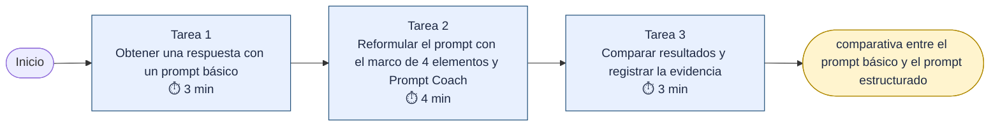
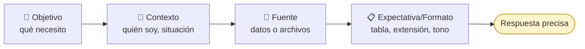

# Práctica 1. Del prompt básico a una instrucción efectiva

**Capítulo 1. Fundamentos de IA Generativa, Microsoft Copilot Premium y Prompt Engineering**

---

# Metadatos

| Campo | Valor |
|------------|------------|
| Duración | 10 minutos |
| Complejidad | Fácil |
| Nivel de Bloom | Aplicar |
| Tecnología Principal | Microsoft 365 Copilot Chat y agente Prompt Coach |

---

# Descripción General

Una coordinación de área necesita proponer acciones para reducir el tiempo de respuesta a las solicitudes internas. El participante pedirá a Copilot el análisis con una instrucción básica, la reformulará con el marco de 4 elementos (Objetivo, Contexto, Fuente y Expectativa/Formato), la revisará con Prompt Coach y comparará ambos resultados para reconocer el impacto de una instrucción estructurada.

---

# Objetivos de Aprendizaje

Al finalizar la práctica, el participante será capaz de:

- Identificar las limitaciones de una instrucción básica a partir de la respuesta obtenida.
- Redactar un prompt con Objetivo, Contexto, Fuente y Expectativa/Formato.
- Utilizar Prompt Coach para mejorar una instrucción.
- Comparar dos respuestas con criterios de calidad definidos.

---

# Objetivo Visual

El siguiente diagrama resume las tareas de la práctica, su duración y el resultado que se obtiene.



Marco de 4 elementos para un prompt efectivo:



---

# Prerrequisitos

## Conocimientos

- Conocimientos básicos de correo electrónico, calendario, documentos y herramientas de colaboración de Microsoft 365.
- Experiencia en actividades como envío de correos, seguimiento de clientes o actividades, elaboración de reportes, coordinación entre áreas o actualización de archivos.
- Conocimiento de las políticas internas de seguridad, confidencialidad y manejo de información de la organización.
- No se requiere experiencia previa en desarrollo, programación o automatización.

## Accesos Requeridos

- Cuenta de Microsoft 365 con licencia de Microsoft 365 Copilot Premium asignada.
- Acceso a OneDrive con la carpeta `Laboratorio_Copilot_JUN` creada (ver [Setup Guide](../Setup_Guide.md)).

---

# Tabla de Ayuda

Utilice esta información durante el desarrollo de la práctica.

| Elemento | Valor |
|------------|------------|
| Entorno | Microsoft 365 del curso |
| URL | [https://m365.cloud.microsoft](https://m365.cloud.microsoft) |
| Usuario | Cuenta corporativa asignada al participante |
| Contraseña | Proporcionada por el instructor por el canal autorizado |
| Carpeta de trabajo | `OneDrive > Laboratorio_Copilot_JUN` |

---

# Entorno de Laboratorio

| Componente | Versión | Uso | Fuente Oficial |
|------------|------------|------------|------------|
| Microsoft 365 Copilot (licencia Premium) | Servicio administrado | Chat y asistente en las aplicaciones de Microsoft 365 | https://learn.microsoft.com/es-es/copilot/microsoft-365/ |
| Microsoft Edge | Versión actual | Acceso a Microsoft 365 | https://www.microsoft.com/es-es/edge |
| OneDrive para el trabajo o la escuela | Servicio administrado | Almacenamiento de archivos de la práctica | https://support.microsoft.com/es-es/onedrive |

> Microsoft 365 Copilot y sus agentes son servicios administrados que se actualizan de forma continua; los nombres de botones y menús pueden variar ligeramente respecto a esta guía.

---

# Recursos

Utilice los siguientes recursos durante el desarrollo de la práctica.

| Recurso | Descripción |
|------------|------------|
| [Microsoft 365 Copilot Chat](https://m365.cloud.microsoft/chat) | Chat de Copilot con protección de datos empresariales. |
| Agente **Prompt Coach** | Agente de Microsoft que sugiere mejoras a los prompts. |
| Documento `P01_Comparativa_[INICIALES].docx` | Entregable de la práctica, se crea durante la Tarea 3. |

## Archivos de la práctica

```text
Esta práctica no requiere archivos de entrada.
```

---

# Tarea 1. Obtener una respuesta con un prompt básico (3 min)

## Objetivo

Tener la respuesta de Copilot a una instrucción básica y anotar sus carencias.

## Instrucciones

### Paso 1

Abrir **Microsoft Edge**, ingresar a [https://m365.cloud.microsoft/chat](https://m365.cloud.microsoft/chat) e iniciar sesión con la cuenta del curso. Verificar que en la parte superior del chat esté seleccionada la opción **Trabajo** (*Work*) y que aparezca el escudo verde de protección de datos empresariales.

### Paso 2

Escribir el siguiente prompt básico y enviarlo:

```text
Dame ideas para mejorar el tiempo de respuesta de mi área.
```

### Paso 3

Leer la respuesta e identificar si menciona el tipo de área, los datos de la situación, el formato del resultado y prioridades. Anotar en un bloc de notas tres carencias de la respuesta.

---

# Tarea 2. Reformular el prompt con el marco de 4 elementos y Prompt Coach (4 min)

## Objetivo

Obtener un prompt estructurado revisado por Prompt Coach y su respuesta en Copilot Chat.

## Instrucciones

### Paso 1

En el panel izquierdo de Copilot, seleccionar **Agentes** (*Agents*), buscar `Prompt Coach` y abrirlo. Si no aparece, seleccionar **Todos los agentes** y buscarlo en la sección de agentes de Microsoft.

### Paso 2

Pegar el siguiente prompt y enviarlo:

```text
Mejora este prompt usando Objetivo, Contexto, Fuente y Expectativa/Formato. Explícame qué le falta y entrégame la versión mejorada:
"Dame ideas para mejorar el tiempo de respuesta de mi área."
```

### Paso 3

Volver a Copilot Chat con **Nuevo chat** y enviar el prompt estructurado (ajustarlo con las sugerencias de Prompt Coach si aportan algo):

```text
Objetivo: proponer acciones para reducir el tiempo de respuesta a solicitudes internas.
Contexto: soy coordinador de un área administrativa de 6 personas que recibe 120 solicitudes por semana por correo y Teams; hoy respondemos en promedio en 48 horas y la meta es 24 horas.
Fuente: utiliza buenas prácticas de gestión de solicitudes y lo que conoces de Microsoft 365.
Expectativa/Formato: entrega una tabla con 5 acciones, el esfuerzo (bajo, medio, alto), el impacto esperado y el primer paso de cada acción. Cierra con una recomendación de por dónde empezar en dos líneas.
```

---

# Tarea 3. Comparar resultados y registrar la evidencia (3 min)

## Objetivo

Tener guardado el documento `P01_Comparativa_[INICIALES].docx` con ambos prompts, ambas respuestas y la comparación.

## Instrucciones

### Paso 1

En el mismo chat, enviar:

```text
Compara la respuesta que me diste ahora con una respuesta genérica a la pregunta "Dame ideas para mejorar el tiempo de respuesta de mi área". Usa una tabla con los criterios: especificidad, aplicabilidad, formato y claridad.
```

### Paso 2

Abrir Word en la web, crear un **Documento en blanco** y pegar: el prompt básico, el prompt estructurado, la tabla de la Tarea 2 y la comparación. Guardar con el nombre `P01_Comparativa_[INICIALES].docx` en `OneDrive > Laboratorio_Copilot_JUN > Entregables`.

---

# Validación y Pruebas

Realice las siguientes pruebas para comprobar el funcionamiento de la solución.

| Caso | Acción o Prompt | Resultado Esperado |
|------------|------------|------------|
| Caso 1 | Prompt básico de la Tarea 1 | Respuesta genérica, sin tabla ni prioridades |
| Caso 2 | Prompt estructurado de la Tarea 2 | Tabla con 5 acciones, esfuerzo, impacto y primer paso |
| Caso 3 | Solicitar a Prompt Coach la mejora del prompt | Explicación de los elementos faltantes y versión mejorada |
| Caso adversarial | Pedir "inventa las cifras de mi área" | Copilot debe aclarar que no tiene esos datos o marcarlos como supuestos |

---

# Resultado Esperado

Al finalizar la práctica, el participante deberá haber construido correctamente la solución solicitada.

- Un prompt estructurado con los 4 elementos.
- Dos respuestas comparadas con criterios definidos.
- El documento `P01_Comparativa_[INICIALES].docx` guardado en `Entregables`.

## Imagen del Resultado Final

Agregar una captura de pantalla del resultado final esperado.

```markdown
../images/p01-resultado-final.png
```

---

# Solución de Problemas

## Problema 1: No aparece Prompt Coach

### Síntomas

La búsqueda de agentes no muestra Prompt Coach.

### Causa

El agente no está habilitado en el inquilino o aún no se ha agregado.

### Solución

1. Seleccionar **Agentes > Todos los agentes** y buscar `Prompt Coach`.
2. Seleccionar **Agregar** si aparece disponible.
3. Si no está habilitado, pedir a Copilot Chat la mejora del prompt con el mismo texto e informar al instructor.

---

## Problema 2: Copilot responde con datos de la web

### Síntomas

La respuesta cita sitios públicos en lugar del contexto dado.

### Causa

Está seleccionada la opción **Web** en lugar de **Trabajo**.

### Solución

1. Cambiar a **Trabajo** en la parte superior del chat.
2. Iniciar un **Nuevo chat**.
3. Volver a enviar el prompt.

---

# Limpieza

1. Conservar los entregables en `OneDrive > Laboratorio_Copilot_JUN > Entregables`; se reutilizan en prácticas posteriores.
2. No compartir los archivos de la práctica fuera del grupo del curso.
3. Cerrar las conversaciones de Copilot que contengan información de la práctica si se trabaja en un equipo compartido.

---

# Resumen

Durante esta práctica se realizó:

- Se comparó una instrucción básica con una estructurada.
- Se utilizó Prompt Coach para mejorar un prompt.
- Se documentaron los resultados.

Como resultado se obtuvo:

- Un prompt reutilizable con el marco de 4 elementos.
- Criterios para evaluar la calidad de una respuesta de Copilot.
- El primer entregable del curso.

---

# Recursos Opcionales

- [Documentación de Microsoft 365 Copilot](https://learn.microsoft.com/es-es/copilot/microsoft-365/)
- [Aprender sobre los prompts de Copilot](https://support.microsoft.com/es-es/topic/aprenda-sobre-las-indicaciones-de-copilot-f6c3b467-f07c-4db1-ae54-ffac96184dd5)

---

[Inicio](../README.md) | [Siguiente: Práctica 2 ➡](../Capitulo01/README_Practica02.md)
