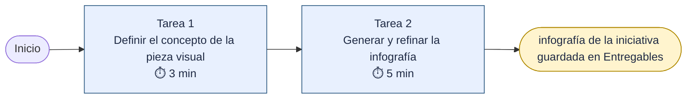
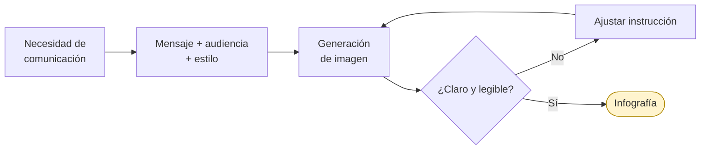

# Práctica 2. De una idea a una comunicación visual con IA

## Objetivo de la práctica:

Al finalizar la práctica, serás capaz de:

- Definir con Copilot el concepto de una pieza visual a partir de una necesidad de comunicación.
- Redactar una instrucción de imagen con contenido, audiencia y estilo.
- Generar y refinar una infografía con las capacidades generativas de Copilot.

## Objetivo Visual

El siguiente diagrama resume las actividades a realizar.



Cómo la instrucción define la pieza visual:



## Duración aproximada:

- 8 minutos.

## Tabla de ayuda:

Utiliza esta información durante el desarrollo de la práctica.

| Elemento | Valor |
|------------|------------|
| Entorno | Microsoft 365 del curso |
| URL | [https://m365.cloud.microsoft](https://m365.cloud.microsoft) |
| Usuario | Cuenta corporativa asignada al participante |
| Contraseña | Proporcionada por el instructor por el canal autorizado |
| Carpeta de trabajo | `OneDrive > Laboratorio_Copilot_JUN` |

## Entorno de laboratorio

| Componente | Versión | Uso | Fuente oficial |
|------------|------------|------------|------------|
| Microsoft 365 Copilot (licencia Premium) | Servicio administrado | Chat y asistente en las aplicaciones de Microsoft 365 | https://learn.microsoft.com/es-es/copilot/microsoft-365/ |
| Microsoft Edge | Versión actual | Acceso a Microsoft 365 | https://www.microsoft.com/es-es/edge |
| OneDrive para el trabajo o la escuela | Servicio administrado | Almacenamiento de archivos de la práctica | https://support.microsoft.com/es-es/onedrive |

> Microsoft 365 Copilot y sus agentes son servicios administrados que se actualizan de forma continua; los nombres de botones y menús pueden variar ligeramente respecto a esta guía.

## Recursos

| Recurso | Descripción |
|------------|------------|
| [Microsoft 365 Copilot](https://m365.cloud.microsoft/chat) | Chat y creación de imágenes con Copilot. |
| Imagen `P02_Infografia_[INICIALES].png` | Entregable de la práctica. |

## Instrucciones

### Tarea 1. Definir el concepto de la pieza visual (3 min)

**Objetivo de la tarea:** Obtener el mensaje principal, tres ideas de apoyo y la descripción visual de la infografía.

Paso 1. Abrir Copilot Chat en modo **Trabajo** e iniciar un **Nuevo chat**.

Paso 2. Enviar el prompt:

```text
Necesito comunicar a los colaboradores de una empresa de intralogística la iniciativa "Copilot responsable: más tiempo para lo importante".
Audiencia: personal comercial, administrativo y de servicio.
Propón: un mensaje principal de máximo 8 palabras, tres ideas de apoyo de una línea (verificar siempre los resultados, no compartir información confidencial fuera de Microsoft 365 y usar prompts claros) y una descripción visual para una infografía vertical con estilo corporativo, colores azul y amarillo, íconos simples y poco texto.
```

### Tarea 2. Generar y refinar la infografía (5 min)

**Objetivo de la tarea:** Tener guardada la infografía `P02_Infografia_[INICIALES].png`.

Paso 1. Enviar el prompt de generación, ajustándolo con el mensaje elegido:

```text
Crea una imagen tipo infografía vertical con el título "Copilot responsable: más tiempo para lo importante" y tres bloques con íconos: 1) Verifica los resultados, 2) Protege la información, 3) Pide con claridad. Estilo corporativo, fondo claro, colores azul marino y amarillo, sin personas, texto grande y legible.
```

Paso 2. Revisar la imagen. Si el texto aparece con errores o hay demasiados elementos, enviar:

```text
Simplifica la imagen: deja solo el título y los tres bloques, aumenta el tamaño del texto y elimina elementos decorativos.
```

Paso 3. Seleccionar la imagen, elegir **Descargar** y guardarla con el nombre `P02_Infografia_[INICIALES].png` en `OneDrive > Laboratorio_Copilot_JUN > Entregables`.

### Resultado esperado

Al finalizar la práctica deberás contar con:

- Concepto de la comunicación definido.
- Infografía generada y refinada.
- Imagen guardada en `Entregables`.

<!-- Agregar captura del resultado esperado: ../images/p02-resultado.png -->

## Resumen

Durante esta práctica se realizó:

- Se definió el concepto de una comunicación interna.
- Se generó una infografía con IA.
- Se refinó el resultado con instrucciones adicionales.

Como resultado se obtuvo:

- Una pieza visual lista para revisión.
- Experiencia sobre cómo el detalle del prompt cambia la imagen.

## Recursos opcionales

- [Documentación de Microsoft 365 Copilot](https://learn.microsoft.com/es-es/copilot/microsoft-365/)
- [Crear imágenes con Copilot](https://support.microsoft.com/es-es/copilot)

---

[⬅ Anterior: Práctica 1](../Capitulo01/README_Practica01.md) | [Inicio](../README.md) | [Siguiente: Práctica 3 ➡](../Capitulo01/README_Practica03.md)
