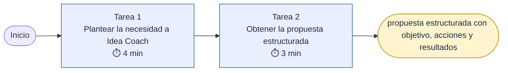
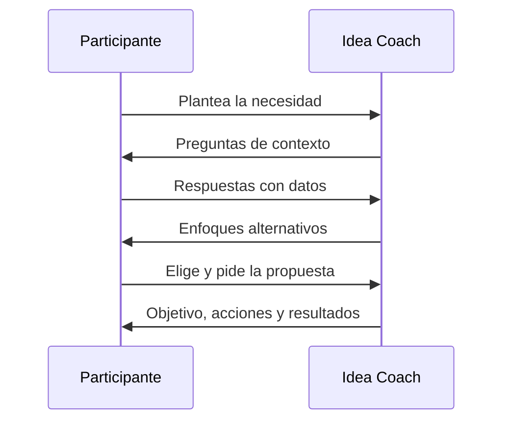

# Práctica 3. De una necesidad a una propuesta estructurada con Idea Coach

**Capítulo 1. Fundamentos de IA Generativa, Microsoft Copilot Premium y Prompt Engineering**

---

# Metadatos

| Campo | Valor |
|------------|------------|
| Duración | 7 minutos |
| Complejidad | Fácil |
| Nivel de Bloom | Crear |
| Tecnología Principal | Agente Idea Coach de Microsoft 365 Copilot |

---

# Descripción General

Las áreas Comercial y de Servicio duplican esfuerzos al atender a un mismo cliente. El participante planteará esta necesidad a Idea Coach, responderá sus preguntas, explorará enfoques distintos y refinará la idea hasta obtener una propuesta con objetivo, acciones principales y resultados esperados.

---

# Objetivos de Aprendizaje

Al finalizar la práctica, el participante será capaz de:

- Plantear una necesidad empresarial a un agente especializado.
- Explorar alternativas respondiendo las preguntas del agente.
- Obtener una propuesta estructurada lista para compartir.

---

# Objetivo Visual

El siguiente diagrama resume las tareas de la práctica, su duración y el resultado que se obtiene.



Ciclo de trabajo con Idea Coach:



---

# Prerrequisitos

## Conocimientos

- Conocimientos básicos de correo electrónico, calendario, documentos y herramientas de colaboración de Microsoft 365.
- Experiencia en actividades como envío de correos, seguimiento de clientes o actividades, elaboración de reportes, coordinación entre áreas o actualización de archivos.
- Conocimiento de las políticas internas de seguridad, confidencialidad y manejo de información de la organización.
- No se requiere experiencia previa en desarrollo, programación o automatización.

## Accesos Requeridos

- Cuenta de Microsoft 365 con licencia de Microsoft 365 Copilot Premium asignada.
- Acceso a OneDrive con la carpeta `Laboratorio_Copilot_JUN` creada (ver [Setup Guide](../Setup_Guide.md)).

---

# Tabla de Ayuda

Utilice esta información durante el desarrollo de la práctica.

| Elemento | Valor |
|------------|------------|
| Entorno | Microsoft 365 del curso |
| URL | [https://m365.cloud.microsoft](https://m365.cloud.microsoft) |
| Usuario | Cuenta corporativa asignada al participante |
| Contraseña | Proporcionada por el instructor por el canal autorizado |
| Carpeta de trabajo | `OneDrive > Laboratorio_Copilot_JUN` |

---

# Entorno de Laboratorio

| Componente | Versión | Uso | Fuente Oficial |
|------------|------------|------------|------------|
| Microsoft 365 Copilot (licencia Premium) | Servicio administrado | Chat y asistente en las aplicaciones de Microsoft 365 | https://learn.microsoft.com/es-es/copilot/microsoft-365/ |
| Microsoft Edge | Versión actual | Acceso a Microsoft 365 | https://www.microsoft.com/es-es/edge |
| OneDrive para el trabajo o la escuela | Servicio administrado | Almacenamiento de archivos de la práctica | https://support.microsoft.com/es-es/onedrive |

> Microsoft 365 Copilot y sus agentes son servicios administrados que se actualizan de forma continua; los nombres de botones y menús pueden variar ligeramente respecto a esta guía.

---

# Recursos

Utilice los siguientes recursos durante el desarrollo de la práctica.

| Recurso | Descripción |
|------------|------------|
| Agente **Idea Coach** | Agente de Microsoft para generar y refinar ideas. |
| Documento `P03_Propuesta_[INICIALES].docx` | Entregable de la práctica. |

## Archivos de la práctica

```text
Esta práctica no requiere archivos de entrada.
```

---

# Tarea 1. Plantear la necesidad a Idea Coach (4 min)

## Objetivo

Tener una conversación con Idea Coach con al menos dos enfoques propuestos.

## Instrucciones

### Paso 1

En Copilot, seleccionar **Agentes**, buscar `Idea Coach` y abrirlo.

### Paso 2

Enviar el prompt:

```text
Quiero mejorar la coordinación entre las áreas Comercial y de Servicio de una empresa de intralogística. Hoy un mismo cliente recibe llamadas de ambas áreas y la información no se comparte. Ayúdame a explorar enfoques para resolverlo.
```

### Paso 3

Responder las preguntas que plantee Idea Coach con datos ficticios breves (por ejemplo: 25 asesores, 8 técnicos, clientes industriales, meta a 3 meses).

---

# Tarea 2. Obtener la propuesta estructurada (3 min)

## Objetivo

Tener guardado `P03_Propuesta_[INICIALES].docx` con objetivo, acciones y resultados esperados.

## Instrucciones

### Paso 1

Enviar:

```text
Elige el enfoque más viable con poco presupuesto y conviértelo en una propuesta con: objetivo, 4 acciones principales con responsable sugerido, y 3 resultados esperados medibles.
```

### Paso 2

Copiar la propuesta a un documento de Word en blanco y guardarlo como `P03_Propuesta_[INICIALES].docx` en `OneDrive > Laboratorio_Copilot_JUN > Entregables`.

---

# Validación y Pruebas

Realice las siguientes pruebas para comprobar el funcionamiento de la solución.

| Caso | Acción o Prompt | Resultado Esperado |
|------------|------------|------------|
| Caso 1 | Plantear la necesidad | Idea Coach responde con preguntas o enfoques |
| Caso 2 | Responder las preguntas | El agente ajusta los enfoques al contexto |
| Caso 3 | Solicitar la propuesta final | Objetivo, 4 acciones con responsable y 3 resultados medibles |
| Caso adversarial | Pedir una propuesta sin dar contexto | El agente solicita más información antes de proponer |

---

# Resultado Esperado

Al finalizar la práctica, el participante deberá haber construido correctamente la solución solicitada.

- Enfoques alternativos explorados.
- Propuesta estructurada.
- Documento guardado en `Entregables`.

## Imagen del Resultado Final

Agregar una captura de pantalla del resultado final esperado.

```markdown
../images/p03-resultado-final.png
```

---

# Solución de Problemas

## Problema 1: No aparece Idea Coach

### Síntomas

El agente no se encuentra en la búsqueda.

### Causa

El agente no está habilitado o no se ha agregado.

### Solución

1. Buscar en **Agentes > Todos los agentes**.
2. Seleccionar **Agregar**.
3. Si no está disponible, realizar la práctica en Copilot Chat pidiendo "Actúa como un coach de ideas y hazme preguntas antes de proponer".

---

## Problema 2: La propuesta es muy general

### Síntomas

Acciones sin responsables ni medición.

### Causa

No se respondieron las preguntas del agente con datos concretos.

### Solución

1. Responder con cifras y plazos ficticios.
2. Pedir explícitamente responsables y métricas.
3. Regenerar la propuesta.

---

# Limpieza

1. Conservar los entregables en `OneDrive > Laboratorio_Copilot_JUN > Entregables`; se reutilizan en prácticas posteriores.
2. No compartir los archivos de la práctica fuera del grupo del curso.
3. Cerrar las conversaciones de Copilot que contengan información de la práctica si se trabaja en un equipo compartido.

---

# Resumen

Durante esta práctica se realizó:

- Se exploró una necesidad con un agente especializado.
- Se refinó una idea mediante preguntas.
- Se obtuvo una propuesta estructurada.

Como resultado se obtuvo:

- Propuesta con objetivo, acciones y resultados.
- Experiencia en el trabajo iterativo con agentes.

---

# Recursos Opcionales

- [Documentación de Microsoft 365 Copilot](https://learn.microsoft.com/es-es/copilot/microsoft-365/)
- [Agentes en Microsoft 365 Copilot](https://learn.microsoft.com/es-es/microsoft-365-copilot/extensibility/)

---

[⬅ Anterior: Práctica 2](../Capitulo01/README_Practica02.md) | [Inicio](../README.md) | [Siguiente: Práctica 4 ➡](../Capitulo02/README_Practica04.md)
