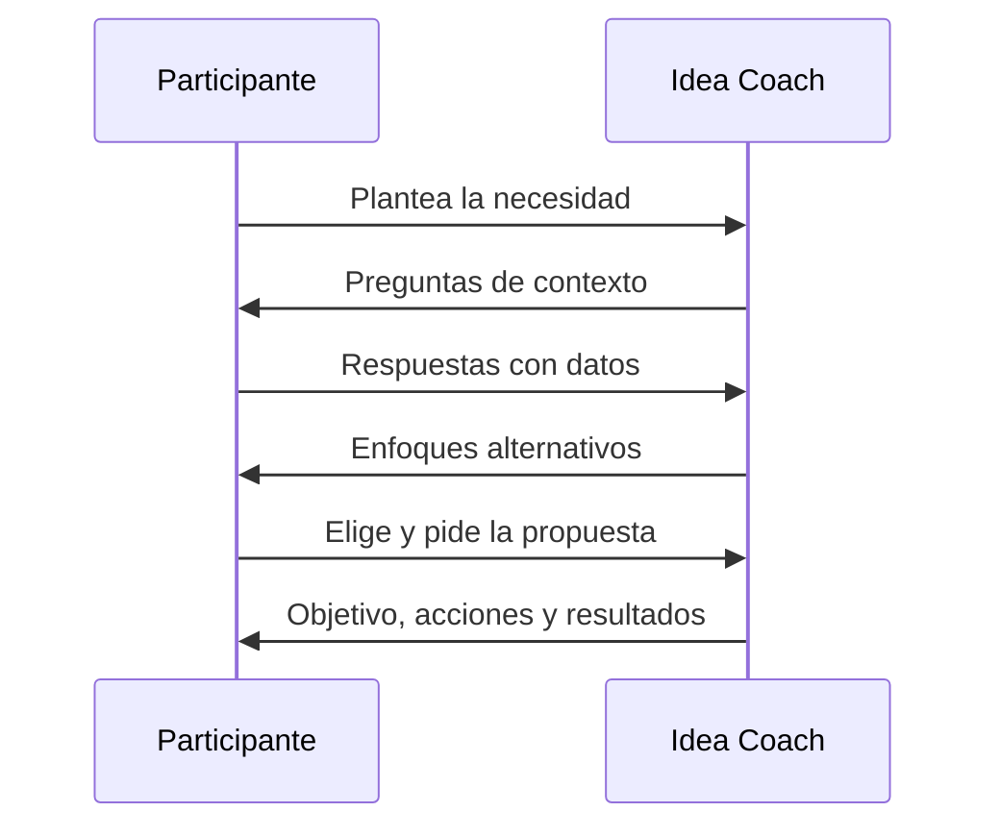

# Práctica 3. De una necesidad a una propuesta estructurada con Idea Coach

## Objetivo de la práctica:

Al finalizar la práctica, serás capaz de:

- Plantear una necesidad empresarial a un agente especializado.
- Explorar alternativas respondiendo las preguntas del agente.
- Obtener una propuesta estructurada lista para compartir.

## Objetivo Visual

El siguiente diagrama resume las actividades a realizar.


Ciclo de trabajo con Idea Coach:



## Duración aproximada:

- 7 minutos.

## Tabla de ayuda:

Utiliza esta información durante el desarrollo de la práctica.

| Elemento | Valor |
|------------|------------|
| Entorno | Microsoft 365 del curso |
| URL | [https://m365.cloud.microsoft](https://m365.cloud.microsoft) |
| Usuario | Cuenta corporativa asignada al participante |
| Contraseña | Proporcionada por el instructor por el canal autorizado |
| Carpeta de trabajo | `OneDrive > Laboratorio_Copilot_JUN` |

## Entorno de laboratorio

| Componente | Versión | Uso | Fuente oficial |
|------------|------------|------------|------------|
| Microsoft 365 Copilot (licencia Premium) | Servicio administrado | Chat y asistente en las aplicaciones de Microsoft 365 | https://learn.microsoft.com/es-es/copilot/microsoft-365/ |
| Microsoft Edge | Versión actual | Acceso a Microsoft 365 | https://www.microsoft.com/es-es/edge |
| OneDrive para el trabajo o la escuela | Servicio administrado | Almacenamiento de archivos de la práctica | https://support.microsoft.com/es-es/onedrive |

> Microsoft 365 Copilot y sus agentes son servicios administrados que se actualizan de forma continua; los nombres de botones y menús pueden variar ligeramente respecto a esta guía.

## Recursos

| Recurso | Descripción |
|------------|------------|
| Agente **Idea Coach** | Agente de Microsoft para generar y refinar ideas. |
| Documento `P03_Propuesta_[INICIALES].docx` | Entregable de la práctica. |

## Instrucciones

### Tarea 1. Plantear la necesidad a Idea Coach (4 min)

**Objetivo de la tarea:** Tener una conversación con Idea Coach con al menos dos enfoques propuestos.

Paso 1. En Copilot, seleccionar **Agentes**, buscar `Idea Coach` y abrirlo.

Paso 2. Enviar el prompt:

```text
Quiero mejorar la coordinación entre las áreas Comercial y de Servicio de una empresa de intralogística. Hoy un mismo cliente recibe llamadas de ambas áreas y la información no se comparte. Ayúdame a explorar enfoques para resolverlo.
```

Paso 3. Responder las preguntas que plantee Idea Coach con datos ficticios breves (por ejemplo: 25 asesores, 8 técnicos, clientes industriales, meta a 3 meses).

### Tarea 2. Obtener la propuesta estructurada (3 min)

**Objetivo de la tarea:** Tener guardado `P03_Propuesta_[INICIALES].docx` con objetivo, acciones y resultados esperados.

Paso 1. Enviar:

```text
Elige el enfoque más viable con poco presupuesto y conviértelo en una propuesta con: objetivo, 4 acciones principales con responsable sugerido, y 3 resultados esperados medibles.
```

Paso 2. Copiar la propuesta a un documento de Word en blanco y guardarlo como `P03_Propuesta_[INICIALES].docx` en `OneDrive > Laboratorio_Copilot_JUN > Entregables`.

### Resultado esperado

Al finalizar la práctica deberás contar con:

- Enfoques alternativos explorados.
- Propuesta estructurada.
- Documento guardado en `Entregables`.

<!-- Agregar captura del resultado esperado: ../images/p03-resultado.png -->

## Resumen

Durante esta práctica se realizó:

- Se exploró una necesidad con un agente especializado.
- Se refinó una idea mediante preguntas.
- Se obtuvo una propuesta estructurada.

Como resultado se obtuvo:

- Propuesta con objetivo, acciones y resultados.
- Experiencia en el trabajo iterativo con agentes.

## Recursos opcionales

- [Documentación de Microsoft 365 Copilot](https://learn.microsoft.com/es-es/copilot/microsoft-365/)
- [Agentes en Microsoft 365 Copilot](https://learn.microsoft.com/es-es/microsoft-365-copilot/extensibility/)

---

[⬅ Anterior: Práctica 2](../Capitulo01/README_Practica02.md) | [Inicio](../README.md) | [Siguiente: Práctica 4 ➡](../Capitulo02/README_Practica04.md)
