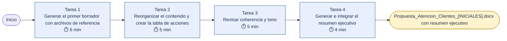
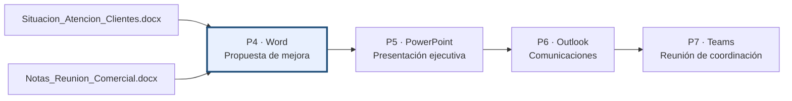

# Práctica 4. Elaboración de una propuesta de mejora de la atención al cliente con Copilot en Word

**Capítulo 2. Uso de Copilot en Aplicaciones M365 y Productividad Individual/Equipo**

---

# Metadatos

| Campo | Valor |
|------------|------------|
| Duración | 20 minutos |
| Complejidad | Intermedia |
| Nivel de Bloom | Crear |
| Tecnología Principal | Microsoft 365 Copilot en Word |

---

# Descripción General

La región Centro de Jungheinrich (escenario ficticio) tarda en promedio 38 horas en dar la primera respuesta a los clientes interesados en equipos, alquiler y mantenimiento. A partir de dos archivos ficticios, el participante utilizará Copilot en Word para elaborar una propuesta de mejora con la situación actual, las oportunidades, un plan de acciones en tabla y un resumen ejecutivo. El documento se reutiliza en las prácticas 5, 6 y 7.

---

# Objetivos de Aprendizaje

Al finalizar la práctica, el participante será capaz de:

- Generar un borrador en Word a partir de archivos de referencia.
- Transformar información en una tabla de acciones con responsables y prioridades.
- Revisar coherencia, tono y vacíos de información con Copilot.
- Generar un resumen ejecutivo e integrarlo al documento.

---

# Objetivo Visual

El siguiente diagrama resume las tareas de la práctica, su duración y el resultado que se obtiene.



El documento de esta práctica alimenta las prácticas 5, 6 y 7 del módulo:



---

# Prerrequisitos

## Conocimientos

- Conocimientos básicos de correo electrónico, calendario, documentos y herramientas de colaboración de Microsoft 365.
- Experiencia en actividades como envío de correos, seguimiento de clientes o actividades, elaboración de reportes, coordinación entre áreas o actualización de archivos.
- Conocimiento de las políticas internas de seguridad, confidencialidad y manejo de información de la organización.
- No se requiere experiencia previa en desarrollo, programación o automatización.

## Accesos Requeridos

- Cuenta de Microsoft 365 con licencia de Microsoft 365 Copilot Premium asignada.
- Acceso a OneDrive con la carpeta `Laboratorio_Copilot_JUN` creada (ver [Setup Guide](../Setup_Guide.md)).

---

# Tabla de Ayuda

Utilice esta información durante el desarrollo de la práctica.

| Elemento | Valor |
|------------|------------|
| Entorno | Microsoft 365 del curso |
| URL | [https://m365.cloud.microsoft](https://m365.cloud.microsoft) |
| Usuario | Cuenta corporativa asignada al participante |
| Contraseña | Proporcionada por el instructor por el canal autorizado |
| Carpeta de trabajo | `OneDrive > Laboratorio_Copilot_JUN` |

---

# Entorno de Laboratorio

| Componente | Versión | Uso | Fuente Oficial |
|------------|------------|------------|------------|
| Microsoft Word | Microsoft 365 (escritorio o web) | Redacción y edición con Copilot | https://support.microsoft.com/es-es/copilot-word |
| OneDrive para el trabajo o la escuela | Servicio administrado | Almacenamiento de archivos de la práctica | https://support.microsoft.com/es-es/onedrive |
| Microsoft Edge | Versión actual | Acceso a Microsoft 365 | https://www.microsoft.com/es-es/edge |

> Microsoft 365 Copilot y sus agentes son servicios administrados que se actualizan de forma continua; los nombres de botones y menús pueden variar ligeramente respecto a esta guía.

---

# Recursos

Utilice los siguientes recursos durante el desarrollo de la práctica.

| Recurso | Descripción |
|------------|------------|
| [Situacion_Atencion_Clientes.docx](recursos/Situacion_Atencion_Clientes.docx) | Indicadores, problemas y comentarios de clientes (ficticios). |
| [Notas_Reunion_Comercial.docx](recursos/Notas_Reunion_Comercial.docx) | Ideas propuestas por las áreas y restricciones. |
| `Propuesta_Atencion_Clientes_[INICIALES].docx` | Entregable que se reutiliza en las prácticas 5 a 7. |

## Archivos de la práctica

```text
Capitulo02/recursos/Situacion_Atencion_Clientes.docx
Capitulo02/recursos/Notas_Reunion_Comercial.docx
```

---

# Tarea 1. Generar el primer borrador con archivos de referencia (6 min)

## Objetivo

Tener un borrador con situación actual, oportunidades de mejora y acciones propuestas.

## Instrucciones

### Paso 1

Descargar los dos archivos de la carpeta `Capitulo02/recursos` de este repositorio y subirlos a `OneDrive > Laboratorio_Copilot_JUN > Practica04`.

### Paso 2

Abrir Word en la web desde [https://m365.cloud.microsoft](https://m365.cloud.microsoft), crear un **Documento en blanco** y guardarlo como `Propuesta_Atencion_Clientes_[INICIALES].docx` en `Entregables`.

### Paso 3

En el cuadro **Crear con Copilot** (o con el ícono de Copilot del margen), escribir el prompt. Para referenciar los archivos, escribir `/` y elegir cada archivo en la lista:

```text
Redacta una propuesta de mejora de la atención y el seguimiento de clientes de intralogística con base en /Situacion_Atencion_Clientes y /Notas_Reunion_Comercial.
Incluye: 1) Situación actual con los indicadores, 2) Oportunidades de mejora, 3) Acciones propuestas, 4) Beneficios esperados.
Tono corporativo, en español, máximo 2 páginas.
```

Revisar que el borrador mencione el tiempo de primera respuesta de 38 horas y la meta de 8 horas. Seleccionar **Conservar**.

---

# Tarea 2. Reorganizar el contenido y crear la tabla de acciones (5 min)

## Objetivo

Tener la sección de acciones convertida en una tabla con actividad, responsable, prioridad y resultado esperado.

## Instrucciones

### Paso 1

Seleccionar el texto de la sección **Acciones propuestas**.

### Paso 2

Abrir Copilot desde el ícono junto a la selección y escribir:

```text
Convierte estas acciones en una tabla con las columnas: Actividad, Responsable (área), Prioridad (Alta, Media, Baja), Plazo y Resultado esperado. Respeta la restricción de iniciar en 60 días y sin nuevo software.
```

### Paso 3

Revisar la tabla y seleccionar **Reemplazar** (o **Insertar debajo** y eliminar la lista original).

---

# Tarea 3. Revisar coherencia y tono (5 min)

## Objetivo

Tener el documento revisado, sin inconsistencias y con tono corporativo uniforme.

## Instrucciones

### Paso 1

Abrir el panel de **Copilot** (botón Copilot de la cinta de opciones) y enviar:

```text
Revisa este documento e indica inconsistencias entre los indicadores y las acciones, información faltante y párrafos poco claros. Preséntalo en una lista.
```

### Paso 2

Corregir los puntos señalados. Para reescribir un párrafo, seleccionarlo, elegir **Copilot > Reescribir** y aplicar la versión más clara.

---

# Tarea 4. Generar e integrar el resumen ejecutivo (4 min)

## Objetivo

Tener el resumen ejecutivo al inicio del documento y el archivo guardado.

## Instrucciones

### Paso 1

En el panel de Copilot, enviar:

```text
Genera un resumen ejecutivo de máximo 120 palabras con los principales problemas, las acciones recomendadas y los beneficios esperados.
```

### Paso 2

Colocar el cursor al inicio del documento, escribir el título **Resumen ejecutivo**, pegar el resumen y guardar el documento (se guarda automáticamente en OneDrive).

---

# Validación y Pruebas

Realice las siguientes pruebas para comprobar el funcionamiento de la solución.

| Caso | Acción o Prompt | Resultado Esperado |
|------------|------------|------------|
| Caso 1 | Prompt de borrador con los dos archivos | Documento con las 4 secciones y los indicadores de los archivos |
| Caso 2 | Prompt de tabla | Tabla de 5 columnas con prioridades y plazos |
| Caso 3 | Prompt de revisión | Lista de inconsistencias o vacíos |
| Caso adversarial | Pedir el porcentaje de clientes perdidos el año pasado | Copilot indica que el dato no está en los archivos |

---

# Resultado Esperado

Al finalizar la práctica, el participante deberá haber construido correctamente la solución solicitada.

- Propuesta con situación, oportunidades, acciones y beneficios.
- Tabla de acciones con responsables y prioridades.
- Resumen ejecutivo al inicio del documento.

## Imagen del Resultado Final

Agregar una captura de pantalla del resultado final esperado.

```markdown
../images/p04-resultado-final.png
```

---

# Solución de Problemas

## Problema 1: Copilot no encuentra los archivos con /

### Síntomas

La lista no muestra los archivos al escribir `/`.

### Causa

Los archivos no están en OneDrive o aún no se indexan.

### Solución

1. Comprobar que estén en `Laboratorio_Copilot_JUN > Practica04`.
2. Esperar uno o dos minutos y volver a intentar.
3. Como alternativa, abrir cada archivo, copiar su contenido y pegarlo en el prompt.

---

## Problema 2: El botón Copilot no aparece en Word

### Síntomas

No hay ícono de Copilot en la cinta.

### Causa

La licencia no está asignada o la sesión es de otra cuenta.

### Solución

1. Cerrar sesión y entrar con la cuenta del curso.
2. Recargar la página.
3. Informar al instructor si persiste.

---

# Limpieza

1. Conservar los entregables en `OneDrive > Laboratorio_Copilot_JUN > Entregables`; se reutilizan en prácticas posteriores.
2. No compartir los archivos de la práctica fuera del grupo del curso.
3. Cerrar las conversaciones de Copilot que contengan información de la práctica si se trabaja en un equipo compartido.

---

# Resumen

Durante esta práctica se realizó:

- Se generó un borrador a partir de archivos de referencia.
- Se transformó información en una tabla.
- Se revisó la coherencia y se agregó un resumen ejecutivo.

Como resultado se obtuvo:

- Propuesta de mejora lista para presentarse.
- Documento base para las prácticas 5, 6 y 7.

---

# Recursos Opcionales

- [Copilot en Word](https://support.microsoft.com/es-es/copilot-word)
- [Documentación de Microsoft 365 Copilot](https://learn.microsoft.com/es-es/copilot/microsoft-365/)

---

[⬅ Anterior: Práctica 3](../Capitulo01/README_Practica03.md) | [Inicio](../README.md) | [Siguiente: Práctica 5 ➡](../Capitulo02/README_Practica05.md)
