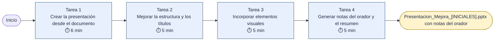
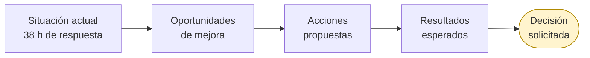

# Práctica 5. Del documento a una presentación ejecutiva con Copilot en PowerPoint

**Capítulo 2. Uso de Copilot en Aplicaciones M365 y Productividad Individual/Equipo**

---

# Metadatos

| Campo | Valor |
|------------|------------|
| Duración | 21 minutos |
| Complejidad | Intermedia |
| Nivel de Bloom | Crear |
| Tecnología Principal | Microsoft 365 Copilot en PowerPoint |

---

# Descripción General

La propuesta de la Práctica 4 debe presentarse a los responsables de las áreas Comercial, Servicio y Administración. El participante utilizará Copilot en PowerPoint para crear una presentación ejecutiva a partir del documento de Word, mejorará la secuencia y los títulos, incorporará elementos visuales y preparará las notas del orador.

---

# Objetivos de Aprendizaje

Al finalizar la práctica, el participante será capaz de:

- Crear una presentación a partir de un documento de Word con Copilot.
- Reorganizar la narrativa de la presentación.
- Incorporar imágenes y mejorar el diseño con Copilot.
- Generar notas del orador y un resumen de la presentación.

---

# Objetivo Visual

El siguiente diagrama resume las tareas de la práctica, su duración y el resultado que se obtiene.



Narrativa que debe seguir la presentación:



---

# Prerrequisitos

## Conocimientos

- Conocimientos básicos de correo electrónico, calendario, documentos y herramientas de colaboración de Microsoft 365.
- Experiencia en actividades como envío de correos, seguimiento de clientes o actividades, elaboración de reportes, coordinación entre áreas o actualización de archivos.
- Conocimiento de las políticas internas de seguridad, confidencialidad y manejo de información de la organización.
- No se requiere experiencia previa en desarrollo, programación o automatización.

## Accesos Requeridos

- Cuenta de Microsoft 365 con licencia de Microsoft 365 Copilot Premium asignada.
- Acceso a OneDrive con la carpeta `Laboratorio_Copilot_JUN` creada (ver [Setup Guide](../Setup_Guide.md)).

---

# Tabla de Ayuda

Utilice esta información durante el desarrollo de la práctica.

| Elemento | Valor |
|------------|------------|
| Entorno | Microsoft 365 del curso |
| URL | [https://m365.cloud.microsoft](https://m365.cloud.microsoft) |
| Usuario | Cuenta corporativa asignada al participante |
| Contraseña | Proporcionada por el instructor por el canal autorizado |
| Carpeta de trabajo | `OneDrive > Laboratorio_Copilot_JUN` |

---

# Entorno de Laboratorio

| Componente | Versión | Uso | Fuente Oficial |
|------------|------------|------------|------------|
| Microsoft PowerPoint | Microsoft 365 (escritorio o web) | Creación de presentaciones con Copilot | https://support.microsoft.com/es-es/copilot-powerpoint |
| Microsoft Word | Microsoft 365 (escritorio o web) | Redacción y edición con Copilot | https://support.microsoft.com/es-es/copilot-word |
| OneDrive para el trabajo o la escuela | Servicio administrado | Almacenamiento de archivos de la práctica | https://support.microsoft.com/es-es/onedrive |

> Microsoft 365 Copilot y sus agentes son servicios administrados que se actualizan de forma continua; los nombres de botones y menús pueden variar ligeramente respecto a esta guía.

---

# Recursos

Utilice los siguientes recursos durante el desarrollo de la práctica.

| Recurso | Descripción |
|------------|------------|
| `Propuesta_Atencion_Clientes_[INICIALES].docx` | Documento elaborado en la Práctica 4. |
| `Presentacion_Mejora_[INICIALES].pptx` | Entregable de la práctica. |

## Archivos de la práctica

```text
OneDrive/Laboratorio_Copilot_JUN/Entregables/Propuesta_Atencion_Clientes_[INICIALES].docx
```

---

# Tarea 1. Crear la presentación desde el documento (6 min)

## Objetivo

Tener una presentación de 7 a 9 diapositivas creada a partir de la propuesta.

## Instrucciones

### Paso 1

Abrir PowerPoint en la web, crear una **Presentación en blanco** y guardarla como `Presentacion_Mejora_[INICIALES].pptx` en `Entregables`.

### Paso 2

Abrir **Copilot** y enviar el prompt, referenciando el documento con `/`:

```text
Crea una presentación a partir de /Propuesta_Atencion_Clientes_[INICIALES].
Audiencia: responsables de las áreas Comercial, Servicio y Administración.
Propósito: obtener su compromiso para iniciar las acciones en 60 días.
Extensión: 8 diapositivas. Mensajes clave: tiempo de respuesta actual vs meta, acciones prioritarias y beneficios.
```

### Paso 3

Revisar el esquema propuesto por Copilot y seleccionar **Generar diapositivas**. Conservar el resultado.

---

# Tarea 2. Mejorar la estructura y los títulos (5 min)

## Objetivo

Tener una secuencia situación → oportunidades → acciones → resultados con títulos que expresen una conclusión.

## Instrucciones

### Paso 1

En el panel de Copilot, enviar:

```text
Revisa la organización de las diapositivas. Propón un orden que conecte situación actual, oportunidades, acciones y resultados esperados, y reescribe cada título como una frase que comunique la conclusión principal.
```

### Paso 2

Aplicar el orden sugerido arrastrando las miniaturas del panel izquierdo y reemplazar los títulos con las versiones propuestas.

---

# Tarea 3. Incorporar elementos visuales (5 min)

## Objetivo

Tener al menos dos diapositivas con imágenes o diagramas coherentes con el mensaje.

## Instrucciones

### Paso 1

Ir a la diapositiva de acciones y enviar a Copilot:

```text
Agrega una imagen relacionada con atención al cliente en un almacén y convierte las acciones en un diagrama de proceso de 4 pasos.
```

### Paso 2

Seleccionar **Diseñador** (*Designer*) para elegir una distribución que equilibre texto e imagen. Verificar que las imágenes no muestren marcas ni datos sensibles.

---

# Tarea 4. Generar notas del orador y el resumen (5 min)

## Objetivo

Tener notas del orador en todas las diapositivas y un resumen de 5 líneas.

## Instrucciones

### Paso 1

Enviar a Copilot:

```text
Genera notas del orador para cada diapositiva con los mensajes que debo enfatizar y una duración total de 8 minutos.
```

### Paso 2

Enviar:

```text
Resume esta presentación en 5 líneas para compartirla por correo.
```

### Paso 3

Copiar el resumen a la nota de la última diapositiva y guardar la presentación.

---

# Validación y Pruebas

Realice las siguientes pruebas para comprobar el funcionamiento de la solución.

| Caso | Acción o Prompt | Resultado Esperado |
|------------|------------|------------|
| Caso 1 | Crear presentación desde el documento | 8 diapositivas con los indicadores de la propuesta |
| Caso 2 | Revisión de estructura | Secuencia lógica y títulos con conclusión |
| Caso 3 | Notas del orador | Notas en cada diapositiva |
| Caso adversarial | Pedir una cifra de ahorro que no está en el documento | Copilot indica que el dato no está disponible o lo marca como supuesto |

---

# Resultado Esperado

Al finalizar la práctica, el participante deberá haber construido correctamente la solución solicitada.

- Presentación ejecutiva creada desde Word.
- Narrativa y títulos mejorados con elementos visuales.
- Notas del orador y resumen listos.

## Imagen del Resultado Final

Agregar una captura de pantalla del resultado final esperado.

```markdown
../images/p05-resultado-final.png
```

---

# Solución de Problemas

## Problema 1: Copilot no permite referenciar el documento

### Síntomas

El documento no aparece al escribir `/`.

### Causa

El archivo no está en OneDrive o es de otra cuenta.

### Solución

1. Comprobar que el documento esté en `Entregables`.
2. Usar la opción **Crear presentación desde archivo** del panel de Copilot.
3. Esperar a que el archivo se sincronice.

---

## Problema 2: Diapositivas con demasiado texto

### Síntomas

Viñetas largas en todas las diapositivas.

### Causa

El documento de origen tiene párrafos extensos.

### Solución

1. Seleccionar la diapositiva y pedir "Resume el texto en 3 viñetas de máximo 10 palabras".
2. Mover el detalle a las notas del orador.

---

# Limpieza

1. Conservar los entregables en `OneDrive > Laboratorio_Copilot_JUN > Entregables`; se reutilizan en prácticas posteriores.
2. No compartir los archivos de la práctica fuera del grupo del curso.
3. Cerrar las conversaciones de Copilot que contengan información de la práctica si se trabaja en un equipo compartido.

---

# Resumen

Durante esta práctica se realizó:

- Se creó una presentación a partir de un documento.
- Se mejoró la narrativa, el diseño y los elementos visuales.
- Se prepararon notas del orador.

Como resultado se obtuvo:

- Presentación ejecutiva lista para la reunión.
- Resumen reutilizable en la Práctica 6.

---

# Recursos Opcionales

- [Copilot en PowerPoint](https://support.microsoft.com/es-es/copilot-powerpoint)
- [Documentación de Microsoft 365 Copilot](https://learn.microsoft.com/es-es/copilot/microsoft-365/)

---

[⬅ Anterior: Práctica 4](../Capitulo02/README_Practica04.md) | [Inicio](../README.md) | [Siguiente: Práctica 6 ➡](../Capitulo02/README_Practica06.md)
