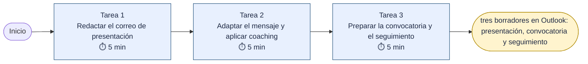
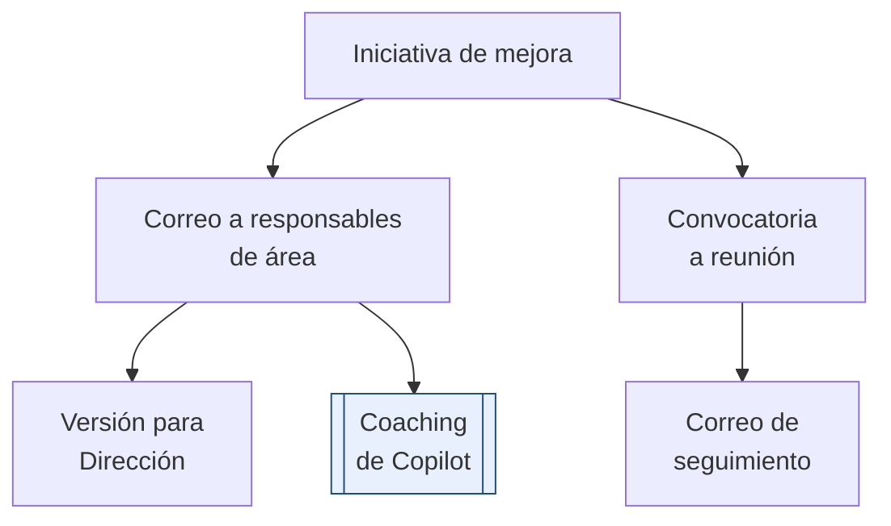

# Práctica 6. Preparación y gestión de comunicaciones estratégicas con Copilot en Outlook

## Objetivo de la práctica:

Al finalizar la práctica, serás capaz de:

- Redactar un correo de presentación de una iniciativa con Copilot.
- Adaptar el tono y el nivel de detalle según el destinatario.
- Evaluar un borrador con el coaching de Copilot.
- Preparar una convocatoria y un correo de seguimiento.

## Objetivo Visual

El siguiente diagrama resume las actividades a realizar.



Comunicaciones que se preparan en la práctica:



## Duración aproximada:

- 15 minutos.

## Tabla de ayuda:

Utiliza esta información durante el desarrollo de la práctica.

| Elemento | Valor |
|------------|------------|
| Entorno | Microsoft 365 del curso |
| URL | [https://m365.cloud.microsoft](https://m365.cloud.microsoft) |
| Usuario | Cuenta corporativa asignada al participante |
| Contraseña | Proporcionada por el instructor por el canal autorizado |
| Carpeta de trabajo | `OneDrive > Laboratorio_Copilot_JUN` |

## Entorno de laboratorio

| Componente | Versión | Uso | Fuente oficial |
|------------|------------|------------|------------|
| Microsoft Outlook | Nuevo Outlook o Outlook en la web | Redacción y coaching de correos con Copilot | https://support.microsoft.com/es-es/copilot-outlook |
| OneDrive para el trabajo o la escuela | Servicio administrado | Almacenamiento de archivos de la práctica | https://support.microsoft.com/es-es/onedrive |
| Microsoft Edge | Versión actual | Acceso a Microsoft 365 | https://www.microsoft.com/es-es/edge |

> Microsoft 365 Copilot y sus agentes son servicios administrados que se actualizan de forma continua; los nombres de botones y menús pueden variar ligeramente respecto a esta guía.

## Recursos

| Recurso | Descripción |
|------------|------------|
| `Propuesta_Atencion_Clientes_[INICIALES].docx` | Documento de la Práctica 4. |
| `Presentacion_Mejora_[INICIALES].pptx` | Presentación de la Práctica 5. |

## Instrucciones

### Tarea 1. Redactar el correo de presentación (5 min)

**Objetivo de la tarea:** Tener un borrador dirigido a los responsables de área que presenta la iniciativa.

Paso 1. Abrir Outlook en la web y seleccionar **Correo nuevo**. En **Para**, escribir su propia dirección de correo (no enviar a otras personas).

Paso 2. Seleccionar el ícono de **Copilot > Borrador con Copilot** y escribir:

```text
Redacta un correo para los responsables de las áreas Comercial, Administrativa y de Servicio presentando la iniciativa de mejora de la atención a clientes.
Incluye: el problema (primera respuesta en 38 horas), la meta (8 horas), tres beneficios y lo que se espera de cada área. Tono profesional y cercano, máximo 180 palabras.
```

Revisar el borrador y seleccionar **Conservar**. Escribir el asunto `Iniciativa: mejora de la atención a clientes`.

### Tarea 2. Adaptar el mensaje y aplicar coaching (5 min)

**Objetivo de la tarea:** Tener una versión para Dirección y el correo original mejorado con el coaching de Copilot.

Paso 1. Seleccionar **Copilot > Coaching de Copilot** (*Coaching by Copilot*) y revisar las sugerencias sobre tono, claridad y sentimiento del lector. Aplicar las que mejoren el mensaje.

```text
Si la opción de coaching no aparece, abrir el panel de Copilot y pedir: Evalúa la claridad, el tono y la efectividad de este correo y sugiere mejoras.
```

Paso 2. Crear un segundo **Correo nuevo**, usar **Borrador con Copilot** y escribir:

```text
Adapta el correo anterior para el Director General: máximo 80 palabras, enfocado en resultados y en la decisión que necesitamos de él.
```

### Tarea 3. Preparar la convocatoria y el seguimiento (5 min)

**Objetivo de la tarea:** Tener una convocatoria con agenda y un correo de seguimiento listos para revisión.

Paso 1. En el calendario de Outlook, seleccionar **Nuevo evento**, título `Coordinación: mejora de la atención a clientes`, invitarse a sí mismo y en el cuerpo usar Copilot con:

```text
Redacta la descripción de esta reunión de 45 minutos con objetivo, 4 temas a discutir y resultados esperados.
```

Paso 2. Guardar el evento sin enviar invitaciones a terceros.

Paso 3. Crear un **Correo nuevo** con **Borrador con Copilot**:

```text
Redacta un correo de seguimiento posterior a la reunión con espacios para acuerdos, responsables, fechas y próximos pasos, en formato de tabla.
```

Paso 4. Guardar el correo como **Borrador**.

### Resultado esperado

Al finalizar la práctica deberás contar con:

- Correo de presentación mejorado.
- Versión adaptada para Dirección.
- Convocatoria y correo de seguimiento listos.

<!-- Agregar captura del resultado esperado: ../images/p06-resultado.png -->

## Resumen

Durante esta práctica se realizó:

- Se redactó un correo estratégico con Copilot.
- Se adaptó y evaluó la comunicación.
- Se preparó la convocatoria y el seguimiento.

Como resultado se obtuvo:

- Comunicaciones de la iniciativa listas para revisión.
- Insumos para la reunión de la Práctica 7.

## Recursos opcionales

- [Copilot en Outlook](https://support.microsoft.com/es-es/copilot-outlook)
- [Documentación de Microsoft 365 Copilot](https://learn.microsoft.com/es-es/copilot/microsoft-365/)

---

[⬅ Anterior: Práctica 5](../Capitulo02/README_Practica05.md) | [Inicio](../README.md) | [Siguiente: Práctica 7 ➡](../Capitulo02/README_Practica07.md)
