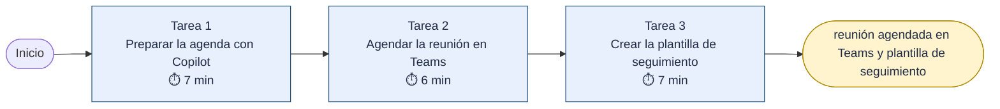

# Práctica 7. Organización de una reunión de coordinación con Copilot en Teams

## Objetivo de la práctica:

Al finalizar la práctica, serás capaz de:

- Preparar la agenda de una reunión con Copilot a partir de documentos de trabajo.
- Agendar una reunión en Teams con objetivos y actividades previas.
- Diseñar una plantilla de seguimiento de acuerdos y compromisos.

## Objetivo Visual

El siguiente diagrama resume las actividades a realizar.



Antes, durante y después de la reunión:


## Duración aproximada:

- 20 minutos.

## Tabla de ayuda:

Utiliza esta información durante el desarrollo de la práctica.

| Elemento | Valor |
|------------|------------|
| Entorno | Microsoft 365 del curso |
| URL | [https://m365.cloud.microsoft](https://m365.cloud.microsoft) |
| Usuario | Cuenta corporativa asignada al participante |
| Contraseña | Proporcionada por el instructor por el canal autorizado |
| Carpeta de trabajo | `OneDrive > Laboratorio_Copilot_JUN` |

## Entorno de laboratorio

| Componente | Versión | Uso | Fuente oficial |
|------------|------------|------------|------------|
| Microsoft Teams | Microsoft 365 (escritorio o web) | Reuniones, chats y Copilot en Teams | https://support.microsoft.com/es-es/copilot-teams |
| Microsoft 365 Copilot (licencia Premium) | Servicio administrado | Chat y asistente en las aplicaciones de Microsoft 365 | https://learn.microsoft.com/es-es/copilot/microsoft-365/ |
| Microsoft Word | Microsoft 365 (escritorio o web) | Redacción y edición con Copilot | https://support.microsoft.com/es-es/copilot-word |
| OneDrive para el trabajo o la escuela | Servicio administrado | Almacenamiento de archivos de la práctica | https://support.microsoft.com/es-es/onedrive |

> Microsoft 365 Copilot y sus agentes son servicios administrados que se actualizan de forma continua; los nombres de botones y menús pueden variar ligeramente respecto a esta guía.

## Recursos

| Recurso | Descripción |
|------------|------------|
| `Propuesta_Atencion_Clientes_[INICIALES].docx` | Documento de la Práctica 4. |
| `Presentacion_Mejora_[INICIALES].pptx` | Presentación de la Práctica 5. |
| `P07_Seguimiento_[INICIALES].docx` | Entregable de la práctica. |

## Instrucciones

### Tarea 1. Preparar la agenda con Copilot (7 min)

**Objetivo de la tarea:** Obtener temas, agenda con tiempos, preguntas por área y resultados esperados.

Paso 1. Abrir Microsoft Teams y seleccionar **Copilot** en el panel izquierdo.

Paso 2. Enviar el prompt, referenciando los archivos con `/`:

```text
Con base en /Propuesta_Atencion_Clientes_[INICIALES] y /Presentacion_Mejora_[INICIALES], prepara una reunión de coordinación de 45 minutos.
Entrega: 1) temas a discutir, 2) agenda con tiempos, 3) dos preguntas para cada responsable (Comercial, Servicio, Administración), 4) resultados esperados de la reunión.
```

### Tarea 2. Agendar la reunión en Teams (6 min)

**Objetivo de la tarea:** Tener una reunión agendada con la agenda, los objetivos y las actividades previas en la descripción.

Paso 1. Ir a **Calendario > Nueva reunión**. Título: `Coordinación: mejora de la atención a clientes`. Invitar solo a su propia cuenta y elegir una fecha de la próxima semana.

Paso 2. Pegar en la descripción la agenda obtenida y agregar la sección **Antes de la reunión** con: revisar la presentación y traer los datos de tiempo de respuesta de su área.

Paso 3. Adjuntar la presentación desde OneDrive y seleccionar **Guardar**.

### Tarea 3. Crear la plantilla de seguimiento (7 min)

**Objetivo de la tarea:** Tener guardado `P07_Seguimiento_[INICIALES].docx` con la plantilla de acuerdos.

Paso 1. En Copilot de Teams, enviar:

```text
Crea una plantilla de seguimiento de acuerdos para esta reunión con una tabla de columnas: Acuerdo, Responsable, Área, Fecha compromiso, Estado y Comentarios. Agrega una sección de próximos pasos y la fecha de la siguiente revisión.
```

Paso 2. Copiar la plantilla a un documento de Word en blanco y guardarlo como `P07_Seguimiento_[INICIALES].docx` en `OneDrive > Laboratorio_Copilot_JUN > Entregables`.

Paso 3. Explicar en una línea, al final del documento, cómo se usaría **Resumen inteligente** (*Intelligent Recap*) de Teams para llenar la plantilla después de la reunión.

### Resultado esperado

Al finalizar la práctica deberás contar con:

- Agenda con preguntas por área.
- Reunión agendada en Teams.
- Plantilla de seguimiento guardada.

<!-- Agregar captura del resultado esperado: ../images/p07-resultado.png -->

## Resumen

Durante esta práctica se realizó:

- Se preparó una reunión con Copilot.
- Se agendó la reunión en Teams.
- Se diseñó una plantilla de seguimiento.

Como resultado se obtuvo:

- Reunión de coordinación preparada.
- Plantilla reutilizable para registrar acuerdos.

## Recursos opcionales

- [Copilot en Teams](https://support.microsoft.com/es-es/copilot-teams)
- [Resumen inteligente en Teams](https://support.microsoft.com/es-es/teams)

---

[⬅ Anterior: Práctica 6](../Capitulo02/README_Practica06.md) | [Inicio](../README.md) | [Siguiente: Práctica 8 ➡](../Capitulo03/README_Practica08.md)
