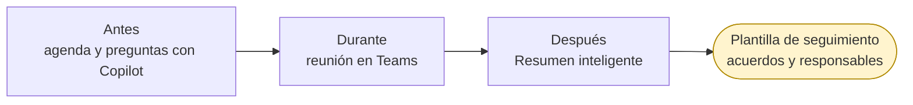

# Práctica 7. Organización de una reunión de coordinación con Copilot en Teams

**Capítulo 2. Uso de Copilot en Aplicaciones M365 y Productividad Individual/Equipo**

---

# Metadatos

| Campo | Valor |
|------------|------------|
| Duración | 20 minutos |
| Complejidad | Intermedia |
| Nivel de Bloom | Aplicar |
| Tecnología Principal | Microsoft 365 Copilot en Teams |

---

# Descripción General

La iniciativa de mejora requiere una reunión de coordinación entre áreas. El participante utilizará Copilot y la información de las prácticas anteriores para definir los temas, la agenda, las preguntas para cada responsable y los resultados esperados; agendará la reunión en Teams y elaborará una plantilla de seguimiento de acuerdos.

---

# Objetivos de Aprendizaje

Al finalizar la práctica, el participante será capaz de:

- Preparar la agenda de una reunión con Copilot a partir de documentos de trabajo.
- Agendar una reunión en Teams con objetivos y actividades previas.
- Diseñar una plantilla de seguimiento de acuerdos y compromisos.

---

# Objetivo Visual

El siguiente diagrama resume las tareas de la práctica, su duración y el resultado que se obtiene.


Antes, durante y después de la reunión:



---

# Prerrequisitos

## Conocimientos

- Conocimientos básicos de correo electrónico, calendario, documentos y herramientas de colaboración de Microsoft 365.
- Experiencia en actividades como envío de correos, seguimiento de clientes o actividades, elaboración de reportes, coordinación entre áreas o actualización de archivos.
- Conocimiento de las políticas internas de seguridad, confidencialidad y manejo de información de la organización.
- No se requiere experiencia previa en desarrollo, programación o automatización.

## Accesos Requeridos

- Cuenta de Microsoft 365 con licencia de Microsoft 365 Copilot Premium asignada.
- Acceso a OneDrive con la carpeta `Laboratorio_Copilot_JUN` creada (ver [Setup Guide](../Setup_Guide.md)).

---

# Tabla de Ayuda

Utilice esta información durante el desarrollo de la práctica.

| Elemento | Valor |
|------------|------------|
| Entorno | Microsoft 365 del curso |
| URL | [https://m365.cloud.microsoft](https://m365.cloud.microsoft) |
| Usuario | Cuenta corporativa asignada al participante |
| Contraseña | Proporcionada por el instructor por el canal autorizado |
| Carpeta de trabajo | `OneDrive > Laboratorio_Copilot_JUN` |

---

# Entorno de Laboratorio

| Componente | Versión | Uso | Fuente Oficial |
|------------|------------|------------|------------|
| Microsoft Teams | Microsoft 365 (escritorio o web) | Reuniones, chats y Copilot en Teams | https://support.microsoft.com/es-es/copilot-teams |
| Microsoft 365 Copilot (licencia Premium) | Servicio administrado | Chat y asistente en las aplicaciones de Microsoft 365 | https://learn.microsoft.com/es-es/copilot/microsoft-365/ |
| Microsoft Word | Microsoft 365 (escritorio o web) | Redacción y edición con Copilot | https://support.microsoft.com/es-es/copilot-word |
| OneDrive para el trabajo o la escuela | Servicio administrado | Almacenamiento de archivos de la práctica | https://support.microsoft.com/es-es/onedrive |

> Microsoft 365 Copilot y sus agentes son servicios administrados que se actualizan de forma continua; los nombres de botones y menús pueden variar ligeramente respecto a esta guía.

---

# Recursos

Utilice los siguientes recursos durante el desarrollo de la práctica.

| Recurso | Descripción |
|------------|------------|
| `Propuesta_Atencion_Clientes_[INICIALES].docx` | Documento de la Práctica 4. |
| `Presentacion_Mejora_[INICIALES].pptx` | Presentación de la Práctica 5. |
| `P07_Seguimiento_[INICIALES].docx` | Entregable de la práctica. |

## Archivos de la práctica

```text
Esta práctica no requiere archivos de entrada.
```

---

# Tarea 1. Preparar la agenda con Copilot (7 min)

## Objetivo

Obtener temas, agenda con tiempos, preguntas por área y resultados esperados.

## Instrucciones

### Paso 1

Abrir Microsoft Teams y seleccionar **Copilot** en el panel izquierdo.

### Paso 2

Enviar el prompt, referenciando los archivos con `/`:

```text
Con base en /Propuesta_Atencion_Clientes_[INICIALES] y /Presentacion_Mejora_[INICIALES], prepara una reunión de coordinación de 45 minutos.
Entrega: 1) temas a discutir, 2) agenda con tiempos, 3) dos preguntas para cada responsable (Comercial, Servicio, Administración), 4) resultados esperados de la reunión.
```

---

# Tarea 2. Agendar la reunión en Teams (6 min)

## Objetivo

Tener una reunión agendada con la agenda, los objetivos y las actividades previas en la descripción.

## Instrucciones

### Paso 1

Ir a **Calendario > Nueva reunión**. Título: `Coordinación: mejora de la atención a clientes`. Invitar solo a su propia cuenta y elegir una fecha de la próxima semana.

### Paso 2

Pegar en la descripción la agenda obtenida y agregar la sección **Antes de la reunión** con: revisar la presentación y traer los datos de tiempo de respuesta de su área.

### Paso 3

Adjuntar la presentación desde OneDrive y seleccionar **Guardar**.

---

# Tarea 3. Crear la plantilla de seguimiento (7 min)

## Objetivo

Tener guardado `P07_Seguimiento_[INICIALES].docx` con la plantilla de acuerdos.

## Instrucciones

### Paso 1

En Copilot de Teams, enviar:

```text
Crea una plantilla de seguimiento de acuerdos para esta reunión con una tabla de columnas: Acuerdo, Responsable, Área, Fecha compromiso, Estado y Comentarios. Agrega una sección de próximos pasos y la fecha de la siguiente revisión.
```

### Paso 2

Copiar la plantilla a un documento de Word en blanco y guardarlo como `P07_Seguimiento_[INICIALES].docx` en `OneDrive > Laboratorio_Copilot_JUN > Entregables`.

### Paso 3

Explicar en una línea, al final del documento, cómo se usaría **Resumen inteligente** (*Intelligent Recap*) de Teams para llenar la plantilla después de la reunión.

---

# Validación y Pruebas

Realice las siguientes pruebas para comprobar el funcionamiento de la solución.

| Caso | Acción o Prompt | Resultado Esperado |
|------------|------------|------------|
| Caso 1 | Prompt de preparación de la reunión | Temas, agenda con tiempos, preguntas y resultados |
| Caso 2 | Reunión agendada | Evento con agenda, actividades previas y presentación adjunta |
| Caso 3 | Prompt de plantilla | Tabla de 6 columnas y próximos pasos |
| Caso adversarial | Pedir los acuerdos de la reunión antes de realizarla | Copilot indica que la reunión no ha ocurrido |

---

# Resultado Esperado

Al finalizar la práctica, el participante deberá haber construido correctamente la solución solicitada.

- Agenda con preguntas por área.
- Reunión agendada en Teams.
- Plantilla de seguimiento guardada.

## Imagen del Resultado Final

Agregar una captura de pantalla del resultado final esperado.

```markdown
../images/p07-resultado-final.png
```

---

# Solución de Problemas

## Problema 1: Copilot de Teams no encuentra los archivos

### Síntomas

No se listan al escribir `/`.

### Causa

Los archivos no se han indexado o están en otra carpeta.

### Solución

1. Comprobar que estén en `Entregables`.
2. Usar Copilot Chat en [m365.cloud.microsoft/chat](https://m365.cloud.microsoft/chat) con el mismo prompt.

---

## Problema 2: No se puede adjuntar la presentación

### Síntomas

El botón de adjuntar no muestra OneDrive.

### Causa

La reunión se creó desde un calendario distinto.

### Solución

1. Pegar el vínculo de la presentación en la descripción.
2. Guardar la reunión.

---

# Limpieza

1. Conservar los entregables en `OneDrive > Laboratorio_Copilot_JUN > Entregables`; se reutilizan en prácticas posteriores.
2. No compartir los archivos de la práctica fuera del grupo del curso.
3. Cerrar las conversaciones de Copilot que contengan información de la práctica si se trabaja en un equipo compartido.

---

# Resumen

Durante esta práctica se realizó:

- Se preparó una reunión con Copilot.
- Se agendó la reunión en Teams.
- Se diseñó una plantilla de seguimiento.

Como resultado se obtuvo:

- Reunión de coordinación preparada.
- Plantilla reutilizable para registrar acuerdos.

---

# Recursos Opcionales

- [Copilot en Teams](https://support.microsoft.com/es-es/copilot-teams)
- [Resumen inteligente en Teams](https://support.microsoft.com/es-es/teams)

---

[⬅ Anterior: Práctica 6](../Capitulo02/README_Practica06.md) | [Inicio](../README.md) | [Siguiente: Práctica 8 ➡](../Capitulo03/README_Practica08.md)
