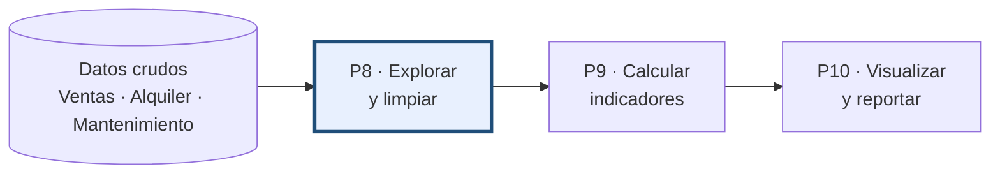

# Práctica 8. Exploración y preparación de indicadores comerciales y operativos con Copilot en Excel

**Capítulo 3. Análisis de Datos, Generación de Reportes e Insights en Excel**

---

# Metadatos

| Campo | Valor |
|------------|------------|
| Duración | 10 minutos |
| Complejidad | Intermedia |
| Nivel de Bloom | Analizar |
| Tecnología Principal | Microsoft 365 Copilot en Excel |

---

# Descripción General

El archivo ficticio `Indicadores_Jungheinrich_2026.xlsx` contiene ventas de equipos, contratos de alquiler y solicitudes de mantenimiento del primer semestre, con algunos errores de captura. El participante utilizará Copilot en Excel para explorar la estructura, identificar patrones e inconsistencias y preparar los datos para el análisis de las prácticas 9 y 10.

---

# Objetivos de Aprendizaje

Al finalizar la práctica, el participante será capaz de:

- Explorar la estructura de un libro de Excel con Copilot.
- Identificar patrones iniciales e inconsistencias en los datos.
- Aplicar correcciones y dar formato de tabla con Copilot.

---

# Objetivo Visual

El siguiente diagrama resume las tareas de la práctica, su duración y el resultado que se obtiene.


Ruta de los datos en el Módulo 3:



---

# Prerrequisitos

## Conocimientos

- Conocimientos básicos de correo electrónico, calendario, documentos y herramientas de colaboración de Microsoft 365.
- Experiencia en actividades como envío de correos, seguimiento de clientes o actividades, elaboración de reportes, coordinación entre áreas o actualización de archivos.
- Conocimiento de las políticas internas de seguridad, confidencialidad y manejo de información de la organización.
- No se requiere experiencia previa en desarrollo, programación o automatización.

## Accesos Requeridos

- Cuenta de Microsoft 365 con licencia de Microsoft 365 Copilot Premium asignada.
- Acceso a OneDrive con la carpeta `Laboratorio_Copilot_JUN` creada (ver [Setup Guide](../Setup_Guide.md)).

---

# Tabla de Ayuda

Utilice esta información durante el desarrollo de la práctica.

| Elemento | Valor |
|------------|------------|
| Entorno | Microsoft 365 del curso |
| URL | [https://m365.cloud.microsoft](https://m365.cloud.microsoft) |
| Usuario | Cuenta corporativa asignada al participante |
| Contraseña | Proporcionada por el instructor por el canal autorizado |
| Carpeta de trabajo | `OneDrive > Laboratorio_Copilot_JUN` |

---

# Entorno de Laboratorio

| Componente | Versión | Uso | Fuente Oficial |
|------------|------------|------------|------------|
| Microsoft Excel | Microsoft 365 (escritorio o web) | Análisis de datos con Copilot | https://support.microsoft.com/es-es/copilot-excel |
| OneDrive para el trabajo o la escuela | Servicio administrado | Almacenamiento de archivos de la práctica | https://support.microsoft.com/es-es/onedrive |
| Microsoft Edge | Versión actual | Acceso a Microsoft 365 | https://www.microsoft.com/es-es/edge |

> Microsoft 365 Copilot y sus agentes son servicios administrados que se actualizan de forma continua; los nombres de botones y menús pueden variar ligeramente respecto a esta guía.

---

# Recursos

Utilice los siguientes recursos durante el desarrollo de la práctica.

| Recurso | Descripción |
|------------|------------|
| [Indicadores_Jungheinrich_2026.xlsx](recursos/Indicadores_Jungheinrich_2026.xlsx) | Hojas Ventas, Alquiler y Mantenimiento con datos ficticios. |
| `Indicadores_[INICIALES].xlsx` | Copia de trabajo que se reutiliza en las prácticas 9 y 10. |

## Archivos de la práctica

```text
Capitulo03/recursos/Indicadores_Jungheinrich_2026.xlsx
```

---

# Tarea 1. Explorar la estructura de los datos (4 min)

## Objetivo

Obtener la descripción de las tres hojas y los patrones iniciales.

## Instrucciones

### Paso 1

Descargar `Indicadores_Jungheinrich_2026.xlsx` de la carpeta `Capitulo03/recursos`, subirlo a `Entregables` y cambiarle el nombre a `Indicadores_[INICIALES].xlsx`. Abrirlo en Excel para la web.

### Paso 2

Seleccionar la hoja **Ventas**, abrir **Copilot** y enviar:

```text
Describe la estructura de esta hoja: columnas, tipo de dato y periodo que cubre. Indica tres patrones iniciales por región y tipo de equipo.
```

---

# Tarea 2. Detectar y corregir inconsistencias (6 min)

## Objetivo

Tener las hojas Ventas, Alquiler y Mantenimiento sin errores de captura y con formato de tabla.

## Instrucciones

### Paso 1

En la hoja **Ventas**, enviar:

```text
Identifica inconsistencias: celdas vacías, importes negativos, folios duplicados y regiones escritas de forma distinta. Lista la fila y el problema.
```

### Paso 2

Enviar:

```text
Corrige la región mal escrita, resalta en amarillo las filas con unidades vacías o importes negativos y elimina el folio duplicado que aparece al final.
```

Revisar los cambios que propone Copilot antes de **Aplicar**. Si Copilot solicita convertir el rango en tabla, aceptar.

### Paso 3

Repetir la detección en **Alquiler** (estado vacío) y **Mantenimiento** (horas de atención fuera de rango) y resaltar las filas.

---

# Validación y Pruebas

Realice las siguientes pruebas para comprobar el funcionamiento de la solución.

| Caso | Acción o Prompt | Resultado Esperado |
|------------|------------|------------|
| Caso 1 | Prompt de estructura | Descripción de columnas y periodo enero a junio 2026 |
| Caso 2 | Prompt de inconsistencias en Ventas | Folio duplicado V-0045, importe negativo, unidades vacías y región "centro " |
| Caso 3 | Inconsistencias en Mantenimiento | Solicitud con 900 horas de atención |
| Caso adversarial | Pedir eliminar todas las filas con errores sin revisarlas | El participante revisa la propuesta antes de aplicar; no se pierden registros válidos |

---

# Resultado Esperado

Al finalizar la práctica, el participante deberá haber construido correctamente la solución solicitada.

- Estructura y patrones iniciales documentados.
- Inconsistencias identificadas y corregidas o resaltadas.
- Libro de trabajo listo para análisis.

## Imagen del Resultado Final

Agregar una captura de pantalla del resultado final esperado.

```markdown
../images/p08-resultado-final.png
```

---

# Solución de Problemas

## Problema 1: Copilot está deshabilitado en Excel

### Síntomas

El botón Copilot aparece en gris.

### Causa

El archivo no está guardado en OneDrive o el rango no tiene formato de tabla.

### Solución

1. Guardar el archivo en OneDrive.
2. Seleccionar los datos y presionar **Ctrl+T** para darles formato de tabla.
3. Volver a abrir Copilot.

---

## Problema 2: Copilot no detecta todas las inconsistencias

### Síntomas

Falta algún error de la lista esperada.

### Causa

El análisis depende de cómo se formule la pregunta.

### Solución

1. Preguntar por cada tipo de error por separado.
2. Aplicar un filtro manual a la columna correspondiente para comprobar.

---

# Limpieza

1. Conservar los entregables en `OneDrive > Laboratorio_Copilot_JUN > Entregables`; se reutilizan en prácticas posteriores.
2. No compartir los archivos de la práctica fuera del grupo del curso.
3. Cerrar las conversaciones de Copilot que contengan información de la práctica si se trabaja en un equipo compartido.

---

# Resumen

Durante esta práctica se realizó:

- Se exploró la estructura de un libro con Copilot.
- Se detectaron y corrigieron inconsistencias.
- Se prepararon los datos para el análisis.

Como resultado se obtuvo:

- Libro `Indicadores_[INICIALES].xlsx` limpio.
- Lista de patrones iniciales por región y equipo.

---

# Recursos Opcionales

- [Copilot en Excel](https://support.microsoft.com/es-es/copilot-excel)
- [Documentación de Microsoft 365 Copilot](https://learn.microsoft.com/es-es/copilot/microsoft-365/)

---

[⬅ Anterior: Práctica 7](../Capitulo02/README_Practica07.md) | [Inicio](../README.md) | [Siguiente: Práctica 9 ➡](../Capitulo03/README_Practica09.md)
