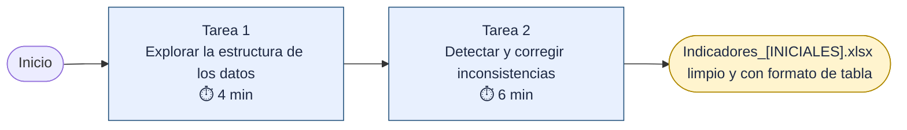
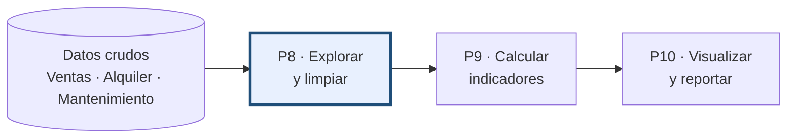

# Práctica 8. Exploración y preparación de indicadores comerciales y operativos con Copilot en Excel

## Objetivo de la práctica:

Al finalizar la práctica, serás capaz de:

- Explorar la estructura de un libro de Excel con Copilot.
- Identificar patrones iniciales e inconsistencias en los datos.
- Aplicar correcciones y dar formato de tabla con Copilot.

## Objetivo Visual

El siguiente diagrama resume las actividades a realizar.



Ruta de los datos en el Módulo 3:



## Duración aproximada:

- 10 minutos.

## Tabla de ayuda:

Utiliza esta información durante el desarrollo de la práctica.

| Elemento | Valor |
|------------|------------|
| Entorno | Microsoft 365 del curso |
| URL | [https://m365.cloud.microsoft](https://m365.cloud.microsoft) |
| Usuario | Cuenta corporativa asignada al participante |
| Contraseña | Proporcionada por el instructor por el canal autorizado |
| Carpeta de trabajo | `OneDrive > Laboratorio_Copilot_JUN` |

## Entorno de laboratorio

| Componente | Versión | Uso | Fuente oficial |
|------------|------------|------------|------------|
| Microsoft Excel | Microsoft 365 (escritorio o web) | Análisis de datos con Copilot | https://support.microsoft.com/es-es/copilot-excel |
| OneDrive para el trabajo o la escuela | Servicio administrado | Almacenamiento de archivos de la práctica | https://support.microsoft.com/es-es/onedrive |
| Microsoft Edge | Versión actual | Acceso a Microsoft 365 | https://www.microsoft.com/es-es/edge |

> Microsoft 365 Copilot y sus agentes son servicios administrados que se actualizan de forma continua; los nombres de botones y menús pueden variar ligeramente respecto a esta guía.

## Recursos

| Recurso | Descripción |
|------------|------------|
| [Indicadores_Jungheinrich_2026.xlsx](recursos/Indicadores_Jungheinrich_2026.xlsx) | Hojas Ventas, Alquiler y Mantenimiento con datos ficticios. |
| `Indicadores_[INICIALES].xlsx` | Copia de trabajo que se reutiliza en las prácticas 9 y 10. |

Archivos de la práctica:

```text
Capitulo03/recursos/Indicadores_Jungheinrich_2026.xlsx
```

## Instrucciones

### Tarea 1. Explorar la estructura de los datos (4 min)

**Objetivo de la tarea:** Obtener la descripción de las tres hojas y los patrones iniciales.

Paso 1. Descargar `Indicadores_Jungheinrich_2026.xlsx` de la carpeta `Capitulo03/recursos`, subirlo a `Entregables` y cambiarle el nombre a `Indicadores_[INICIALES].xlsx`. Abrirlo en Excel para la web.

Paso 2. Seleccionar la hoja **Ventas**, abrir **Copilot** y enviar:

```text
Describe la estructura de esta hoja: columnas, tipo de dato y periodo que cubre. Indica tres patrones iniciales por región y tipo de equipo.
```

### Tarea 2. Detectar y corregir inconsistencias (6 min)

**Objetivo de la tarea:** Tener las hojas Ventas, Alquiler y Mantenimiento sin errores de captura y con formato de tabla.

Paso 1. En la hoja **Ventas**, enviar:

```text
Identifica inconsistencias: celdas vacías, importes negativos, folios duplicados y regiones escritas de forma distinta. Lista la fila y el problema.
```

Paso 2. Enviar:

```text
Corrige la región mal escrita, resalta en amarillo las filas con unidades vacías o importes negativos y elimina el folio duplicado que aparece al final.
```

Revisar los cambios que propone Copilot antes de **Aplicar**. Si Copilot solicita convertir el rango en tabla, aceptar.

Paso 3. Repetir la detección en **Alquiler** (estado vacío) y **Mantenimiento** (horas de atención fuera de rango) y resaltar las filas.

### Resultado esperado

Al finalizar la práctica deberás contar con:

- Estructura y patrones iniciales documentados.
- Inconsistencias identificadas y corregidas o resaltadas.
- Libro de trabajo listo para análisis.

<!-- Agregar captura del resultado esperado: ../images/p08-resultado.png -->

## Resumen

Durante esta práctica se realizó:

- Se exploró la estructura de un libro con Copilot.
- Se detectaron y corrigieron inconsistencias.
- Se prepararon los datos para el análisis.

Como resultado se obtuvo:

- Libro `Indicadores_[INICIALES].xlsx` limpio.
- Lista de patrones iniciales por región y equipo.

## Recursos opcionales

- [Copilot en Excel](https://support.microsoft.com/es-es/copilot-excel)
- [Documentación de Microsoft 365 Copilot](https://learn.microsoft.com/es-es/copilot/microsoft-365/)

---

[⬅ Anterior: Práctica 7](../Capitulo02/README_Practica07.md) | [Inicio](../README.md) | [Siguiente: Práctica 9 ➡](../Capitulo03/README_Practica09.md)
