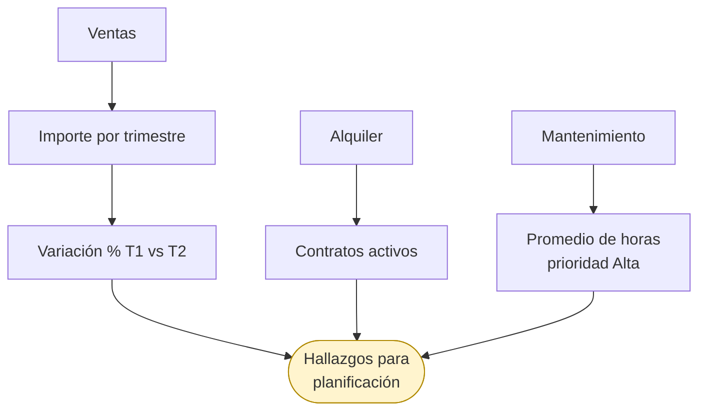

# Práctica 9. Análisis de indicadores y generación de cálculos con Copilot en Excel

**Capítulo 3. Análisis de Datos, Generación de Reportes e Insights en Excel**

---

# Metadatos

| Campo | Valor |
|------------|------------|
| Duración | 12 minutos |
| Complejidad | Intermedia |
| Nivel de Bloom | Analizar |
| Tecnología Principal | Microsoft 365 Copilot en Excel |

---

# Descripción General

Con los datos preparados en la Práctica 8, el participante formulará preguntas a Copilot sobre el comportamiento de las ventas, la demanda de alquiler y las solicitudes de mantenimiento, creará fórmulas sin codificación para calcular variaciones entre periodos e indicadores, e identificará los hallazgos que apoyan la planificación comercial y operativa.

---

# Objetivos de Aprendizaje

Al finalizar la práctica, el participante será capaz de:

- Formular preguntas de análisis a Copilot sobre datos de negocio.
- Crear columnas calculadas y fórmulas con lenguaje natural.
- Calcular variaciones entre periodos e interpretar los resultados.

---

# Objetivo Visual

El siguiente diagrama resume las tareas de la práctica, su duración y el resultado que se obtiene.


Indicadores que se construyen:



---

# Prerrequisitos

## Conocimientos

- Conocimientos básicos de correo electrónico, calendario, documentos y herramientas de colaboración de Microsoft 365.
- Experiencia en actividades como envío de correos, seguimiento de clientes o actividades, elaboración de reportes, coordinación entre áreas o actualización de archivos.
- Conocimiento de las políticas internas de seguridad, confidencialidad y manejo de información de la organización.
- No se requiere experiencia previa en desarrollo, programación o automatización.

## Accesos Requeridos

- Cuenta de Microsoft 365 con licencia de Microsoft 365 Copilot Premium asignada.
- Acceso a OneDrive con la carpeta `Laboratorio_Copilot_JUN` creada (ver [Setup Guide](../Setup_Guide.md)).

---

# Tabla de Ayuda

Utilice esta información durante el desarrollo de la práctica.

| Elemento | Valor |
|------------|------------|
| Entorno | Microsoft 365 del curso |
| URL | [https://m365.cloud.microsoft](https://m365.cloud.microsoft) |
| Usuario | Cuenta corporativa asignada al participante |
| Contraseña | Proporcionada por el instructor por el canal autorizado |
| Carpeta de trabajo | `OneDrive > Laboratorio_Copilot_JUN` |

---

# Entorno de Laboratorio

| Componente | Versión | Uso | Fuente Oficial |
|------------|------------|------------|------------|
| Microsoft Excel | Microsoft 365 (escritorio o web) | Análisis de datos con Copilot | https://support.microsoft.com/es-es/copilot-excel |
| OneDrive para el trabajo o la escuela | Servicio administrado | Almacenamiento de archivos de la práctica | https://support.microsoft.com/es-es/onedrive |

> Microsoft 365 Copilot y sus agentes son servicios administrados que se actualizan de forma continua; los nombres de botones y menús pueden variar ligeramente respecto a esta guía.

---

# Recursos

Utilice los siguientes recursos durante el desarrollo de la práctica.

| Recurso | Descripción |
|------------|------------|
| `Indicadores_[INICIALES].xlsx` | Libro preparado en la Práctica 8. |

## Archivos de la práctica

```text
OneDrive/Laboratorio_Copilot_JUN/Entregables/Indicadores_[INICIALES].xlsx
```

---

# Tarea 1. Analizar el comportamiento de los datos (5 min)

## Objetivo

Obtener respuestas sobre ventas por región, demanda de alquiler y prioridades de mantenimiento.

## Instrucciones

### Paso 1

Abrir `Indicadores_[INICIALES].xlsx` en Excel para la web y abrir **Copilot**.

### Paso 2

En la hoja **Ventas**, enviar:

```text
¿Qué región y qué tipo de equipo generan más importe? Compara el primer trimestre con el segundo.
```

### Paso 3

En **Mantenimiento**, enviar:

```text
¿Cuál es el promedio de horas de atención por prioridad y región? Excluye los valores fuera de rango.
```

---

# Tarea 2. Crear fórmulas e indicadores (5 min)

## Objetivo

Tener columnas calculadas de Mes y Trimestre y una hoja Indicadores con variaciones entre trimestres.

## Instrucciones

### Paso 1

En **Ventas**, enviar:

```text
Agrega una columna Mes y una columna Trimestre calculadas a partir de la fecha.
```

Revisar la fórmula propuesta y seleccionar **Insertar columna**.

### Paso 2

Enviar:

```text
Crea una hoja nueva llamada Indicadores con: importe total por trimestre, variación porcentual entre T1 y T2, número de contratos de alquiler activos y promedio de horas de atención de mantenimiento de prioridad Alta. Usa fórmulas que hagan referencia a las hojas originales.
```

### Paso 3

Seleccionar una celda de la hoja **Indicadores** y comprobar en la barra de fórmulas que el resultado proviene de una fórmula y no de un valor fijo.

---

# Tarea 3. Identificar hallazgos (2 min)

## Objetivo

Tener tres hallazgos escritos en la hoja Indicadores.

## Instrucciones

### Paso 1

Enviar:

```text
Con base en la hoja Indicadores, redacta tres hallazgos que apoyen la planificación comercial y operativa del segundo semestre.
```

### Paso 2

Pegar los hallazgos debajo de los indicadores y guardar.

---

# Validación y Pruebas

Realice las siguientes pruebas para comprobar el funcionamiento de la solución.

| Caso | Acción o Prompt | Resultado Esperado |
|------------|------------|------------|
| Caso 1 | Pregunta de región y tipo de equipo | Región y equipo con mayor importe y comparación T1 vs T2 |
| Caso 2 | Columna Trimestre | Fórmula insertada que devuelve T1 o T2 |
| Caso 3 | Hoja Indicadores | Celdas con fórmulas y variación porcentual |
| Caso adversarial | Preguntar por ventas de 2025 | Copilot indica que no hay datos de ese periodo |

---

# Resultado Esperado

Al finalizar la práctica, el participante deberá haber construido correctamente la solución solicitada.

- Respuestas de análisis documentadas.
- Fórmulas e indicadores creados sin codificación.
- Tres hallazgos para la planificación.

## Imagen del Resultado Final

Agregar una captura de pantalla del resultado final esperado.

```markdown
../images/p09-resultado-final.png
```

---

# Solución de Problemas

## Problema 1: La fórmula devuelve error

### Síntomas

Aparece `#VALOR!` o `#NOMBRE?`.

### Causa

Las fechas o los importes están almacenados como texto.

### Solución

1. Pedir a Copilot "Explica esta fórmula y corrige el error".
2. Convertir la columna a formato de fecha o número.

---

## Problema 2: Los totales no coinciden

### Síntomas

El importe total es distinto al esperado.

### Causa

Las filas resaltadas en la Práctica 8 se incluyen en el cálculo.

### Solución

1. Pedir que excluya las filas con importe negativo o unidades vacías.
2. Comprobar con un filtro manual.

---

# Limpieza

1. Conservar los entregables en `OneDrive > Laboratorio_Copilot_JUN > Entregables`; se reutilizan en prácticas posteriores.
2. No compartir los archivos de la práctica fuera del grupo del curso.
3. Cerrar las conversaciones de Copilot que contengan información de la práctica si se trabaja en un equipo compartido.

---

# Resumen

Durante esta práctica se realizó:

- Se formularon preguntas de negocio a Copilot.
- Se crearon fórmulas sin codificación.
- Se identificaron hallazgos.

Como resultado se obtuvo:

- Hoja Indicadores con cálculos verificables.
- Base para las visualizaciones de la Práctica 10.

---

# Recursos Opcionales

- [Copilot en Excel](https://support.microsoft.com/es-es/copilot-excel)
- [Funciones de Excel](https://support.microsoft.com/es-es/excel)

---

[⬅ Anterior: Práctica 8](../Capitulo03/README_Practica08.md) | [Inicio](../README.md) | [Siguiente: Práctica 10 ➡](../Capitulo03/README_Practica10.md)
