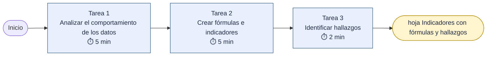

# Práctica 9. Análisis de indicadores y generación de cálculos con Copilot en Excel

## Objetivo de la práctica:

Al finalizar la práctica, serás capaz de:

- Formular preguntas de análisis a Copilot sobre datos de negocio.
- Crear columnas calculadas y fórmulas con lenguaje natural.
- Calcular variaciones entre periodos e interpretar los resultados.

## Objetivo Visual

El siguiente diagrama resume las actividades a realizar.



Indicadores que se construyen:


## Duración aproximada:

- 12 minutos.

## Tabla de ayuda:

Utiliza esta información durante el desarrollo de la práctica.

| Elemento | Valor |
|------------|------------|
| Entorno | Microsoft 365 del curso |
| URL | [https://m365.cloud.microsoft](https://m365.cloud.microsoft) |
| Usuario | Cuenta corporativa asignada al participante |
| Contraseña | Proporcionada por el instructor por el canal autorizado |
| Carpeta de trabajo | `OneDrive > Laboratorio_Copilot_JUN` |

## Entorno de laboratorio

| Componente | Versión | Uso | Fuente oficial |
|------------|------------|------------|------------|
| Microsoft Excel | Microsoft 365 (escritorio o web) | Análisis de datos con Copilot | https://support.microsoft.com/es-es/copilot-excel |
| OneDrive para el trabajo o la escuela | Servicio administrado | Almacenamiento de archivos de la práctica | https://support.microsoft.com/es-es/onedrive |

> Microsoft 365 Copilot y sus agentes son servicios administrados que se actualizan de forma continua; los nombres de botones y menús pueden variar ligeramente respecto a esta guía.

## Recursos

| Recurso | Descripción |
|------------|------------|
| `Indicadores_[INICIALES].xlsx` | Libro preparado en la Práctica 8. |

Archivos de la práctica:

```text
OneDrive/Laboratorio_Copilot_JUN/Entregables/Indicadores_[INICIALES].xlsx
```

## Instrucciones

### Tarea 1. Analizar el comportamiento de los datos (5 min)

**Objetivo de la tarea:** Obtener respuestas sobre ventas por región, demanda de alquiler y prioridades de mantenimiento.

Paso 1. Abrir `Indicadores_[INICIALES].xlsx` en Excel para la web y abrir **Copilot**.

Paso 2. En la hoja **Ventas**, enviar:

```text
¿Qué región y qué tipo de equipo generan más importe? Compara el primer trimestre con el segundo.
```

Paso 3. En **Mantenimiento**, enviar:

```text
¿Cuál es el promedio de horas de atención por prioridad y región? Excluye los valores fuera de rango.
```

### Tarea 2. Crear fórmulas e indicadores (5 min)

**Objetivo de la tarea:** Tener columnas calculadas de Mes y Trimestre y una hoja Indicadores con variaciones entre trimestres.

Paso 1. En **Ventas**, enviar:

```text
Agrega una columna Mes y una columna Trimestre calculadas a partir de la fecha.
```

Revisar la fórmula propuesta y seleccionar **Insertar columna**.

Paso 2. Enviar:

```text
Crea una hoja nueva llamada Indicadores con: importe total por trimestre, variación porcentual entre T1 y T2, número de contratos de alquiler activos y promedio de horas de atención de mantenimiento de prioridad Alta. Usa fórmulas que hagan referencia a las hojas originales.
```

Paso 3. Seleccionar una celda de la hoja **Indicadores** y comprobar en la barra de fórmulas que el resultado proviene de una fórmula y no de un valor fijo.

### Tarea 3. Identificar hallazgos (2 min)

**Objetivo de la tarea:** Tener tres hallazgos escritos en la hoja Indicadores.

Paso 1. Enviar:

```text
Con base en la hoja Indicadores, redacta tres hallazgos que apoyen la planificación comercial y operativa del segundo semestre.
```

Paso 2. Pegar los hallazgos debajo de los indicadores y guardar.

### Resultado esperado

Al finalizar la práctica deberás contar con:

- Respuestas de análisis documentadas.
- Fórmulas e indicadores creados sin codificación.
- Tres hallazgos para la planificación.

<!-- Agregar captura del resultado esperado: ../images/p09-resultado.png -->

## Resumen

Durante esta práctica se realizó:

- Se formularon preguntas de negocio a Copilot.
- Se crearon fórmulas sin codificación.
- Se identificaron hallazgos.

Como resultado se obtuvo:

- Hoja Indicadores con cálculos verificables.
- Base para las visualizaciones de la Práctica 10.

## Recursos opcionales

- [Copilot en Excel](https://support.microsoft.com/es-es/copilot-excel)
- [Funciones de Excel](https://support.microsoft.com/es-es/excel)

---

[⬅ Anterior: Práctica 8](../Capitulo03/README_Practica08.md) | [Inicio](../README.md) | [Siguiente: Práctica 10 ➡](../Capitulo03/README_Practica10.md)
