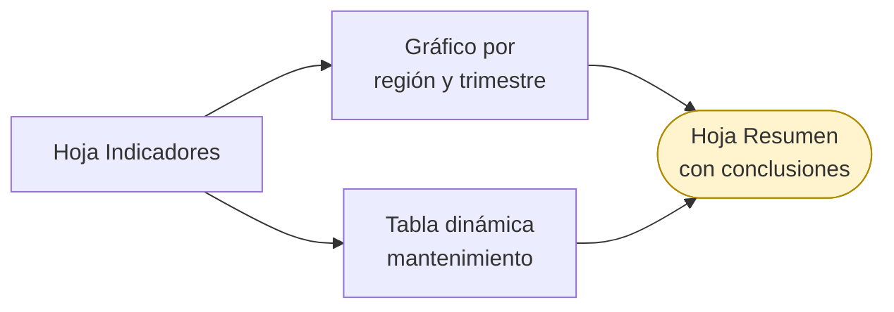

# Práctica 10. Creación de visualizaciones y reportes con Copilot en Excel

## Objetivo de la práctica:

Al finalizar la práctica, serás capaz de:

- Generar gráficos con Copilot a partir de indicadores.
- Crear tablas dinámicas con lenguaje natural.
- Organizar una hoja de resumen para la toma de decisiones.

## Objetivo Visual

El siguiente diagrama resume las actividades a realizar.


De los indicadores al reporte:



## Duración aproximada:

- 10 minutos.

## Tabla de ayuda:

Utiliza esta información durante el desarrollo de la práctica.

| Elemento | Valor |
|------------|------------|
| Entorno | Microsoft 365 del curso |
| URL | [https://m365.cloud.microsoft](https://m365.cloud.microsoft) |
| Usuario | Cuenta corporativa asignada al participante |
| Contraseña | Proporcionada por el instructor por el canal autorizado |
| Carpeta de trabajo | `OneDrive > Laboratorio_Copilot_JUN` |

## Entorno de laboratorio

| Componente | Versión | Uso | Fuente oficial |
|------------|------------|------------|------------|
| Microsoft Excel | Microsoft 365 (escritorio o web) | Análisis de datos con Copilot | https://support.microsoft.com/es-es/copilot-excel |
| OneDrive para el trabajo o la escuela | Servicio administrado | Almacenamiento de archivos de la práctica | https://support.microsoft.com/es-es/onedrive |

> Microsoft 365 Copilot y sus agentes son servicios administrados que se actualizan de forma continua; los nombres de botones y menús pueden variar ligeramente respecto a esta guía.

## Recursos

| Recurso | Descripción |
|------------|------------|
| `Indicadores_[INICIALES].xlsx` | Libro con la hoja Indicadores de la Práctica 9. |

Archivos de la práctica:

```text
OneDrive/Laboratorio_Copilot_JUN/Entregables/Indicadores_[INICIALES].xlsx
```

## Instrucciones

### Tarea 1. Generar gráficos y tablas dinámicas (6 min)

**Objetivo de la tarea:** Tener un gráfico de importe por región y trimestre y una tabla dinámica de mantenimiento por prioridad.

Paso 1. Abrir `Indicadores_[INICIALES].xlsx`, ir a la hoja **Ventas** y abrir **Copilot**.

Paso 2. Enviar:

```text
Crea un gráfico de columnas agrupadas con el importe por región y trimestre.
```

Seleccionar **Agregar a una hoja nueva**.

Paso 3. Ir a **Mantenimiento** y enviar:

```text
Crea una tabla dinámica con el número de solicitudes y el promedio de horas de atención por región y prioridad.
```

Seleccionar **Agregar a una hoja nueva**.

### Tarea 2. Preparar la hoja de resumen (4 min)

**Objetivo de la tarea:** Tener una hoja Resumen con las visualizaciones y una interpretación breve.

Paso 1. Crear una hoja llamada **Resumen**, mover a ella el gráfico y copiar la tabla dinámica (o un gráfico dinámico de ella).

Paso 2. Con la hoja **Resumen** seleccionada, enviar a Copilot:

```text
Redacta tres conclusiones de una línea sobre las tendencias que muestran estas visualizaciones y una oportunidad de mejora.
```

Paso 3. Pegar las conclusiones en la parte superior de la hoja **Resumen** y guardar.

### Resultado esperado

Al finalizar la práctica deberás contar con:

- Gráfico comparativo por región y trimestre.
- Tabla dinámica de mantenimiento.
- Hoja Resumen con conclusiones.

<!-- Agregar captura del resultado esperado: ../images/p10-resultado.png -->

## Resumen

Durante esta práctica se realizó:

- Se generaron gráficos y tablas dinámicas con Copilot.
- Se preparó una hoja de resumen.

Como resultado se obtuvo:

- Reporte visual de indicadores.
- Conclusiones listas para la planificación.

## Recursos opcionales

- [Copilot en Excel](https://support.microsoft.com/es-es/copilot-excel)
- [Tablas dinámicas](https://support.microsoft.com/es-es/excel)

---

[⬅ Anterior: Práctica 9](../Capitulo03/README_Practica09.md) | [Inicio](../README.md) | [Siguiente: Práctica 11 ➡](../Capitulo03/README_Practica11.md)
