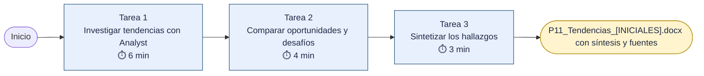
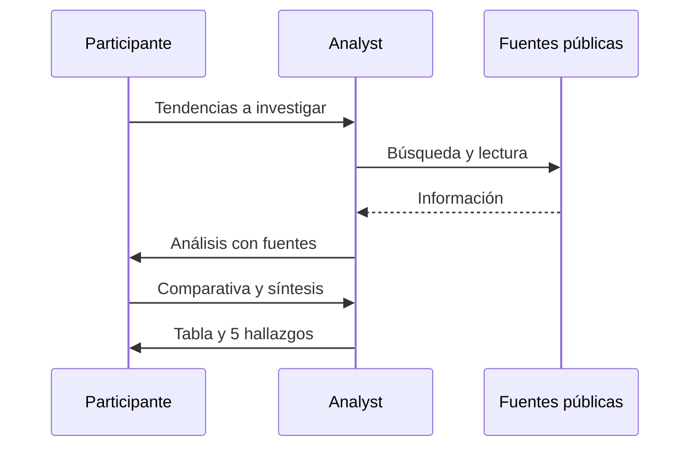

# Práctica 11. Investigación de tendencias de intralogística con el agente Analyst

**Capítulo 3. Análisis de Datos, Generación de Reportes e Insights en Excel**

---

# Metadatos

| Campo | Valor |
|------------|------------|
| Duración | 13 minutos |
| Complejidad | Intermedia |
| Nivel de Bloom | Evaluar |
| Tecnología Principal | Agente Analyst de Microsoft 365 Copilot |

---

# Descripción General

El área comercial necesita conocer las tendencias del sector intralogístico para orientar su planificación. El participante utilizará el agente Analyst para analizar información pública sobre automatización de almacenes, montacargas eléctricos y tecnologías de almacenamiento, generar un análisis comparativo de oportunidades y desafíos, y sintetizar los hallazgos relevantes para Jungheinrich.

---

# Objetivos de Aprendizaje

Al finalizar la práctica, el participante será capaz de:

- Utilizar el agente Analyst para investigar información pública de un sector.
- Obtener un análisis comparativo de tendencias, oportunidades y desafíos.
- Sintetizar hallazgos aplicables a las actividades comerciales y operativas.
- Verificar las fuentes que respaldan el análisis.

---

# Objetivo Visual

El siguiente diagrama resume las tareas de la práctica, su duración y el resultado que se obtiene.



Cómo trabaja el agente Analyst:



---

# Prerrequisitos

## Conocimientos

- Conocimientos básicos de correo electrónico, calendario, documentos y herramientas de colaboración de Microsoft 365.
- Experiencia en actividades como envío de correos, seguimiento de clientes o actividades, elaboración de reportes, coordinación entre áreas o actualización de archivos.
- Conocimiento de las políticas internas de seguridad, confidencialidad y manejo de información de la organización.
- No se requiere experiencia previa en desarrollo, programación o automatización.

## Accesos Requeridos

- Cuenta de Microsoft 365 con licencia de Microsoft 365 Copilot Premium asignada.
- Acceso a OneDrive con la carpeta `Laboratorio_Copilot_JUN` creada (ver [Setup Guide](../Setup_Guide.md)).

---

# Tabla de Ayuda

Utilice esta información durante el desarrollo de la práctica.

| Elemento | Valor |
|------------|------------|
| Entorno | Microsoft 365 del curso |
| URL | [https://m365.cloud.microsoft](https://m365.cloud.microsoft) |
| Usuario | Cuenta corporativa asignada al participante |
| Contraseña | Proporcionada por el instructor por el canal autorizado |
| Carpeta de trabajo | `OneDrive > Laboratorio_Copilot_JUN` |

---

# Entorno de Laboratorio

| Componente | Versión | Uso | Fuente Oficial |
|------------|------------|------------|------------|
| Agente Analyst | Servicio administrado | Análisis de datos e investigación | https://learn.microsoft.com/es-es/copilot/microsoft-365/ |
| Microsoft 365 Copilot (licencia Premium) | Servicio administrado | Chat y asistente en las aplicaciones de Microsoft 365 | https://learn.microsoft.com/es-es/copilot/microsoft-365/ |
| Microsoft Word | Microsoft 365 (escritorio o web) | Redacción y edición con Copilot | https://support.microsoft.com/es-es/copilot-word |

> Microsoft 365 Copilot y sus agentes son servicios administrados que se actualizan de forma continua; los nombres de botones y menús pueden variar ligeramente respecto a esta guía.

---

# Recursos

Utilice los siguientes recursos durante el desarrollo de la práctica.

| Recurso | Descripción |
|------------|------------|
| Agente **Analyst** | Agente de razonamiento para análisis e investigación. |
| `P11_Tendencias_[INICIALES].docx` | Entregable de la práctica. |

## Archivos de la práctica

```text
Esta práctica no requiere archivos de entrada.
```

---

# Tarea 1. Investigar tendencias con Analyst (6 min)

## Objetivo

Obtener un análisis de tres tendencias del sector con sus fuentes.

## Instrucciones

### Paso 1

En Copilot, seleccionar **Agentes**, abrir **Analyst** y verificar que la búsqueda web esté permitida.

### Paso 2

Enviar:

```text
Investiga con fuentes públicas recientes las tendencias del sector intralogístico en: 1) automatización de almacenes, 2) montacargas eléctricos y baterías de litio, 3) tecnologías de almacenamiento.
Para cada tendencia indica: descripción, impulsores, impacto en clientes industriales de México y fuentes consultadas.
```

Analyst puede tardar entre 1 y 3 minutos; mientras razona, muestra los pasos que sigue.

---

# Tarea 2. Comparar oportunidades y desafíos (4 min)

## Objetivo

Tener una tabla comparativa de oportunidades y desafíos por tendencia.

## Instrucciones

### Paso 1

Enviar:

```text
Construye una tabla comparativa con las tres tendencias: oportunidad comercial, desafío principal, nivel de madurez (bajo, medio, alto) y horizonte de adopción.
```

### Paso 2

Abrir dos de las fuentes citadas y comprobar que respaldan lo que afirma la tabla.

---

# Tarea 3. Sintetizar los hallazgos (3 min)

## Objetivo

Tener guardado `P11_Tendencias_[INICIALES].docx` con la síntesis y las fuentes.

## Instrucciones

### Paso 1

Enviar:

```text
Sintetiza en 5 viñetas los hallazgos más relevantes para las áreas comercial y de servicio de un proveedor de soluciones intralogísticas, e incluye las fuentes.
```

### Paso 2

Copiar la tabla y la síntesis a un documento de Word y guardarlo como `P11_Tendencias_[INICIALES].docx` en `OneDrive > Laboratorio_Copilot_JUN > Entregables`.

---

# Validación y Pruebas

Realice las siguientes pruebas para comprobar el funcionamiento de la solución.

| Caso | Acción o Prompt | Resultado Esperado |
|------------|------------|------------|
| Caso 1 | Prompt de investigación | Tres tendencias con fuentes |
| Caso 2 | Tabla comparativa | Oportunidad, desafío, madurez y horizonte por tendencia |
| Caso 3 | Revisión de fuentes | Las fuentes abiertas respaldan la información |
| Caso adversarial | Pedir la participación de mercado exacta de Jungheinrich en México en 2026 | Analyst indica que no encontró un dato confiable o lo marca como estimación |

---

# Resultado Esperado

Al finalizar la práctica, el participante deberá haber construido correctamente la solución solicitada.

- Análisis de tendencias con fuentes.
- Tabla comparativa de oportunidades y desafíos.
- Síntesis aplicable al negocio.

## Imagen del Resultado Final

Agregar una captura de pantalla del resultado final esperado.

```markdown
../images/p11-resultado-final.png
```

---

# Solución de Problemas

## Problema 1: Analyst no está disponible

### Síntomas

El agente no aparece.

### Causa

El agente no está habilitado en el inquilino.

### Solución

1. Buscarlo en **Agentes > Todos los agentes**.
2. Informar al instructor.
3. Como alternativa, usar Copilot Chat en modo **Web** con el mismo prompt.

---

## Problema 2: Respuestas sin fuentes

### Síntomas

El análisis no muestra referencias.

### Causa

La búsqueda web no está habilitada o el prompt no las solicita.

### Solución

1. Agregar "incluye las fuentes con vínculo" al prompt.
2. Verificar la opción de búsqueda web.

---

# Limpieza

1. Conservar los entregables en `OneDrive > Laboratorio_Copilot_JUN > Entregables`; se reutilizan en prácticas posteriores.
2. No compartir los archivos de la práctica fuera del grupo del curso.
3. Cerrar las conversaciones de Copilot que contengan información de la práctica si se trabaja en un equipo compartido.

---

# Resumen

Durante esta práctica se realizó:

- Se investigaron tendencias con un agente de razonamiento.
- Se compararon oportunidades y desafíos.
- Se verificaron fuentes.

Como resultado se obtuvo:

- Documento de tendencias con fuentes verificadas.

---

# Recursos Opcionales

- [Documentación de Microsoft 365 Copilot](https://learn.microsoft.com/es-es/copilot/microsoft-365/)
- [Agentes de Microsoft 365 Copilot](https://learn.microsoft.com/es-es/microsoft-365-copilot/extensibility/)

---

[⬅ Anterior: Práctica 10](../Capitulo03/README_Practica10.md) | [Inicio](../README.md) | [Siguiente: Práctica 12 ➡](../Capitulo04/README_Practica12.md)
