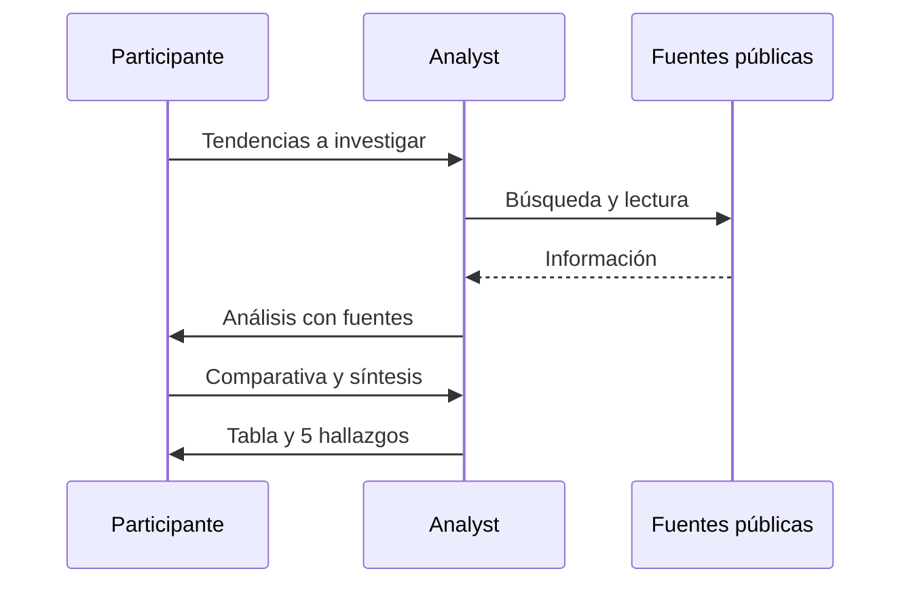

# Práctica 11. Investigación de tendencias de intralogística con el agente Analyst

## Objetivo de la práctica:

Al finalizar la práctica, serás capaz de:

- Utilizar el agente Analyst para investigar información pública de un sector.
- Obtener un análisis comparativo de tendencias, oportunidades y desafíos.
- Sintetizar hallazgos aplicables a las actividades comerciales y operativas.
- Verificar las fuentes que respaldan el análisis.

## Objetivo Visual

El siguiente diagrama resume las actividades a realizar.


Cómo trabaja el agente Analyst:



## Duración aproximada:

- 13 minutos.

## Tabla de ayuda:

Utiliza esta información durante el desarrollo de la práctica.

| Elemento | Valor |
|------------|------------|
| Entorno | Microsoft 365 del curso |
| URL | [https://m365.cloud.microsoft](https://m365.cloud.microsoft) |
| Usuario | Cuenta corporativa asignada al participante |
| Contraseña | Proporcionada por el instructor por el canal autorizado |
| Carpeta de trabajo | `OneDrive > Laboratorio_Copilot_JUN` |

## Entorno de laboratorio

| Componente | Versión | Uso | Fuente oficial |
|------------|------------|------------|------------|
| Agente Analyst | Servicio administrado | Análisis de datos e investigación | https://learn.microsoft.com/es-es/copilot/microsoft-365/ |
| Microsoft 365 Copilot (licencia Premium) | Servicio administrado | Chat y asistente en las aplicaciones de Microsoft 365 | https://learn.microsoft.com/es-es/copilot/microsoft-365/ |
| Microsoft Word | Microsoft 365 (escritorio o web) | Redacción y edición con Copilot | https://support.microsoft.com/es-es/copilot-word |

> Microsoft 365 Copilot y sus agentes son servicios administrados que se actualizan de forma continua; los nombres de botones y menús pueden variar ligeramente respecto a esta guía.

## Recursos

| Recurso | Descripción |
|------------|------------|
| Agente **Analyst** | Agente de razonamiento para análisis e investigación. |
| `P11_Tendencias_[INICIALES].docx` | Entregable de la práctica. |

## Instrucciones

### Tarea 1. Investigar tendencias con Analyst (6 min)

**Objetivo de la tarea:** Obtener un análisis de tres tendencias del sector con sus fuentes.

Paso 1. En Copilot, seleccionar **Agentes**, abrir **Analyst** y verificar que la búsqueda web esté permitida.

Paso 2. Enviar:

```text
Investiga con fuentes públicas recientes las tendencias del sector intralogístico en: 1) automatización de almacenes, 2) montacargas eléctricos y baterías de litio, 3) tecnologías de almacenamiento.
Para cada tendencia indica: descripción, impulsores, impacto en clientes industriales de México y fuentes consultadas.
```

Analyst puede tardar entre 1 y 3 minutos; mientras razona, muestra los pasos que sigue.

### Tarea 2. Comparar oportunidades y desafíos (4 min)

**Objetivo de la tarea:** Tener una tabla comparativa de oportunidades y desafíos por tendencia.

Paso 1. Enviar:

```text
Construye una tabla comparativa con las tres tendencias: oportunidad comercial, desafío principal, nivel de madurez (bajo, medio, alto) y horizonte de adopción.
```

Paso 2. Abrir dos de las fuentes citadas y comprobar que respaldan lo que afirma la tabla.

### Tarea 3. Sintetizar los hallazgos (3 min)

**Objetivo de la tarea:** Tener guardado `P11_Tendencias_[INICIALES].docx` con la síntesis y las fuentes.

Paso 1. Enviar:

```text
Sintetiza en 5 viñetas los hallazgos más relevantes para las áreas comercial y de servicio de un proveedor de soluciones intralogísticas, e incluye las fuentes.
```

Paso 2. Copiar la tabla y la síntesis a un documento de Word y guardarlo como `P11_Tendencias_[INICIALES].docx` en `OneDrive > Laboratorio_Copilot_JUN > Entregables`.

### Resultado esperado

Al finalizar la práctica deberás contar con:

- Análisis de tendencias con fuentes.
- Tabla comparativa de oportunidades y desafíos.
- Síntesis aplicable al negocio.

<!-- Agregar captura del resultado esperado: ../images/p11-resultado.png -->

## Resumen

Durante esta práctica se realizó:

- Se investigaron tendencias con un agente de razonamiento.
- Se compararon oportunidades y desafíos.
- Se verificaron fuentes.

Como resultado se obtuvo:

- Documento de tendencias con fuentes verificadas.

## Recursos opcionales

- [Documentación de Microsoft 365 Copilot](https://learn.microsoft.com/es-es/copilot/microsoft-365/)
- [Agentes de Microsoft 365 Copilot](https://learn.microsoft.com/es-es/microsoft-365-copilot/extensibility/)

---

[⬅ Anterior: Práctica 10](../Capitulo03/README_Practica10.md) | [Inicio](../README.md) | [Siguiente: Práctica 12 ➡](../Capitulo04/README_Practica12.md)
