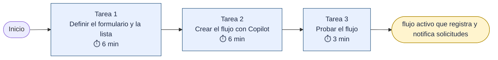
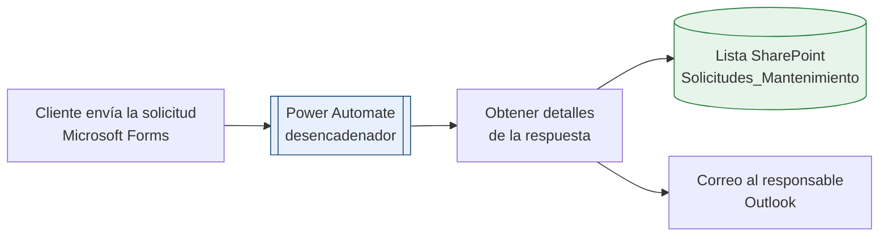

# Práctica 12. Automatización del registro de solicitudes de mantenimiento

## Objetivo de la práctica:

Al finalizar la práctica, serás capaz de:

- Definir los campos para recopilar una solicitud de mantenimiento.
- Crear un flujo de nube con Copilot en Power Automate a partir de una descripción.
- Registrar automáticamente las respuestas en SharePoint y enviar una notificación.
- Probar el flujo con una solicitud ficticia.

## Objetivo Visual

El siguiente diagrama resume las actividades a realizar.



Flujo de la información durante la práctica:



## Duración aproximada:

- 15 minutos.

## Tabla de ayuda:

Utiliza esta información durante el desarrollo de la práctica.

| Elemento | Valor |
|------------|------------|
| Entorno | Microsoft 365 del curso |
| URL | [https://m365.cloud.microsoft](https://m365.cloud.microsoft) |
| Usuario | Cuenta corporativa asignada al participante |
| Contraseña | Proporcionada por el instructor por el canal autorizado |
| Carpeta de trabajo | `OneDrive > Laboratorio_Copilot_JUN` |
| Power Automate | [https://make.powerautomate.com](https://make.powerautomate.com) |
| Microsoft Forms | [https://forms.office.com](https://forms.office.com) |
| Sitio de SharePoint | Proporcionado por el instructor: `Laboratorio Copilot JUN` |

## Entorno de laboratorio

| Componente | Versión | Uso | Fuente oficial |
|------------|------------|------------|------------|
| Power Automate | Servicio administrado | Diseño de flujos con Copilot | https://learn.microsoft.com/es-es/power-automate/ |
| Microsoft Forms | Servicio administrado | Formulario de solicitudes | https://support.microsoft.com/es-es/forms |
| SharePoint Online | Servicio administrado | Lista de registro de solicitudes y fuentes de conocimiento | https://learn.microsoft.com/es-es/sharepoint/ |
| Microsoft Outlook | Nuevo Outlook o Outlook en la web | Redacción y coaching de correos con Copilot | https://support.microsoft.com/es-es/copilot-outlook |

> Microsoft 365 Copilot y sus agentes son servicios administrados que se actualizan de forma continua; los nombres de botones y menús pueden variar ligeramente respecto a esta guía.

## Recursos

| Recurso | Descripción |
|------------|------------|
| Formulario `Solicitud de mantenimiento [INICIALES]` | Se crea en la Tarea 1. |
| Lista `Solicitudes_Mantenimiento_[INICIALES]` | Se crea en la Tarea 1 en el sitio del curso. |
| Flujo `Registro de solicitudes [INICIALES]` | Se crea en la Tarea 2 y se amplía en la Práctica 13. |

## Instrucciones

### Tarea 1. Definir el formulario y la lista (6 min)

**Objetivo de la tarea:** Tener el formulario con 5 preguntas y la lista de SharePoint con las mismas columnas.

Paso 1. Abrir [https://forms.office.com](https://forms.office.com), seleccionar **Nuevo formulario** y titularlo `Solicitud de mantenimiento [INICIALES]`.

Paso 2. Agregar las preguntas: **Cliente** (texto), **Correo de contacto** (texto), **Tipo de equipo** (opción: Montacargas eléctrico, Apilador, Transpaleta eléctrica, Retráctil), **Descripción de la falla** (texto largo) y **Prioridad** (opción: Alta, Media, Baja). Marcar todas como obligatorias.

Paso 3. Abrir el sitio de SharePoint del curso, seleccionar **Nuevo > Lista > Lista en blanco**, nombrarla `Solicitudes_Mantenimiento_[INICIALES]` y agregar columnas de una línea de texto: Correo, TipoEquipo, Descripcion, Prioridad. Usar la columna **Título** para el cliente.

### Tarea 2. Crear el flujo con Copilot (6 min)

**Objetivo de la tarea:** Tener el flujo `Registro de solicitudes [INICIALES]` creado con desencadenador y acciones configurados.

Paso 1. Abrir [https://make.powerautomate.com](https://make.powerautomate.com), en la página de inicio escribir en el cuadro de Copilot la descripción y seleccionar **Generar**:

```text
Cuando se envíe una nueva respuesta en el formulario Solicitud de mantenimiento [INICIALES], obtener los detalles de la respuesta, crear un elemento en la lista Solicitudes_Mantenimiento_[INICIALES] de SharePoint y enviar un correo al responsable de seguimiento con el cliente, el tipo de equipo y la prioridad.
```

Paso 2. Revisar la propuesta (desencadenador **Cuando se envía una respuesta nueva**, acciones **Obtener los detalles de la respuesta**, **Crear elemento** y **Enviar un correo electrónico (V2)**) y seleccionar **Siguiente**. Confirmar las conexiones de Forms, SharePoint y Outlook.

Paso 3. En cada acción, seleccionar el formulario, el sitio y la lista; asignar cada pregunta a su columna y, en **Para** del correo, escribir su propia dirección. Guardar con el nombre `Registro de solicitudes [INICIALES]`.

### Tarea 3. Probar el flujo (3 min)

**Objetivo de la tarea:** Comprobar que una respuesta de prueba crea un elemento en la lista y un correo.

Paso 1. Abrir el formulario en **Vista previa** y enviar: Cliente `Distribuidora del Bajío`, Tipo de equipo `Apilador`, Prioridad `Media`, Descripción `Ruido en el mástil al elevar carga`.

Paso 2. En Power Automate, abrir **Historial de ejecuciones** y comprobar que la ejecución terminó como **Correcta**. Verificar el nuevo elemento en la lista y el correo recibido.

### Resultado esperado

Al finalizar la práctica deberás contar con:

- Formulario y lista de registro creados.
- Flujo generado con Copilot y configurado.
- Prueba exitosa con registro y notificación.

<!-- Agregar captura del resultado esperado: ../images/p12-resultado.png -->

## Resumen

Durante esta práctica se realizó:

- Se definieron los datos de una solicitud.
- Se generó un flujo con Copilot.
- Se probó el flujo con una solicitud ficticia.

Como resultado se obtuvo:

- Registro automático de solicitudes en SharePoint.
- Notificación automática al responsable.

## Recursos opcionales

- [Copilot en Power Automate](https://learn.microsoft.com/es-es/power-automate/get-started-with-copilot)
- [Microsoft Forms en Power Automate](https://learn.microsoft.com/es-es/power-automate/forms/overview)

---

[⬅ Anterior: Práctica 11](../Capitulo03/README_Practica11.md) | [Inicio](../README.md) | [Siguiente: Práctica 13 ➡](../Capitulo04/README_Practica13.md)
