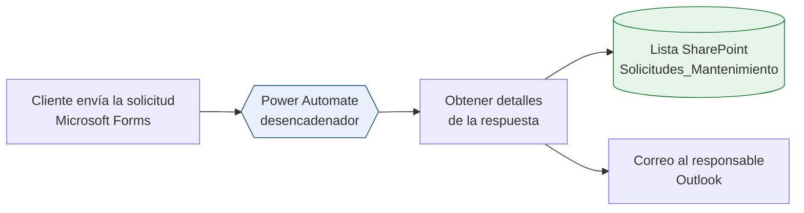

# Práctica 12. Automatización del registro de solicitudes de mantenimiento

**Capítulo 4. Automatización de Tareas Diarias con Power Automate & Copilot**

---

# Metadatos

| Campo | Valor |
|------------|------------|
| Duración | 15 minutos |
| Complejidad | Intermedia |
| Nivel de Bloom | Aplicar |
| Tecnología Principal | Power Automate con Copilot, Microsoft Forms y SharePoint |

---

# Descripción General

Jungheinrich (escenario ficticio) recibe solicitudes de mantenimiento de montacargas de distintos clientes por diferentes canales. El participante definirá los campos de un formulario de Microsoft Forms y, mediante instrucciones en lenguaje natural, utilizará Copilot en Power Automate para generar un flujo que registre cada solicitud en una lista de SharePoint y notifique al responsable del seguimiento.

---

# Objetivos de Aprendizaje

Al finalizar la práctica, el participante será capaz de:

- Definir los campos para recopilar una solicitud de mantenimiento.
- Crear un flujo de nube con Copilot en Power Automate a partir de una descripción.
- Registrar automáticamente las respuestas en SharePoint y enviar una notificación.
- Probar el flujo con una solicitud ficticia.

---

# Objetivo Visual

El siguiente diagrama resume las tareas de la práctica, su duración y el resultado que se obtiene.


El siguiente diagrama muestra cómo fluye la información durante la práctica.



---

# Prerrequisitos

## Conocimientos

- Conocimientos básicos de correo electrónico, calendario, documentos y herramientas de colaboración de Microsoft 365.
- Experiencia en actividades como envío de correos, seguimiento de clientes o actividades, elaboración de reportes, coordinación entre áreas o actualización de archivos.
- Conocimiento de las políticas internas de seguridad, confidencialidad y manejo de información de la organización.
- No se requiere experiencia previa en desarrollo, programación o automatización.

## Accesos Requeridos

- Cuenta de Microsoft 365 con licencia de Microsoft 365 Copilot Premium asignada.
- Acceso a OneDrive con la carpeta `Laboratorio_Copilot_JUN` creada (ver [Setup Guide](../Setup_Guide.md)).
- Permisos para crear formularios en Microsoft Forms y flujos de nube en Power Automate.
- Permisos de edición en el sitio de SharePoint `Laboratorio Copilot JUN` (ver [Setup Guide](../Setup_Guide.md)).

---

# Tabla de Ayuda

Utilice esta información durante el desarrollo de la práctica.

| Elemento | Valor |
|------------|------------|
| Entorno | Microsoft 365 del curso |
| URL | [https://m365.cloud.microsoft](https://m365.cloud.microsoft) |
| Usuario | Cuenta corporativa asignada al participante |
| Contraseña | Proporcionada por el instructor por el canal autorizado |
| Carpeta de trabajo | `OneDrive > Laboratorio_Copilot_JUN` |
| Power Automate | [https://make.powerautomate.com](https://make.powerautomate.com) |
| Microsoft Forms | [https://forms.office.com](https://forms.office.com) |
| Sitio de SharePoint | Proporcionado por el instructor: `Laboratorio Copilot JUN` |

---

# Entorno de Laboratorio

| Componente | Versión | Uso | Fuente Oficial |
|------------|------------|------------|------------|
| Power Automate | Servicio administrado | Diseño de flujos con Copilot | https://learn.microsoft.com/es-es/power-automate/ |
| Microsoft Forms | Servicio administrado | Formulario de solicitudes | https://support.microsoft.com/es-es/forms |
| SharePoint Online | Servicio administrado | Lista de registro de solicitudes y fuentes de conocimiento | https://learn.microsoft.com/es-es/sharepoint/ |
| Microsoft Outlook | Nuevo Outlook o Outlook en la web | Redacción y coaching de correos con Copilot | https://support.microsoft.com/es-es/copilot-outlook |

> Microsoft 365 Copilot y sus agentes son servicios administrados que se actualizan de forma continua; los nombres de botones y menús pueden variar ligeramente respecto a esta guía.

---

# Recursos

Utilice los siguientes recursos durante el desarrollo de la práctica.

| Recurso | Descripción |
|------------|------------|
| Formulario `Solicitud de mantenimiento [INICIALES]` | Se crea en la Tarea 1. |
| Lista `Solicitudes_Mantenimiento_[INICIALES]` | Se crea en la Tarea 1 en el sitio del curso. |
| Flujo `Registro de solicitudes [INICIALES]` | Se crea en la Tarea 2 y se amplía en la Práctica 13. |

## Archivos de la práctica

```text
Esta práctica no requiere archivos de entrada.
```

---

# Tarea 1. Definir el formulario y la lista (6 min)

## Objetivo

Tener el formulario con 5 preguntas y la lista de SharePoint con las mismas columnas.

## Instrucciones

### Paso 1

Abrir [https://forms.office.com](https://forms.office.com), seleccionar **Nuevo formulario** y titularlo `Solicitud de mantenimiento [INICIALES]`.

### Paso 2

Agregar las preguntas: **Cliente** (texto), **Correo de contacto** (texto), **Tipo de equipo** (opción: Montacargas eléctrico, Apilador, Transpaleta eléctrica, Retráctil), **Descripción de la falla** (texto largo) y **Prioridad** (opción: Alta, Media, Baja). Marcar todas como obligatorias.

### Paso 3

Abrir el sitio de SharePoint del curso, seleccionar **Nuevo > Lista > Lista en blanco**, nombrarla `Solicitudes_Mantenimiento_[INICIALES]` y agregar columnas de una línea de texto: Correo, TipoEquipo, Descripcion, Prioridad. Usar la columna **Título** para el cliente.

---

# Tarea 2. Crear el flujo con Copilot (6 min)

## Objetivo

Tener el flujo `Registro de solicitudes [INICIALES]` creado con desencadenador y acciones configurados.

## Instrucciones

### Paso 1

Abrir [https://make.powerautomate.com](https://make.powerautomate.com), en la página de inicio escribir en el cuadro de Copilot la descripción y seleccionar **Generar**:

```text
Cuando se envíe una nueva respuesta en el formulario Solicitud de mantenimiento [INICIALES], obtener los detalles de la respuesta, crear un elemento en la lista Solicitudes_Mantenimiento_[INICIALES] de SharePoint y enviar un correo al responsable de seguimiento con el cliente, el tipo de equipo y la prioridad.
```

### Paso 2

Revisar la propuesta (desencadenador **Cuando se envía una respuesta nueva**, acciones **Obtener los detalles de la respuesta**, **Crear elemento** y **Enviar un correo electrónico (V2)**) y seleccionar **Siguiente**. Confirmar las conexiones de Forms, SharePoint y Outlook.

### Paso 3

En cada acción, seleccionar el formulario, el sitio y la lista; asignar cada pregunta a su columna y, en **Para** del correo, escribir su propia dirección. Guardar con el nombre `Registro de solicitudes [INICIALES]`.

---

# Tarea 3. Probar el flujo (3 min)

## Objetivo

Comprobar que una respuesta de prueba crea un elemento en la lista y un correo.

## Instrucciones

### Paso 1

Abrir el formulario en **Vista previa** y enviar: Cliente `Distribuidora del Bajío`, Tipo de equipo `Apilador`, Prioridad `Media`, Descripción `Ruido en el mástil al elevar carga`.

### Paso 2

En Power Automate, abrir **Historial de ejecuciones** y comprobar que la ejecución terminó como **Correcta**. Verificar el nuevo elemento en la lista y el correo recibido.

---

# Validación y Pruebas

Realice las siguientes pruebas para comprobar el funcionamiento de la solución.

| Caso | Acción o Prompt | Resultado Esperado |
|------------|------------|------------|
| Caso 1 | Enviar respuesta de prioridad Media | Elemento creado en la lista con todos los campos |
| Caso 2 | Revisar el correo | Correo con cliente, equipo y prioridad |
| Caso 3 | Historial de ejecuciones | Ejecución marcada como Correcta |
| Caso adversarial | Enviar el formulario sin prioridad | El formulario no permite enviarlo porque la pregunta es obligatoria |

---

# Resultado Esperado

Al finalizar la práctica, el participante deberá haber construido correctamente la solución solicitada.

- Formulario y lista de registro creados.
- Flujo generado con Copilot y configurado.
- Prueba exitosa con registro y notificación.

## Imagen del Resultado Final

Agregar una captura de pantalla del resultado final esperado.

```markdown
../images/p12-resultado-final.png
```

---

# Solución de Problemas

## Problema 1: El formulario no aparece en el flujo

### Síntomas

La lista de formularios está vacía.

### Causa

El formulario se creó con otra cuenta o en un grupo.

### Solución

1. Comprobar la cuenta en Forms.
2. Pegar el identificador del formulario en el campo **Id. de formulario** como valor personalizado.

---

## Problema 2: La ejecución falla en Crear elemento

### Síntomas

Error de columna o de permisos.

### Causa

La columna no existe o el participante no tiene permisos en el sitio.

### Solución

1. Revisar los nombres de columnas.
2. Solicitar al instructor permisos de edición en el sitio.

---

# Limpieza

1. Mantener el flujo **activado**: se amplía en la Práctica 13.
2. Conservar el formulario y la lista.
3. No compartir el formulario fuera del grupo del curso.

---

# Resumen

Durante esta práctica se realizó:

- Se definieron los datos de una solicitud.
- Se generó un flujo con Copilot.
- Se probó el flujo con una solicitud ficticia.

Como resultado se obtuvo:

- Registro automático de solicitudes en SharePoint.
- Notificación automática al responsable.

---

# Recursos Opcionales

- [Copilot en Power Automate](https://learn.microsoft.com/es-es/power-automate/get-started-with-copilot)
- [Microsoft Forms en Power Automate](https://learn.microsoft.com/es-es/power-automate/forms/overview)

---

[⬅ Anterior: Práctica 11](../Capitulo03/README_Practica11.md) | [Inicio](../README.md) | [Siguiente: Práctica 13 ➡](../Capitulo04/README_Practica13.md)
