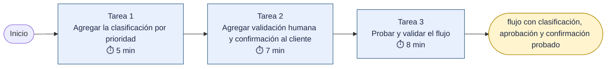
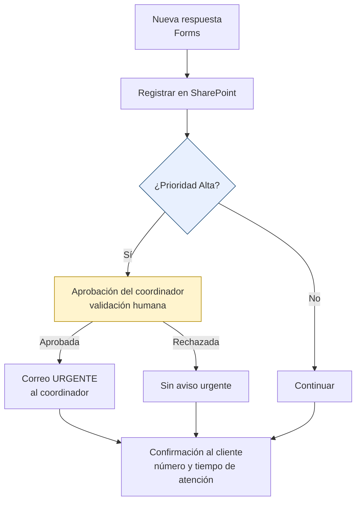

# Práctica 13. Clasificación y seguimiento automatizado de solicitudes de servicio

**Capítulo 4. Automatización de Tareas Diarias con Power Automate & Copilot**

---

# Metadatos

| Campo | Valor |
|------------|------------|
| Duración | 20 minutos |
| Complejidad | Avanzada |
| Nivel de Bloom | Crear |
| Tecnología Principal | Power Automate con Copilot |

---

# Descripción General

El flujo de la Práctica 12 registra todas las solicitudes por igual. El participante lo ampliará para clasificar por prioridad, notificar las solicitudes urgentes al coordinador, enviar una confirmación al cliente y agregar un punto de validación humana antes de comunicar las solicitudes urgentes. Probará el flujo con solicitudes de distinta prioridad y revisará las acciones ejecutadas.

---

# Objetivos de Aprendizaje

Al finalizar la práctica, el participante será capaz de:

- Agregar condiciones a un flujo para clasificar solicitudes por prioridad.
- Configurar notificaciones específicas y confirmaciones al cliente.
- Incorporar un punto de aprobación como validación humana.
- Probar el flujo y diagnosticar errores en el historial de ejecuciones.

---

# Objetivo Visual

El siguiente diagrama resume las tareas de la práctica, su duración y el resultado que se obtiene.



El siguiente diagrama muestra cómo fluye la información durante la práctica.



---

# Prerrequisitos

## Conocimientos

- Conocimientos básicos de correo electrónico, calendario, documentos y herramientas de colaboración de Microsoft 365.
- Experiencia en actividades como envío de correos, seguimiento de clientes o actividades, elaboración de reportes, coordinación entre áreas o actualización de archivos.
- Conocimiento de las políticas internas de seguridad, confidencialidad y manejo de información de la organización.
- No se requiere experiencia previa en desarrollo, programación o automatización.

## Accesos Requeridos

- Cuenta de Microsoft 365 con licencia de Microsoft 365 Copilot Premium asignada.
- Acceso a OneDrive con la carpeta `Laboratorio_Copilot_JUN` creada (ver [Setup Guide](../Setup_Guide.md)).
- Flujo `Registro de solicitudes [INICIALES]` de la Práctica 12.

---

# Tabla de Ayuda

Utilice esta información durante el desarrollo de la práctica.

| Elemento | Valor |
|------------|------------|
| Entorno | Microsoft 365 del curso |
| URL | [https://m365.cloud.microsoft](https://m365.cloud.microsoft) |
| Usuario | Cuenta corporativa asignada al participante |
| Contraseña | Proporcionada por el instructor por el canal autorizado |
| Carpeta de trabajo | `OneDrive > Laboratorio_Copilot_JUN` |
| Power Automate | [https://make.powerautomate.com](https://make.powerautomate.com) |

---

# Entorno de Laboratorio

| Componente | Versión | Uso | Fuente Oficial |
|------------|------------|------------|------------|
| Power Automate | Servicio administrado | Diseño de flujos con Copilot | https://learn.microsoft.com/es-es/power-automate/ |
| Microsoft Forms | Servicio administrado | Formulario de solicitudes | https://support.microsoft.com/es-es/forms |
| SharePoint Online | Servicio administrado | Lista de registro de solicitudes y fuentes de conocimiento | https://learn.microsoft.com/es-es/sharepoint/ |
| Microsoft Outlook | Nuevo Outlook o Outlook en la web | Redacción y coaching de correos con Copilot | https://support.microsoft.com/es-es/copilot-outlook |

> Microsoft 365 Copilot y sus agentes son servicios administrados que se actualizan de forma continua; los nombres de botones y menús pueden variar ligeramente respecto a esta guía.

---

# Recursos

Utilice los siguientes recursos durante el desarrollo de la práctica.

| Recurso | Descripción |
|------------|------------|
| Flujo `Registro de solicitudes [INICIALES]` | Flujo de la Práctica 12. |
| Lista `Solicitudes_Mantenimiento_[INICIALES]` | Lista de registro. |

## Archivos de la práctica

```text
Esta práctica no requiere archivos de entrada.
```

---

# Tarea 1. Agregar la clasificación por prioridad (5 min)

## Objetivo

Tener una condición que separe las solicitudes de prioridad Alta.

## Instrucciones

### Paso 1

Abrir el flujo `Registro de solicitudes [INICIALES]` en modo **Editar** y abrir el panel de **Copilot**.

### Paso 2

Escribir en Copilot:

```text
Después de crear el elemento en SharePoint, agrega una condición: si la Prioridad es igual a Alta, envía un correo al coordinador con el asunto URGENTE y los datos de la solicitud; si no, no hagas nada adicional.
```

### Paso 3

Revisar que la condición compare el campo **Prioridad** de la respuesta con el texto `Alta` y que el correo use su propia dirección. Guardar.

---

# Tarea 2. Agregar validación humana y confirmación al cliente (7 min)

## Objetivo

Tener una aprobación antes del aviso urgente y un correo de confirmación al cliente.

## Instrucciones

### Paso 1

Escribir en Copilot:

```text
En la rama Sí de la condición, antes del correo urgente, agrega una aprobación de tipo Aprobar/Rechazar dirigida al coordinador para confirmar que la solicitud es realmente urgente. Envía el correo URGENTE solo si se aprueba.
```

### Paso 2

Escribir en Copilot:

```text
Al final del flujo, envía un correo de confirmación al Correo de contacto del formulario con el número de elemento de SharePoint como número de solicitud y el tiempo de atención según la prioridad: Alta 4 horas, Media 24 horas, Baja 72 horas.
```

### Paso 3

Revisar cada acción generada, asignar su propia dirección como coordinador y guardar.

---

# Tarea 3. Probar y validar el flujo (8 min)

## Objetivo

Tener tres ejecuciones correctas con prioridades distintas y una aprobación respondida.

## Instrucciones

### Paso 1

Enviar tres respuestas de prueba en el formulario: una de prioridad **Alta**, una **Media** y una **Baja**, usando su propio correo como contacto.

### Paso 2

Abrir el correo o Teams y responder la aprobación de la solicitud Alta con **Aprobar**.

### Paso 3

En **Historial de ejecuciones**, abrir cada ejecución y comprobar qué rama de la condición se ejecutó. Si alguna falló, abrir la acción en rojo y pedir a Copilot: `Explica este error y cómo corregirlo`.

### Paso 4

Anotar en la descripción del flujo qué pasaría si nadie responde la aprobación y cuál es el riesgo de enviar comunicaciones sin supervisión.

---

# Validación y Pruebas

Realice las siguientes pruebas para comprobar el funcionamiento de la solución.

| Caso | Acción o Prompt | Resultado Esperado |
|------------|------------|------------|
| Caso 1 | Solicitud de prioridad Alta y aprobación | Aprobación recibida; al aprobar llega el correo URGENTE |
| Caso 2 | Solicitud de prioridad Media | Registro y confirmación al cliente con tiempo de 24 horas, sin aviso urgente |
| Caso 3 | Solicitud de prioridad Baja | Confirmación con tiempo de 72 horas |
| Caso adversarial | Solicitud Alta y rechazar la aprobación | No se envía el correo URGENTE; el cliente recibe solo la confirmación |

---

# Resultado Esperado

Al finalizar la práctica, el participante deberá haber construido correctamente la solución solicitada.

- Flujo con clasificación por prioridad.
- Validación humana antes de comunicaciones urgentes.
- Pruebas con tres prioridades revisadas en el historial.

## Imagen del Resultado Final

Agregar una captura de pantalla del resultado final esperado.

```markdown
../images/p13-resultado-final.png
```

---

# Solución de Problemas

## Problema 1: La condición siempre va por la rama No

### Síntomas

La solicitud Alta no genera aprobación.

### Causa

Se comparó con un valor distinto (espacios o mayúsculas) o con el campo equivocado.

### Solución

1. Abrir la condición y verificar el campo **Prioridad**.
2. Usar el texto exacto `Alta`.
3. Volver a probar.

---

## Problema 2: La aprobación no llega

### Síntomas

No aparece en correo ni en Teams.

### Causa

Se asignó a otra dirección o la ejecución sigue en espera.

### Solución

1. Revisar el campo **Asignado a**.
2. Abrir **Aprobaciones** en Teams.
3. Revisar la ejecución en curso en el historial.

---

# Limpieza

1. Conservar el flujo: se retoma en la Práctica 17.
2. Desactivar el flujo al terminar el curso para evitar notificaciones.
3. Eliminar las respuestas de prueba si el instructor lo indica.

---

# Resumen

Durante esta práctica se realizó:

- Se agregaron condiciones y notificaciones al flujo.
- Se incorporó una aprobación como validación humana.
- Se probaron escenarios con distintas prioridades.

Como resultado se obtuvo:

- Flujo de seguimiento automatizado y supervisado.
- Criterios de supervisión humana documentados.

---

# Recursos Opcionales

- [Copilot en Power Automate](https://learn.microsoft.com/es-es/power-automate/get-started-with-copilot)
- [Aprobaciones en Power Automate](https://learn.microsoft.com/es-es/power-automate/get-started-approvals)

---

[⬅ Anterior: Práctica 12](../Capitulo04/README_Practica12.md) | [Inicio](../README.md) | [Siguiente: Práctica 14 ➡](../Capitulo05/README_Practica14.md)
