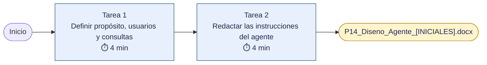
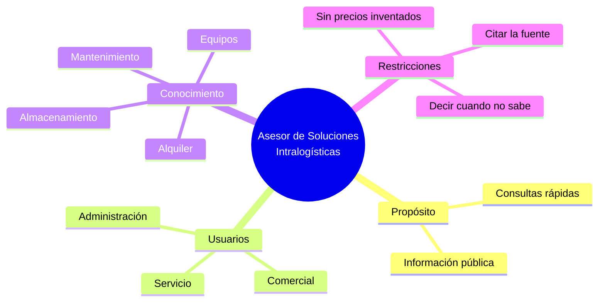

# Práctica 14. Diseño de un agente de consulta de soluciones intralogísticas

**Capítulo 5. Creación y Personalización de Agentes con Agent Builder**

---

# Metadatos

| Campo | Valor |
|------------|------------|
| Duración | 8 minutos |
| Complejidad | Intermedia |
| Nivel de Bloom | Crear |
| Tecnología Principal | Microsoft 365 Copilot (diseño de agentes) |

---

# Descripción General

Colaboradores de distintas áreas necesitan consultar rápidamente información pública sobre las soluciones de Jungheinrich: equipos de manipulación de materiales, almacenamiento, alquiler y mantenimiento. El participante diseñará el agente antes de construirlo: propósito, usuarios, consultas principales, instrucciones generales, tipo de respuesta y restricciones cuando no disponga de información.

---

# Objetivos de Aprendizaje

Al finalizar la práctica, el participante será capaz de:

- Definir propósito, usuarios y consultas principales de un agente.
- Redactar instrucciones de comportamiento con restricciones.
- Documentar el diseño del agente para su construcción.

---

# Objetivo Visual

El siguiente diagrama resume las tareas de la práctica, su duración y el resultado que se obtiene.



Mapa del diseño del agente:



---

# Prerrequisitos

## Conocimientos

- Conocimientos básicos de correo electrónico, calendario, documentos y herramientas de colaboración de Microsoft 365.
- Experiencia en actividades como envío de correos, seguimiento de clientes o actividades, elaboración de reportes, coordinación entre áreas o actualización de archivos.
- Conocimiento de las políticas internas de seguridad, confidencialidad y manejo de información de la organización.
- No se requiere experiencia previa en desarrollo, programación o automatización.

## Accesos Requeridos

- Cuenta de Microsoft 365 con licencia de Microsoft 365 Copilot Premium asignada.
- Acceso a OneDrive con la carpeta `Laboratorio_Copilot_JUN` creada (ver [Setup Guide](../Setup_Guide.md)).

---

# Tabla de Ayuda

Utilice esta información durante el desarrollo de la práctica.

| Elemento | Valor |
|------------|------------|
| Entorno | Microsoft 365 del curso |
| URL | [https://m365.cloud.microsoft](https://m365.cloud.microsoft) |
| Usuario | Cuenta corporativa asignada al participante |
| Contraseña | Proporcionada por el instructor por el canal autorizado |
| Carpeta de trabajo | `OneDrive > Laboratorio_Copilot_JUN` |

---

# Entorno de Laboratorio

| Componente | Versión | Uso | Fuente Oficial |
|------------|------------|------------|------------|
| Microsoft 365 Copilot (licencia Premium) | Servicio administrado | Chat y asistente en las aplicaciones de Microsoft 365 | https://learn.microsoft.com/es-es/copilot/microsoft-365/ |
| Microsoft Word | Microsoft 365 (escritorio o web) | Redacción y edición con Copilot | https://support.microsoft.com/es-es/copilot-word |

> Microsoft 365 Copilot y sus agentes son servicios administrados que se actualizan de forma continua; los nombres de botones y menús pueden variar ligeramente respecto a esta guía.

---

# Recursos

Utilice los siguientes recursos durante el desarrollo de la práctica.

| Recurso | Descripción |
|------------|------------|
| Sitio público de Jungheinrich | [https://www.jungheinrich.com](https://www.jungheinrich.com) (fuente que usará el agente). |
| `P14_Diseno_Agente_[INICIALES].docx` | Diseño del agente, se usa en la Práctica 15. |

## Archivos de la práctica

```text
Esta práctica no requiere archivos de entrada.
```

---

# Tarea 1. Definir propósito, usuarios y consultas (4 min)

## Objetivo

Tener la ficha del agente con propósito, usuarios y 6 consultas típicas.

## Instrucciones

### Paso 1

En Copilot Chat (modo **Trabajo**), enviar:

```text
Ayúdame a diseñar un agente llamado "Asesor de Soluciones Intralogísticas".
Usuarios: colaboradores comerciales, administrativos y de servicio.
Debe responder sobre equipos de manipulación de materiales, soluciones de almacenamiento, alquiler y servicios de mantenimiento con información pública del sitio de Jungheinrich.
Entrega una ficha con: propósito (2 líneas), usuarios, 6 consultas típicas y lo que el agente NO debe hacer.
```

---

# Tarea 2. Redactar las instrucciones del agente (4 min)

## Objetivo

Tener las instrucciones listas para pegarse en Agent Builder.

## Instrucciones

### Paso 1

Enviar:

```text
Redacta las instrucciones del agente en segunda persona, máximo 150 palabras: tono, formato de respuesta (viñetas y fuente consultada), cómo actuar cuando no encuentre información (decirlo y sugerir contactar al área correspondiente) y prohibiciones (no inventar precios, disponibilidad ni datos de clientes).
```

### Paso 2

Copiar la ficha y las instrucciones a Word y guardar como `P14_Diseno_Agente_[INICIALES].docx` en `OneDrive > Laboratorio_Copilot_JUN > Entregables`.

---

# Validación y Pruebas

Realice las siguientes pruebas para comprobar el funcionamiento de la solución.

| Caso | Acción o Prompt | Resultado Esperado |
|------------|------------|------------|
| Caso 1 | Prompt de ficha | Propósito, usuarios, 6 consultas y exclusiones |
| Caso 2 | Prompt de instrucciones | Instrucciones de máximo 150 palabras con restricciones |
| Caso 3 | Revisión del documento | Ficha e instrucciones en el mismo archivo |
| Caso adversarial | Pedir que el agente dé precios de lista | Las instrucciones lo prohíben explícitamente |

---

# Resultado Esperado

Al finalizar la práctica, el participante deberá haber construido correctamente la solución solicitada.

- Ficha de diseño del agente.
- Instrucciones con restricciones.
- Documento listo para la Práctica 15.

## Imagen del Resultado Final

Agregar una captura de pantalla del resultado final esperado.

```markdown
../images/p14-resultado-final.png
```

---

# Solución de Problemas

## Problema 1: Instrucciones demasiado largas

### Síntomas

Más de 150 palabras.

### Causa

El prompt no limitó la extensión o se agregaron detalles.

### Solución

1. Pedir "reduce a 150 palabras sin perder las restricciones".

---

## Problema 2: Consultas poco realistas

### Síntomas

Las consultas no corresponden a los usuarios.

### Causa

No se dio contexto de las áreas.

### Solución

1. Indicar ejemplos de consultas reales de su área y regenerar.

---

# Limpieza

1. Conservar los entregables en `OneDrive > Laboratorio_Copilot_JUN > Entregables`; se reutilizan en prácticas posteriores.
2. No compartir los archivos de la práctica fuera del grupo del curso.
3. Cerrar las conversaciones de Copilot que contengan información de la práctica si se trabaja en un equipo compartido.

---

# Resumen

Durante esta práctica se realizó:

- Se diseñó un agente antes de construirlo.
- Se redactaron instrucciones con restricciones.

Como resultado se obtuvo:

- Diseño documentado del agente.

---

# Recursos Opcionales

- [Agent Builder en Microsoft 365 Copilot](https://learn.microsoft.com/es-es/microsoft-365-copilot/extensibility/agent-builder)
- [Documentación de Microsoft 365 Copilot](https://learn.microsoft.com/es-es/copilot/microsoft-365/)

---

[⬅ Anterior: Práctica 13](../Capitulo04/README_Practica13.md) | [Inicio](../README.md) | [Siguiente: Práctica 15 ➡](../Capitulo05/README_Practica15.md)
