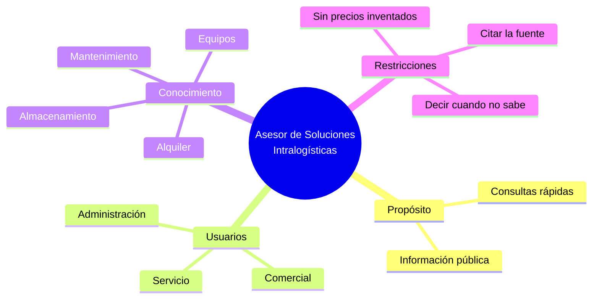

# Práctica 14. Diseño de un agente de consulta de soluciones intralogísticas

## Objetivo de la práctica:

Al finalizar la práctica, serás capaz de:

- Definir propósito, usuarios y consultas principales de un agente.
- Redactar instrucciones de comportamiento con restricciones.
- Documentar el diseño del agente para su construcción.

## Objetivo Visual

El siguiente diagrama resume las actividades a realizar.


Mapa del diseño del agente:



## Duración aproximada:

- 8 minutos.

## Tabla de ayuda:

Utiliza esta información durante el desarrollo de la práctica.

| Elemento | Valor |
|------------|------------|
| Entorno | Microsoft 365 del curso |
| URL | [https://m365.cloud.microsoft](https://m365.cloud.microsoft) |
| Usuario | Cuenta corporativa asignada al participante |
| Contraseña | Proporcionada por el instructor por el canal autorizado |
| Carpeta de trabajo | `OneDrive > Laboratorio_Copilot_JUN` |

## Entorno de laboratorio

| Componente | Versión | Uso | Fuente oficial |
|------------|------------|------------|------------|
| Microsoft 365 Copilot (licencia Premium) | Servicio administrado | Chat y asistente en las aplicaciones de Microsoft 365 | https://learn.microsoft.com/es-es/copilot/microsoft-365/ |
| Microsoft Word | Microsoft 365 (escritorio o web) | Redacción y edición con Copilot | https://support.microsoft.com/es-es/copilot-word |

> Microsoft 365 Copilot y sus agentes son servicios administrados que se actualizan de forma continua; los nombres de botones y menús pueden variar ligeramente respecto a esta guía.

## Recursos

| Recurso | Descripción |
|------------|------------|
| Sitio público de Jungheinrich | [https://www.jungheinrich.com](https://www.jungheinrich.com) (fuente que usará el agente). |
| `P14_Diseno_Agente_[INICIALES].docx` | Diseño del agente, se usa en la Práctica 15. |

## Instrucciones

### Tarea 1. Definir propósito, usuarios y consultas (4 min)

**Objetivo de la tarea:** Tener la ficha del agente con propósito, usuarios y 6 consultas típicas.

Paso 1. En Copilot Chat (modo **Trabajo**), enviar:

```text
Ayúdame a diseñar un agente llamado "Asesor de Soluciones Intralogísticas".
Usuarios: colaboradores comerciales, administrativos y de servicio.
Debe responder sobre equipos de manipulación de materiales, soluciones de almacenamiento, alquiler y servicios de mantenimiento con información pública del sitio de Jungheinrich.
Entrega una ficha con: propósito (2 líneas), usuarios, 6 consultas típicas y lo que el agente NO debe hacer.
```

### Tarea 2. Redactar las instrucciones del agente (4 min)

**Objetivo de la tarea:** Tener las instrucciones listas para pegarse en Agent Builder.

Paso 1. Enviar:

```text
Redacta las instrucciones del agente en segunda persona, máximo 150 palabras: tono, formato de respuesta (viñetas y fuente consultada), cómo actuar cuando no encuentre información (decirlo y sugerir contactar al área correspondiente) y prohibiciones (no inventar precios, disponibilidad ni datos de clientes).
```

Paso 2. Copiar la ficha y las instrucciones a Word y guardar como `P14_Diseno_Agente_[INICIALES].docx` en `OneDrive > Laboratorio_Copilot_JUN > Entregables`.

### Resultado esperado

Al finalizar la práctica deberás contar con:

- Ficha de diseño del agente.
- Instrucciones con restricciones.
- Documento listo para la Práctica 15.

<!-- Agregar captura del resultado esperado: ../images/p14-resultado.png -->

## Resumen

Durante esta práctica se realizó:

- Se diseñó un agente antes de construirlo.
- Se redactaron instrucciones con restricciones.

Como resultado se obtuvo:

- Diseño documentado del agente.

## Recursos opcionales

- [Agent Builder en Microsoft 365 Copilot](https://learn.microsoft.com/es-es/microsoft-365-copilot/extensibility/agent-builder)
- [Documentación de Microsoft 365 Copilot](https://learn.microsoft.com/es-es/copilot/microsoft-365/)

---

[⬅ Anterior: Práctica 13](../Capitulo04/README_Practica13.md) | [Inicio](../README.md) | [Siguiente: Práctica 15 ➡](../Capitulo05/README_Practica15.md)
