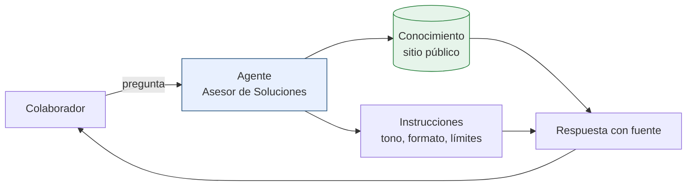

# Práctica 15. Construcción y configuración del agente con Agent Builder

**Capítulo 5. Creación y Personalización de Agentes con Agent Builder**

---

# Metadatos

| Campo | Valor |
|------------|------------|
| Duración | 14 minutos |
| Complejidad | Intermedia |
| Nivel de Bloom | Crear |
| Tecnología Principal | Agent Builder de Microsoft 365 Copilot |

---

# Descripción General

Con el diseño de la Práctica 14, el participante creará el agente en Agent Builder: nombre, descripción, instrucciones, fuentes de conocimiento del sitio público de Jungheinrich y preguntas iniciales. Configurará el agente para priorizar la información proporcionada, citar sus fuentes y no responder lo que no esté respaldado.

---

# Objetivos de Aprendizaje

Al finalizar la práctica, el participante será capaz de:

- Crear un agente con Agent Builder a partir de un diseño.
- Configurar instrucciones y fuentes de conocimiento.
- Definir preguntas iniciales que orienten a los usuarios.

---

# Objetivo Visual

El siguiente diagrama resume las tareas de la práctica, su duración y el resultado que se obtiene.


El siguiente diagrama muestra cómo fluye la información durante la práctica.



---

# Prerrequisitos

## Conocimientos

- Conocimientos básicos de correo electrónico, calendario, documentos y herramientas de colaboración de Microsoft 365.
- Experiencia en actividades como envío de correos, seguimiento de clientes o actividades, elaboración de reportes, coordinación entre áreas o actualización de archivos.
- Conocimiento de las políticas internas de seguridad, confidencialidad y manejo de información de la organización.
- No se requiere experiencia previa en desarrollo, programación o automatización.

## Accesos Requeridos

- Cuenta de Microsoft 365 con licencia de Microsoft 365 Copilot Premium asignada.
- Acceso a OneDrive con la carpeta `Laboratorio_Copilot_JUN` creada (ver [Setup Guide](../Setup_Guide.md)).

---

# Tabla de Ayuda

Utilice esta información durante el desarrollo de la práctica.

| Elemento | Valor |
|------------|------------|
| Entorno | Microsoft 365 del curso |
| URL | [https://m365.cloud.microsoft](https://m365.cloud.microsoft) |
| Usuario | Cuenta corporativa asignada al participante |
| Contraseña | Proporcionada por el instructor por el canal autorizado |
| Carpeta de trabajo | `OneDrive > Laboratorio_Copilot_JUN` |

---

# Entorno de Laboratorio

| Componente | Versión | Uso | Fuente Oficial |
|------------|------------|------------|------------|
| Agent Builder (Microsoft 365 Copilot) | Servicio administrado | Creación de agentes sin código | https://learn.microsoft.com/es-es/microsoft-365-copilot/extensibility/agent-builder |
| Microsoft 365 Copilot (licencia Premium) | Servicio administrado | Chat y asistente en las aplicaciones de Microsoft 365 | https://learn.microsoft.com/es-es/copilot/microsoft-365/ |
| Microsoft Edge | Versión actual | Acceso a Microsoft 365 | https://www.microsoft.com/es-es/edge |

> Microsoft 365 Copilot y sus agentes son servicios administrados que se actualizan de forma continua; los nombres de botones y menús pueden variar ligeramente respecto a esta guía.

---

# Recursos

Utilice los siguientes recursos durante el desarrollo de la práctica.

| Recurso | Descripción |
|------------|------------|
| `P14_Diseno_Agente_[INICIALES].docx` | Diseño de la Práctica 14. |
| Sitio público de Jungheinrich | [https://www.jungheinrich.com](https://www.jungheinrich.com) |

## Archivos de la práctica

```text
Esta práctica no requiere archivos de entrada.
```

---

# Tarea 1. Crear el agente y su descripción (5 min)

## Objetivo

Tener el agente creado con nombre, descripción e instrucciones.

## Instrucciones

### Paso 1

En Copilot, seleccionar **Agentes > Crear agente** (*Create agent*). Seleccionar la pestaña **Configurar** (*Configure*).

### Paso 2

Escribir el nombre `Asesor de Soluciones Intralogísticas [INICIALES]` y la descripción: `Responde consultas sobre equipos, almacenamiento, alquiler y mantenimiento de Jungheinrich con información pública`.

### Paso 3

Pegar en **Instrucciones** las instrucciones redactadas en la Práctica 14.

---

# Tarea 2. Configurar el conocimiento (5 min)

## Objetivo

Tener el sitio público como fuente y la búsqueda limitada a ella.

## Instrucciones

### Paso 1

En **Conocimiento** (*Knowledge*), agregar el sitio `https://www.jungheinrich.com` y, si el instructor lo indica, las páginas de productos y servicios seleccionadas para el ejercicio.

### Paso 2

Desactivar la búsqueda en toda la web si la opción está disponible, para que el agente use solo las fuentes configuradas.

### Paso 3

Agregar al final de las instrucciones:

```text
Usa únicamente la información de las fuentes configuradas. Indica al final de cada respuesta la página consultada. Si la información no está en las fuentes, responde: "No encuentro esa información en las fuentes disponibles" y sugiere contactar al área comercial o de servicio.
```

---

# Tarea 3. Definir preguntas iniciales y crear el agente (4 min)

## Objetivo

Tener 4 preguntas iniciales y el agente disponible en la lista de agentes.

## Instrucciones

### Paso 1

En **Preguntas iniciales** (*Starter prompts*), agregar: `¿Qué tipos de montacargas eléctricos ofrecen?`, `¿Cómo funciona el alquiler de equipos?`, `¿Qué servicios de mantenimiento existen?`, `¿Qué soluciones de almacenamiento automatizado hay?`.

### Paso 2

Seleccionar **Crear** (*Create*). Cuando aparezca el mensaje de confirmación, seleccionar **Ir al agente**.

---

# Validación y Pruebas

Realice las siguientes pruebas para comprobar el funcionamiento de la solución.

| Caso | Acción o Prompt | Resultado Esperado |
|------------|------------|------------|
| Caso 1 | Agente creado | Aparece en la lista de agentes del participante |
| Caso 2 | Seleccionar una pregunta inicial | Respuesta con la página consultada |
| Caso 3 | Revisar la configuración | Instrucciones y fuente configuradas |
| Caso adversarial | Preguntar el precio de un montacargas | El agente indica que no tiene esa información |

---

# Resultado Esperado

Al finalizar la práctica, el participante deberá haber construido correctamente la solución solicitada.

- Agente creado y configurado.
- Conocimiento limitado a fuentes definidas.
- Preguntas iniciales disponibles.

## Imagen del Resultado Final

Agregar una captura de pantalla del resultado final esperado.

```markdown
../images/p15-resultado-final.png
```

---

# Solución de Problemas

## Problema 1: No aparece Crear agente

### Síntomas

La opción no se muestra en Copilot.

### Causa

La creación de agentes no está habilitada para la cuenta.

### Solución

1. Recargar la página.
2. Informar al instructor para que valide la política del inquilino.

---

## Problema 2: No se puede agregar el sitio

### Síntomas

Mensaje de URL no válida.

### Causa

La URL tiene demasiados niveles o no es pública.

### Solución

1. Usar el dominio principal sin parámetros.
2. Probar con otra página pública indicada por el instructor.

---

# Limpieza

1. Conservar el agente: se prueba en la Práctica 16 y se consulta en la Práctica 17.
2. No compartir el agente fuera del grupo del curso.

---

# Resumen

Durante esta práctica se realizó:

- Se construyó un agente sin código.
- Se configuraron instrucciones y conocimiento.
- Se definieron preguntas iniciales.

Como resultado se obtuvo:

- Agente funcional listo para pruebas.

---

# Recursos Opcionales

- [Agent Builder en Microsoft 365 Copilot](https://learn.microsoft.com/es-es/microsoft-365-copilot/extensibility/agent-builder)

---

[⬅ Anterior: Práctica 14](../Capitulo05/README_Practica14.md) | [Inicio](../README.md) | [Siguiente: Práctica 16 ➡](../Capitulo05/README_Practica16.md)
