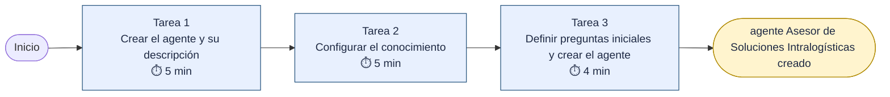
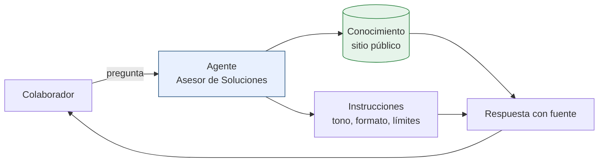

# Práctica 15. Construcción y configuración del agente con Agent Builder

## Objetivo de la práctica:

Al finalizar la práctica, serás capaz de:

- Crear un agente con Agent Builder a partir de un diseño.
- Configurar instrucciones y fuentes de conocimiento.
- Definir preguntas iniciales que orienten a los usuarios.

## Objetivo Visual

El siguiente diagrama resume las actividades a realizar.



Flujo de la información durante la práctica:



## Duración aproximada:

- 14 minutos.

## Tabla de ayuda:

Utiliza esta información durante el desarrollo de la práctica.

| Elemento | Valor |
|------------|------------|
| Entorno | Microsoft 365 del curso |
| URL | [https://m365.cloud.microsoft](https://m365.cloud.microsoft) |
| Usuario | Cuenta corporativa asignada al participante |
| Contraseña | Proporcionada por el instructor por el canal autorizado |
| Carpeta de trabajo | `OneDrive > Laboratorio_Copilot_JUN` |

## Entorno de laboratorio

| Componente | Versión | Uso | Fuente oficial |
|------------|------------|------------|------------|
| Agent Builder (Microsoft 365 Copilot) | Servicio administrado | Creación de agentes sin código | https://learn.microsoft.com/es-es/microsoft-365-copilot/extensibility/agent-builder |
| Microsoft 365 Copilot (licencia Premium) | Servicio administrado | Chat y asistente en las aplicaciones de Microsoft 365 | https://learn.microsoft.com/es-es/copilot/microsoft-365/ |
| Microsoft Edge | Versión actual | Acceso a Microsoft 365 | https://www.microsoft.com/es-es/edge |

> Microsoft 365 Copilot y sus agentes son servicios administrados que se actualizan de forma continua; los nombres de botones y menús pueden variar ligeramente respecto a esta guía.

## Recursos

| Recurso | Descripción |
|------------|------------|
| `P14_Diseno_Agente_[INICIALES].docx` | Diseño de la Práctica 14. |
| Sitio público de Jungheinrich | [https://www.jungheinrich.com](https://www.jungheinrich.com) |

## Instrucciones

### Tarea 1. Crear el agente y su descripción (5 min)

**Objetivo de la tarea:** Tener el agente creado con nombre, descripción e instrucciones.

Paso 1. En Copilot, seleccionar **Agentes > Crear agente** (*Create agent*). Seleccionar la pestaña **Configurar** (*Configure*).

Paso 2. Escribir el nombre `Asesor de Soluciones Intralogísticas [INICIALES]` y la descripción: `Responde consultas sobre equipos, almacenamiento, alquiler y mantenimiento de Jungheinrich con información pública`.

Paso 3. Pegar en **Instrucciones** las instrucciones redactadas en la Práctica 14.

### Tarea 2. Configurar el conocimiento (5 min)

**Objetivo de la tarea:** Tener el sitio público como fuente y la búsqueda limitada a ella.

Paso 1. En **Conocimiento** (*Knowledge*), agregar el sitio `https://www.jungheinrich.com` y, si el instructor lo indica, las páginas de productos y servicios seleccionadas para el ejercicio.

Paso 2. Desactivar la búsqueda en toda la web si la opción está disponible, para que el agente use solo las fuentes configuradas.

Paso 3. Agregar al final de las instrucciones:

```text
Usa únicamente la información de las fuentes configuradas. Indica al final de cada respuesta la página consultada. Si la información no está en las fuentes, responde: "No encuentro esa información en las fuentes disponibles" y sugiere contactar al área comercial o de servicio.
```

### Tarea 3. Definir preguntas iniciales y crear el agente (4 min)

**Objetivo de la tarea:** Tener 4 preguntas iniciales y el agente disponible en la lista de agentes.

Paso 1. En **Preguntas iniciales** (*Starter prompts*), agregar: `¿Qué tipos de montacargas eléctricos ofrecen?`, `¿Cómo funciona el alquiler de equipos?`, `¿Qué servicios de mantenimiento existen?`, `¿Qué soluciones de almacenamiento automatizado hay?`.

Paso 2. Seleccionar **Crear** (*Create*). Cuando aparezca el mensaje de confirmación, seleccionar **Ir al agente**.

### Resultado esperado

Al finalizar la práctica deberás contar con:

- Agente creado y configurado.
- Conocimiento limitado a fuentes definidas.
- Preguntas iniciales disponibles.

<!-- Agregar captura del resultado esperado: ../images/p15-resultado.png -->

## Resumen

Durante esta práctica se realizó:

- Se construyó un agente sin código.
- Se configuraron instrucciones y conocimiento.
- Se definieron preguntas iniciales.

Como resultado se obtuvo:

- Agente funcional listo para pruebas.

## Recursos opcionales

- [Agent Builder en Microsoft 365 Copilot](https://learn.microsoft.com/es-es/microsoft-365-copilot/extensibility/agent-builder)

---

[⬅ Anterior: Práctica 14](../Capitulo05/README_Practica14.md) | [Inicio](../README.md) | [Siguiente: Práctica 16 ➡](../Capitulo05/README_Practica16.md)
