# Práctica 17. Integración de Copilot y agentes para la planificación de una iniciativa de mejora intralogística

## Objetivo de la práctica:

Al finalizar la práctica, serás capaz de:

- Analizar datos operativos con Copilot en Excel y el agente Analyst.
- Consultar un agente personalizado para identificar alternativas.
- Elaborar informe, presentación y comunicaciones con Copilot.
- Proponer la adaptación de un flujo automatizado con supervisión humana.

## Objetivo Visual

El siguiente diagrama resume las actividades a realizar.


Flujo de trabajo integrado de la práctica:

```mermaid
flowchart LR
    X["Excel + Copilot<br/>datos del almacén"] --> AN["Agente Analyst<br/>diagnóstico"]
    AN --> AG["Agente personalizado<br/>alternativas"]
    AG --> W["Word<br/>informe"]
    W --> PP["PowerPoint<br/>presentación"]
    PP --> O["Outlook<br/>comunicación"]
    O --> T["Teams<br/>coordinación"]
    T --> PA["Power Automate<br/>seguimiento"]
    PA -. "validación humana" .-> H(["Responsable revisa"])
    style AN fill:#e8f0fe,stroke:#1f4e79
    style AG fill:#e8f0fe,stroke:#1f4e79
    style PA fill:#e6f4ea,stroke:#1e7b34
    style H fill:#fff4ce,stroke:#b08900
```



## Duración aproximada:

- 27 minutos.

## Tabla de ayuda:

Utiliza esta información durante el desarrollo de la práctica.

| Elemento | Valor |
|------------|------------|
| Entorno | Microsoft 365 del curso |
| URL | [https://m365.cloud.microsoft](https://m365.cloud.microsoft) |
| Usuario | Cuenta corporativa asignada al participante |
| Contraseña | Proporcionada por el instructor por el canal autorizado |
| Carpeta de trabajo | `OneDrive > Laboratorio_Copilot_JUN` |

## Entorno de laboratorio

| Componente | Versión | Uso | Fuente oficial |
|------------|------------|------------|------------|
| Microsoft Excel | Microsoft 365 (escritorio o web) | Análisis de datos con Copilot | https://support.microsoft.com/es-es/copilot-excel |
| Agente Analyst | Servicio administrado | Análisis de datos e investigación | https://learn.microsoft.com/es-es/copilot/microsoft-365/ |
| Microsoft Word | Microsoft 365 (escritorio o web) | Redacción y edición con Copilot | https://support.microsoft.com/es-es/copilot-word |
| Microsoft PowerPoint | Microsoft 365 (escritorio o web) | Creación de presentaciones con Copilot | https://support.microsoft.com/es-es/copilot-powerpoint |
| Microsoft Outlook | Nuevo Outlook o Outlook en la web | Redacción y coaching de correos con Copilot | https://support.microsoft.com/es-es/copilot-outlook |
| Microsoft Teams | Microsoft 365 (escritorio o web) | Reuniones, chats y Copilot en Teams | https://support.microsoft.com/es-es/copilot-teams |
| Power Automate | Servicio administrado | Diseño de flujos con Copilot | https://learn.microsoft.com/es-es/power-automate/ |

> Microsoft 365 Copilot y sus agentes son servicios administrados que se actualizan de forma continua; los nombres de botones y menús pueden variar ligeramente respecto a esta guía.

## Recursos

| Recurso | Descripción |
|------------|------------|
| [Operacion_Almacen_Centro.xlsx](recursos/Operacion_Almacen_Centro.xlsx) | Operación diaria e incidencias de 60 días (ficticios). |
| Agente `Asesor de Soluciones Intralogísticas [INICIALES]` | Agente del Módulo 5. |
| Flujo `Registro de solicitudes [INICIALES]` | Flujo del Módulo 4. |

Archivos de la práctica:

```text
Capitulo06/recursos/Operacion_Almacen_Centro.xlsx
```

## Instrucciones

### Tarea 1. Diagnosticar la operación con Excel y Analyst (6 min)

**Objetivo de la tarea:** Obtener los tres principales problemas operativos con sus indicadores.

Paso 1. Subir `Operacion_Almacen_Centro.xlsx` a `Laboratorio_Copilot_JUN > Practica17` y abrir el agente **Analyst**.

Paso 2. Enviar, referenciando el archivo con `/`:

```text
Analiza /Operacion_Almacen_Centro. Identifica los tres principales problemas de eficiencia, su relación con los equipos en mantenimiento y las incidencias, y entrega los indicadores que los respaldan en una tabla.
```

Comprobar en Excel uno de los indicadores con Copilot (por ejemplo, el promedio de errores por turno).

### Tarea 2. Identificar alternativas con el agente personalizado (3 min)

**Objetivo de la tarea:** Tener dos o tres soluciones intralogísticas relacionadas con los problemas.

Paso 1. Abrir el agente `Asesor de Soluciones Intralogísticas [INICIALES]` y enviar:

```text
Para un almacén con errores de surtido, paros por mantenimiento de equipos y baterías descargadas, ¿qué soluciones y servicios podrían ayudar? Cita la fuente.
```

### Tarea 3. Elaborar el informe y la presentación (9 min)

**Objetivo de la tarea:** Tener el informe en Word y una presentación de 6 diapositivas.

Paso 1. Crear en Word `P17_Informe_[INICIALES].docx` y usar Copilot:

```text
Redacta un informe de 1 página con: diagnóstico (usa la tabla de Analyst), alternativas identificadas, acciones propuestas con responsable y plazo, y beneficios esperados.
```

Pegar antes la tabla de Analyst y las respuestas del agente en el documento o referenciarlas.

Paso 2. Crear en PowerPoint `P17_Presentacion_[INICIALES].pptx` y usar Copilot:

```text
Crea una presentación ejecutiva de 6 diapositivas a partir de /P17_Informe_[INICIALES] para la Dirección de Operaciones, con notas del orador.
```

### Tarea 4. Comunicar y coordinar (5 min)

**Objetivo de la tarea:** Tener un borrador de correo y una reunión de coordinación agendada.

Paso 1. En Outlook, usar **Borrador con Copilot** para redactar el correo de presentación de la iniciativa a Operaciones, Servicio y Comercial (destinatario: su propia cuenta). Guardar como borrador.

Paso 2. En Teams, crear la reunión `Arranque: eficiencia del almacén Centro` con la agenda generada por Copilot y la presentación adjunta.

### Tarea 5. Adaptar la automatización al seguimiento (4 min)

**Objetivo de la tarea:** Tener descrita la adaptación del flujo con responsables, notificaciones y validación humana.

Paso 1. En Power Automate, abrir Copilot desde el flujo `Registro de solicitudes [INICIALES]` (sin guardar cambios) y preguntar:

```text
¿Cómo adaptaría este flujo para dar seguimiento a las acciones del proyecto de eficiencia del almacén, con responsables, recordatorios de fechas compromiso y una aprobación antes de cerrar cada acción?
```

Paso 2. Agregar la propuesta como última sección del informe con el título **Seguimiento automatizado** y guardar.

### Resultado esperado

Al finalizar la práctica deberás contar con:

- Diagnóstico basado en datos.
- Informe, presentación, correo y reunión de la iniciativa.
- Propuesta de seguimiento automatizado con supervisión humana.

<!-- Agregar captura del resultado esperado: ../images/p17-resultado.png -->

## Resumen

Durante esta práctica se realizó:

- Se integraron Copilot, agentes y automatización en un caso de negocio.
- Se elaboraron los entregables de una iniciativa.

Como resultado se obtuvo:

- Paquete completo de la iniciativa.
- Visión de un flujo de trabajo empresarial de principio a fin.

## Recursos opcionales

- [Documentación de Microsoft 365 Copilot](https://learn.microsoft.com/es-es/copilot/microsoft-365/)
- [Agent Builder en Microsoft 365 Copilot](https://learn.microsoft.com/es-es/microsoft-365-copilot/extensibility/agent-builder)
- [Copilot en Power Automate](https://learn.microsoft.com/es-es/power-automate/get-started-with-copilot)

---

[⬅ Anterior: Práctica 16](../Capitulo05/README_Practica16.md) | [Inicio](../README.md) | [Siguiente: Práctica 18 ➡](../Capitulo06/README_Practica18.md)
