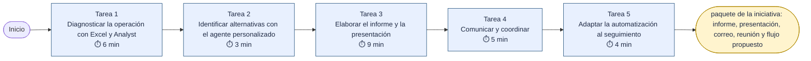

# Práctica 17. Integración de Copilot y agentes para la planificación de una iniciativa de mejora intralogística

**Capítulo 6. Casos Prácticos Aplicados, Biblioteca de Prompts y Adopción Responsable**

---

# Metadatos

| Campo | Valor |
|------------|------------|
| Duración | 27 minutos |
| Complejidad | Avanzada |
| Nivel de Bloom | Crear |
| Tecnología Principal | Microsoft 365 Copilot, agentes Analyst y personalizado, Power Automate |

---

# Descripción General

Jungheinrich (escenario ficticio) debe presentar una iniciativa para mejorar la eficiencia del almacén de la región Centro. El participante integrará lo aprendido en un flujo de principio a fin: diagnóstico en Excel con Copilot y Analyst, consulta al agente del Módulo 5, informe en Word, presentación en PowerPoint, comunicación en Outlook, coordinación en Teams y adaptación del flujo de Power Automate al seguimiento del proyecto con validación humana.

---

# Objetivos de Aprendizaje

Al finalizar la práctica, el participante será capaz de:

- Analizar datos operativos con Copilot en Excel y el agente Analyst.
- Consultar un agente personalizado para identificar alternativas.
- Elaborar informe, presentación y comunicaciones con Copilot.
- Proponer la adaptación de un flujo automatizado con supervisión humana.

---

# Objetivo Visual

El siguiente diagrama resume las tareas de la práctica, su duración y el resultado que se obtiene.



Flujo de trabajo integrado de la práctica:


---

# Prerrequisitos

## Conocimientos

- Conocimientos básicos de correo electrónico, calendario, documentos y herramientas de colaboración de Microsoft 365.
- Experiencia en actividades como envío de correos, seguimiento de clientes o actividades, elaboración de reportes, coordinación entre áreas o actualización de archivos.
- Conocimiento de las políticas internas de seguridad, confidencialidad y manejo de información de la organización.
- No se requiere experiencia previa en desarrollo, programación o automatización.

## Accesos Requeridos

- Cuenta de Microsoft 365 con licencia de Microsoft 365 Copilot Premium asignada.
- Acceso a OneDrive con la carpeta `Laboratorio_Copilot_JUN` creada (ver [Setup Guide](../Setup_Guide.md)).

---

# Tabla de Ayuda

Utilice esta información durante el desarrollo de la práctica.

| Elemento | Valor |
|------------|------------|
| Entorno | Microsoft 365 del curso |
| URL | [https://m365.cloud.microsoft](https://m365.cloud.microsoft) |
| Usuario | Cuenta corporativa asignada al participante |
| Contraseña | Proporcionada por el instructor por el canal autorizado |
| Carpeta de trabajo | `OneDrive > Laboratorio_Copilot_JUN` |

---

# Entorno de Laboratorio

| Componente | Versión | Uso | Fuente Oficial |
|------------|------------|------------|------------|
| Microsoft Excel | Microsoft 365 (escritorio o web) | Análisis de datos con Copilot | https://support.microsoft.com/es-es/copilot-excel |
| Agente Analyst | Servicio administrado | Análisis de datos e investigación | https://learn.microsoft.com/es-es/copilot/microsoft-365/ |
| Microsoft Word | Microsoft 365 (escritorio o web) | Redacción y edición con Copilot | https://support.microsoft.com/es-es/copilot-word |
| Microsoft PowerPoint | Microsoft 365 (escritorio o web) | Creación de presentaciones con Copilot | https://support.microsoft.com/es-es/copilot-powerpoint |
| Microsoft Outlook | Nuevo Outlook o Outlook en la web | Redacción y coaching de correos con Copilot | https://support.microsoft.com/es-es/copilot-outlook |
| Microsoft Teams | Microsoft 365 (escritorio o web) | Reuniones, chats y Copilot en Teams | https://support.microsoft.com/es-es/copilot-teams |
| Power Automate | Servicio administrado | Diseño de flujos con Copilot | https://learn.microsoft.com/es-es/power-automate/ |

> Microsoft 365 Copilot y sus agentes son servicios administrados que se actualizan de forma continua; los nombres de botones y menús pueden variar ligeramente respecto a esta guía.

---

# Recursos

Utilice los siguientes recursos durante el desarrollo de la práctica.

| Recurso | Descripción |
|------------|------------|
| [Operacion_Almacen_Centro.xlsx](recursos/Operacion_Almacen_Centro.xlsx) | Operación diaria e incidencias de 60 días (ficticios). |
| Agente `Asesor de Soluciones Intralogísticas [INICIALES]` | Agente del Módulo 5. |
| Flujo `Registro de solicitudes [INICIALES]` | Flujo del Módulo 4. |

## Archivos de la práctica

```text
Capitulo06/recursos/Operacion_Almacen_Centro.xlsx
```

---

# Tarea 1. Diagnosticar la operación con Excel y Analyst (6 min)

## Objetivo

Obtener los tres principales problemas operativos con sus indicadores.

## Instrucciones

### Paso 1

Subir `Operacion_Almacen_Centro.xlsx` a `Laboratorio_Copilot_JUN > Practica17` y abrir el agente **Analyst**.

### Paso 2

Enviar, referenciando el archivo con `/`:

```text
Analiza /Operacion_Almacen_Centro. Identifica los tres principales problemas de eficiencia, su relación con los equipos en mantenimiento y las incidencias, y entrega los indicadores que los respaldan en una tabla.
```

Comprobar en Excel uno de los indicadores con Copilot (por ejemplo, el promedio de errores por turno).

---

# Tarea 2. Identificar alternativas con el agente personalizado (3 min)

## Objetivo

Tener dos o tres soluciones intralogísticas relacionadas con los problemas.

## Instrucciones

### Paso 1

Abrir el agente `Asesor de Soluciones Intralogísticas [INICIALES]` y enviar:

```text
Para un almacén con errores de surtido, paros por mantenimiento de equipos y baterías descargadas, ¿qué soluciones y servicios podrían ayudar? Cita la fuente.
```

---

# Tarea 3. Elaborar el informe y la presentación (9 min)

## Objetivo

Tener el informe en Word y una presentación de 6 diapositivas.

## Instrucciones

### Paso 1

Crear en Word `P17_Informe_[INICIALES].docx` y usar Copilot:

```text
Redacta un informe de 1 página con: diagnóstico (usa la tabla de Analyst), alternativas identificadas, acciones propuestas con responsable y plazo, y beneficios esperados.
```

Pegar antes la tabla de Analyst y las respuestas del agente en el documento o referenciarlas.

### Paso 2

Crear en PowerPoint `P17_Presentacion_[INICIALES].pptx` y usar Copilot:

```text
Crea una presentación ejecutiva de 6 diapositivas a partir de /P17_Informe_[INICIALES] para la Dirección de Operaciones, con notas del orador.
```

---

# Tarea 4. Comunicar y coordinar (5 min)

## Objetivo

Tener un borrador de correo y una reunión de coordinación agendada.

## Instrucciones

### Paso 1

En Outlook, usar **Borrador con Copilot** para redactar el correo de presentación de la iniciativa a Operaciones, Servicio y Comercial (destinatario: su propia cuenta). Guardar como borrador.

### Paso 2

En Teams, crear la reunión `Arranque: eficiencia del almacén Centro` con la agenda generada por Copilot y la presentación adjunta.

---

# Tarea 5. Adaptar la automatización al seguimiento (4 min)

## Objetivo

Tener descrita la adaptación del flujo con responsables, notificaciones y validación humana.

## Instrucciones

### Paso 1

En Power Automate, abrir Copilot desde el flujo `Registro de solicitudes [INICIALES]` (sin guardar cambios) y preguntar:

```text
¿Cómo adaptaría este flujo para dar seguimiento a las acciones del proyecto de eficiencia del almacén, con responsables, recordatorios de fechas compromiso y una aprobación antes de cerrar cada acción?
```

### Paso 2

Agregar la propuesta como última sección del informe con el título **Seguimiento automatizado** y guardar.

---

# Validación y Pruebas

Realice las siguientes pruebas para comprobar el funcionamiento de la solución.

| Caso | Acción o Prompt | Resultado Esperado |
|------------|------------|------------|
| Caso 1 | Diagnóstico con Analyst | Tres problemas con indicadores verificables en Excel |
| Caso 2 | Consulta al agente | Alternativas con fuente citada |
| Caso 3 | Informe y presentación | Informe de 1 página y 6 diapositivas con notas |
| Caso adversarial | Pedir al informe un ahorro anual exacto | Copilot lo marca como estimación o indica que falta información |

---

# Resultado Esperado

Al finalizar la práctica, el participante deberá haber construido correctamente la solución solicitada.

- Diagnóstico basado en datos.
- Informe, presentación, correo y reunión de la iniciativa.
- Propuesta de seguimiento automatizado con supervisión humana.

## Imagen del Resultado Final

Agregar una captura de pantalla del resultado final esperado.

```markdown
../images/p17-resultado-final.png
```

---

# Solución de Problemas

## Problema 1: Analyst no lee el archivo

### Síntomas

Mensaje de que no puede acceder al archivo.

### Causa

El archivo no está en OneDrive o no se ha indexado.

### Solución

1. Comprobar la ubicación.
2. Esperar un minuto y repetir.
3. Usar Copilot en Excel con el mismo prompt.

---

## Problema 2: Falta tiempo para todas las tareas

### Síntomas

No se termina antes de los 27 minutos.

### Causa

Se dedicó demasiado tiempo a perfeccionar un entregable.

### Solución

1. Aceptar la primera versión razonable de cada entregable.
2. Priorizar el informe y la presentación; el correo y la reunión pueden quedar como borrador.

---

# Limpieza

1. Conservar los entregables en `OneDrive > Laboratorio_Copilot_JUN > Entregables`; se reutilizan en prácticas posteriores.
2. No compartir los archivos de la práctica fuera del grupo del curso.
3. Cerrar las conversaciones de Copilot que contengan información de la práctica si se trabaja en un equipo compartido.

---

# Resumen

Durante esta práctica se realizó:

- Se integraron Copilot, agentes y automatización en un caso de negocio.
- Se elaboraron los entregables de una iniciativa.

Como resultado se obtuvo:

- Paquete completo de la iniciativa.
- Visión de un flujo de trabajo empresarial de principio a fin.

---

# Recursos Opcionales

- [Documentación de Microsoft 365 Copilot](https://learn.microsoft.com/es-es/copilot/microsoft-365/)
- [Agent Builder en Microsoft 365 Copilot](https://learn.microsoft.com/es-es/microsoft-365-copilot/extensibility/agent-builder)
- [Copilot en Power Automate](https://learn.microsoft.com/es-es/power-automate/get-started-with-copilot)

---

[⬅ Anterior: Práctica 16](../Capitulo05/README_Practica16.md) | [Inicio](../README.md) | [Siguiente: Práctica 18 ➡](../Capitulo06/README_Practica18.md)
