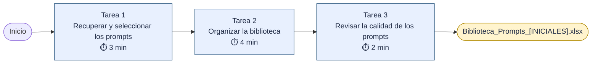

# Práctica 18. Construcción de una biblioteca de prompts reutilizables por área

**Capítulo 6. Casos Prácticos Aplicados, Biblioteca de Prompts y Adopción Responsable**

---

# Metadatos

| Campo | Valor |
|------------|------------|
| Duración | 9 minutos |
| Complejidad | Fácil |
| Nivel de Bloom | Crear |
| Tecnología Principal | Microsoft 365 Copilot |

---

# Descripción General

Para aplicar lo aprendido en su puesto de trabajo, el participante recuperará los prompts utilizados durante el curso, seleccionará los reutilizables en actividades comerciales, administrativas, operativas o de servicio y, con Copilot, los organizará en una biblioteca por área, actividad y herramienta, con variables para adaptarlos fácilmente.

---

# Objetivos de Aprendizaje

Al finalizar la práctica, el participante será capaz de:

- Seleccionar prompts reutilizables del curso.
- Organizar una biblioteca de prompts por área, actividad y herramienta.
- Verificar que cada prompt incluya los elementos para adaptarlo.

---

# Objetivo Visual

El siguiente diagrama resume las tareas de la práctica, su duración y el resultado que se obtiene.



---

# Prerrequisitos

## Conocimientos

- Conocimientos básicos de correo electrónico, calendario, documentos y herramientas de colaboración de Microsoft 365.
- Experiencia en actividades como envío de correos, seguimiento de clientes o actividades, elaboración de reportes, coordinación entre áreas o actualización de archivos.
- Conocimiento de las políticas internas de seguridad, confidencialidad y manejo de información de la organización.
- No se requiere experiencia previa en desarrollo, programación o automatización.

## Accesos Requeridos

- Cuenta de Microsoft 365 con licencia de Microsoft 365 Copilot Premium asignada.
- Acceso a OneDrive con la carpeta `Laboratorio_Copilot_JUN` creada (ver [Setup Guide](../Setup_Guide.md)).

---

# Tabla de Ayuda

Utilice esta información durante el desarrollo de la práctica.

| Elemento | Valor |
|------------|------------|
| Entorno | Microsoft 365 del curso |
| URL | [https://m365.cloud.microsoft](https://m365.cloud.microsoft) |
| Usuario | Cuenta corporativa asignada al participante |
| Contraseña | Proporcionada por el instructor por el canal autorizado |
| Carpeta de trabajo | `OneDrive > Laboratorio_Copilot_JUN` |

---

# Entorno de Laboratorio

| Componente | Versión | Uso | Fuente Oficial |
|------------|------------|------------|------------|
| Microsoft 365 Copilot (licencia Premium) | Servicio administrado | Chat y asistente en las aplicaciones de Microsoft 365 | https://learn.microsoft.com/es-es/copilot/microsoft-365/ |
| Microsoft Excel | Microsoft 365 (escritorio o web) | Análisis de datos con Copilot | https://support.microsoft.com/es-es/copilot-excel |
| OneDrive para el trabajo o la escuela | Servicio administrado | Almacenamiento de archivos de la práctica | https://support.microsoft.com/es-es/onedrive |

> Microsoft 365 Copilot y sus agentes son servicios administrados que se actualizan de forma continua; los nombres de botones y menús pueden variar ligeramente respecto a esta guía.

---

# Recursos

Utilice los siguientes recursos durante el desarrollo de la práctica.

| Recurso | Descripción |
|------------|------------|
| Entregables de las prácticas 1 a 17 | Prompts utilizados durante el curso. |
| `Biblioteca_Prompts_[INICIALES].xlsx` | Entregable final del curso. |

## Archivos de la práctica

```text
Esta práctica no requiere archivos de entrada.
```

---

# Tarea 1. Recuperar y seleccionar los prompts (3 min)

## Objetivo

Tener una lista de al menos 8 prompts reutilizables.

## Instrucciones

### Paso 1

En Copilot Chat (modo **Trabajo**), enviar:

```text
Revisa mis conversaciones y documentos recientes de la carpeta Laboratorio_Copilot_JUN y lista los prompts que utilicé para documentos, análisis de datos, presentaciones, correos, reuniones, automatización y agentes.
```

### Paso 2

Seleccionar al menos 8 prompts que pueda reutilizar en su área.

---

# Tarea 2. Organizar la biblioteca (4 min)

## Objetivo

Tener guardada `Biblioteca_Prompts_[INICIALES].xlsx` con la biblioteca estructurada.

## Instrucciones

### Paso 1

Enviar:

```text
Organiza estos prompts en una tabla con las columnas: Área (Comercial, Administración, Operación, Servicio), Actividad, Herramienta, Prompt con variables entre corchetes, Resultado esperado y Recomendación de revisión humana. Reemplaza los datos específicos por variables como [CLIENTE], [PERIODO] o [ARCHIVO].
```

### Paso 2

Copiar la tabla a un libro de Excel en blanco, darle formato de tabla con **Ctrl+T** y guardarlo como `Biblioteca_Prompts_[INICIALES].xlsx` en `Entregables`.

---

# Tarea 3. Revisar la calidad de los prompts (2 min)

## Objetivo

Tener cada prompt con Objetivo, Contexto, Fuente y Expectativa/Formato.

## Instrucciones

### Paso 1

Enviar:

```text
Revisa cada prompt de la tabla y señala cuál no incluye Objetivo, Contexto, Fuente o Expectativa/Formato; propón la corrección.
```

### Paso 2

Aplicar las correcciones en el libro y guardar.

---

# Validación y Pruebas

Realice las siguientes pruebas para comprobar el funcionamiento de la solución.

| Caso | Acción o Prompt | Resultado Esperado |
|------------|------------|------------|
| Caso 1 | Recuperación de prompts | Lista de prompts del curso |
| Caso 2 | Organización | Tabla por área, actividad y herramienta con variables |
| Caso 3 | Revisión de calidad | Prompts con los 4 elementos |
| Caso adversarial | Incluir un prompt con datos confidenciales reales | Se reemplazan por variables antes de guardarlo |

---

# Resultado Esperado

Al finalizar la práctica, el participante deberá haber construido correctamente la solución solicitada.

- Biblioteca de prompts reutilizables por área.
- Prompts con variables y criterios de revisión humana.

## Imagen del Resultado Final

Agregar una captura de pantalla del resultado final esperado.

```markdown
../images/p18-resultado-final.png
```

---

# Solución de Problemas

## Problema 1: Copilot no recupera conversaciones anteriores

### Síntomas

La lista de prompts está incompleta.

### Causa

El historial no está disponible para la consulta.

### Solución

1. Abrir los entregables de las prácticas y copiar los prompts manualmente.
2. Revisar el historial en el panel izquierdo de Copilot.

---

## Problema 2: Prompts demasiado específicos

### Síntomas

Contienen nombres o cifras del ejercicio.

### Causa

No se sustituyeron por variables.

### Solución

1. Pedir a Copilot que los generalice con variables entre corchetes.

---

# Limpieza

1. Conservar la biblioteca y compartirla solo con el equipo de trabajo autorizado.
2. Desactivar el flujo de las prácticas 12 y 13 si ya no se utilizará.
3. Revisar que ningún entregable contenga información confidencial real.

---

# Resumen

Durante esta práctica se realizó:

- Se recuperaron y seleccionaron prompts del curso.
- Se organizó una biblioteca reutilizable.

Como resultado se obtuvo:

- Biblioteca de prompts lista para aplicarse en el puesto de trabajo.

---

# Recursos Opcionales

- [Documentación de Microsoft 365 Copilot](https://learn.microsoft.com/es-es/copilot/microsoft-365/)
- [Aprender sobre los prompts de Copilot](https://support.microsoft.com/es-es/topic/aprenda-sobre-las-indicaciones-de-copilot-f6c3b467-f07c-4db1-ae54-ffac96184dd5)

---

[⬅ Anterior: Práctica 17](../Capitulo06/README_Practica17.md) | [Inicio](../README.md)
