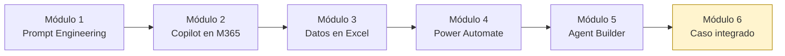

# Transformación Digital y Productividad con Microsoft 365 Copilot Premium, Agentes y Automatización

## Plataforma de laboratorios

Te damos la bienvenida a la **plataforma de laboratorios** del curso **Transformación Digital y Productividad con Microsoft 365 Copilot Premium, Agentes y Automatización**. Aquí podrás explorar diferentes tecnologías a través de prácticas guiadas. ¡Desarrolla tus habilidades y lleva tus conocimientos al siguiente nivel!

Las prácticas utilizan un escenario empresarial ficticio de soluciones intralogísticas y se realizan en Microsoft 365 Copilot Premium, Word, Excel, PowerPoint, Outlook, Teams, Power Automate y Agent Builder. Antes de comenzar, revisa la [Guía de configuración del entorno](Setup_Guide.md).

## Lista de laboratorios

Cada uno de estos laboratorios está diseñado para ofrecerte una experiencia práctica. Haz clic en los enlaces para comenzar.

## Capítulo 1. Fundamentos de IA Generativa, Microsoft Copilot Premium y Prompt Engineering

### [Práctica 1. Del prompt básico a una instrucción efectiva](Capitulo01/README_Practica01.md)

  - **Descripción**: Identificar las limitaciones de una instrucción básica a partir de la respuesta obtenida.

  - ⏱️ **Duración estimada**: 10 min.

### [Práctica 2. De una idea a una comunicación visual con IA](Capitulo01/README_Practica02.md)

  - **Descripción**: Definir con Copilot el concepto de una pieza visual a partir de una necesidad de comunicación.

  - ⏱️ **Duración estimada**: 8 min.

### [Práctica 3. De una necesidad a una propuesta estructurada con Idea Coach](Capitulo01/README_Practica03.md)

  - **Descripción**: Plantear una necesidad empresarial a un agente especializado.

  - ⏱️ **Duración estimada**: 7 min.

## Capítulo 2. Uso de Copilot en Aplicaciones M365 y Productividad Individual/Equipo

### [Práctica 4. Elaboración de una propuesta de mejora de la atención al cliente con Copilot en Word](Capitulo02/README_Practica04.md)

  - **Descripción**: Generar un borrador en Word a partir de archivos de referencia.

  - ⏱️ **Duración estimada**: 20 min.

### [Práctica 5. Del documento a una presentación ejecutiva con Copilot en PowerPoint](Capitulo02/README_Practica05.md)

  - **Descripción**: Crear una presentación a partir de un documento de Word con Copilot.

  - ⏱️ **Duración estimada**: 21 min.

### [Práctica 6. Preparación y gestión de comunicaciones estratégicas con Copilot en Outlook](Capitulo02/README_Practica06.md)

  - **Descripción**: Redactar un correo de presentación de una iniciativa con Copilot.

  - ⏱️ **Duración estimada**: 15 min.

### [Práctica 7. Organización de una reunión de coordinación con Copilot en Teams](Capitulo02/README_Practica07.md)

  - **Descripción**: Preparar la agenda de una reunión con Copilot a partir de documentos de trabajo.

  - ⏱️ **Duración estimada**: 20 min.

## Capítulo 3. Análisis de Datos, Generación de Reportes e Insights en Excel

### [Práctica 8. Exploración y preparación de indicadores comerciales y operativos con Copilot en Excel](Capitulo03/README_Practica08.md)

  - **Descripción**: Explorar la estructura de un libro de Excel con Copilot.

  - ⏱️ **Duración estimada**: 10 min.

### [Práctica 9. Análisis de indicadores y generación de cálculos con Copilot en Excel](Capitulo03/README_Practica09.md)

  - **Descripción**: Formular preguntas de análisis a Copilot sobre datos de negocio.

  - ⏱️ **Duración estimada**: 12 min.

### [Práctica 10. Creación de visualizaciones y reportes con Copilot en Excel](Capitulo03/README_Practica10.md)

  - **Descripción**: Generar gráficos con Copilot a partir de indicadores.

  - ⏱️ **Duración estimada**: 10 min.

### [Práctica 11. Investigación de tendencias de intralogística con el agente Analyst](Capitulo03/README_Practica11.md)

  - **Descripción**: Utilizar el agente Analyst para investigar información pública de un sector.

  - ⏱️ **Duración estimada**: 13 min.

## Capítulo 4. Automatización de Tareas Diarias con Power Automate & Copilot

### [Práctica 12. Automatización del registro de solicitudes de mantenimiento](Capitulo04/README_Practica12.md)

  - **Descripción**: Definir los campos para recopilar una solicitud de mantenimiento.

  - ⏱️ **Duración estimada**: 15 min.

### [Práctica 13. Clasificación y seguimiento automatizado de solicitudes de servicio](Capitulo04/README_Practica13.md)

  - **Descripción**: Agregar condiciones a un flujo para clasificar solicitudes por prioridad.

  - ⏱️ **Duración estimada**: 20 min.

## Capítulo 5. Creación y Personalización de Agentes con Agent Builder

### [Práctica 14. Diseño de un agente de consulta de soluciones intralogísticas](Capitulo05/README_Practica14.md)

  - **Descripción**: Definir propósito, usuarios y consultas principales de un agente.

  - ⏱️ **Duración estimada**: 8 min.

### [Práctica 15. Construcción y configuración del agente con Agent Builder](Capitulo05/README_Practica15.md)

  - **Descripción**: Crear un agente con Agent Builder a partir de un diseño.

  - ⏱️ **Duración estimada**: 14 min.

### [Práctica 16. Prueba y refinamiento de un agente especializado](Capitulo05/README_Practica16.md)

  - **Descripción**: Probar un agente con escenarios normales y adversariales.

  - ⏱️ **Duración estimada**: 10 min.

## Capítulo 6. Casos Prácticos Aplicados, Biblioteca de Prompts y Adopción Responsable

### [Práctica 17. Integración de Copilot y agentes para la planificación de una iniciativa de mejora intralogística](Capitulo06/README_Practica17.md)

  - **Descripción**: Analizar datos operativos con Copilot en Excel y el agente Analyst.

  - ⏱️ **Duración estimada**: 27 min.

### [Práctica 18. Construcción de una biblioteca de prompts reutilizables por área](Capitulo06/README_Practica18.md)

  - **Descripción**: Seleccionar prompts reutilizables del curso.

  - ⏱️ **Duración estimada**: 9 min.

---

## 📬 **Contacto y más información**

Si tienes alguna pregunta o necesitas más detalles, no dudes en [contactarnos](mailto:soporte@netec.com). También puedes encontrar más recursos en nuestra [página](https://netec.com).

---

¡Gracias por visitar nuestra plataforma! No olvides revisar todos los laboratorios y comenzar tu viaje de aprendizaje hoy mismo.
